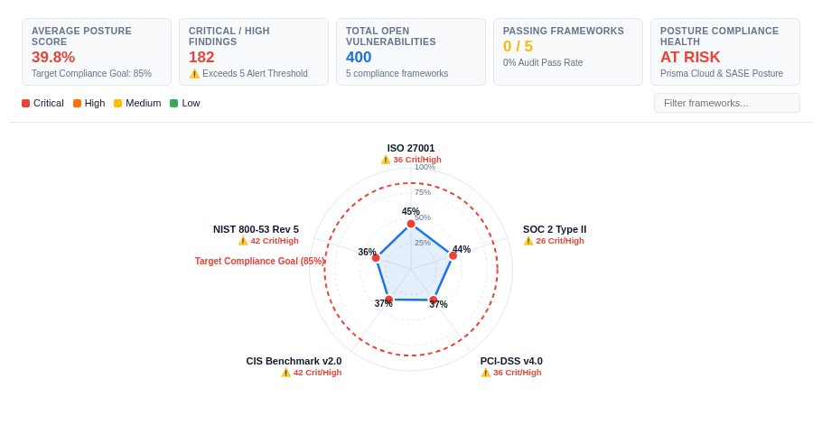

# SecOps Incident Dwell-Time & SLA Frontier Matrix



An enterprise implementation of the **SecOps Incident Dwell-Time, MTTD vs MTTR Remediation Velocity & SLA Frontier Matrix** for Google Cloud Looker, engineered with **D3.js v7**.

Modern SOC (Security Operations Center) and CISO leadership require a dual-lens view into threat detection and remediation performance:
1. **Intrusion Detection Efficiency (MTTD - Mean Time to Detect)**: How swiftly security tooling detects unauthorized activity across MITRE ATT&CK tactics.
2. **Containment & Remediation Velocity (MTTR - Mean Time to Remediate)**: How rapidly analysts and automated SOAR playbooks isolate, contain, and eradicate threats.

The **SecOps Incident Dwell-Time & SLA Frontier Matrix** maps incidents into an interactive 4-quadrant decision frontier, contrasting detection lag against remediation duration, benchmarking performance against CISO SLA targets, and isolating SOAR playbook automation impact across security incidents.

---

## 📸 Key Features

- **4 Analytical Layout Paradigms**:
  - `Quadrant SLA Matrix`: 4-Quadrant scatter plot comparing MTTD (X-axis) vs MTTR (Y-axis) with bubble size representing alert volume, color-coded by severity or MITRE tactic, and crosshair SLA benchmark targets separating optimal operations from critical dwell lag.
  - `Tactic Velocity Waterfall`: Horizontal stacked bar chart ranking MITRE tactics by Total Dwell Time (MTTD detect + MTTR remediate minutes), breaking down detection vs containment proportions.
  - `Automation Frontier Curve`: Scatter plot visualizing SOAR Playbook Automation Rate (%) vs MTTR reduction, revealing the payback frontier of automated playbooks.
  - `Incident Risk Heatmap Grid`: Cross-tabulation matrix of MITRE Tactic x Severity colored by MTTR/Dwell severity with total alert counts and incident frequencies.
- **Dynamic Field-Role Mapping**: Dropdowns dynamically populated from the live query via Looker's `registerOptions`:
  - Primary Tactic / Incident Dimension
  - Severity / Sub-Category Dimension
  - MTTD (Detection Duration) Measure
  - MTTR (Remediation Duration) Measure
  - Volume / Alert Count Measure
  - Target / SLA Benchmark Measure
- **Configurable SLA Targets & Benchmark Lines**:
  - MTTD Target SLA (default: 8.0 min, customizable mode: Fixed, Mean, Median, P75, P90)
  - MTTR Target SLA (default: 75.0 min, customizable mode: Fixed, Mean, Median, P75, P90)
  - Reference Target Line Label & Badges
  - Incident Anomaly Dwell Alert Thresholds
- **Executive KPI HUD Scorecard**: Top metrics strip tracking Fleet Average MTTD, Fleet Average MTTR, CISO SLA Compliance %, and SOAR Automation Rate %.
- **Enterprise Brand Palettes**: Palo Alto Cortex Cyber Navy, Google Enterprise, Modern Slate, Cyberpunk Midnight, Emerald FinOps, Sunset Alert, or Custom Hex overrides.
- **Interactive Tooltip & Native Drill Menus**: High-fidelity hover cards with full MTTD/MTTR metrics, dwell time calculation, and Looker drill-down menu support (`LookerCharts.Utils.openDrillMenu`).

---

## 📊 Data Shape Requirements

| Field Type | Count | Purpose | Examples |
| :--- | :--- | :--- | :--- |
| **Dimension 1** | `1` *(Required)* | Primary Tactic / Threat Hierarchy | `cortex_security_incidents.mitre_tactic` |
| **Dimension 2** | `0` or `1` *(Optional)* | Severity / Incident Category | `cortex_security_incidents.severity` |
| **Measure 1** | `1` *(Required)* | Mean Time to Detect (MTTD minutes) | `cortex_security_incidents.avg_mttd_minutes` |
| **Measure 2** | `1` *(Required)* | Mean Time to Remediate (MTTR minutes)| `cortex_security_incidents.avg_mttr_minutes` |
| **Measure 3** | `0` or `1` *(Optional)* | Alert Volume / Incident Count | `cortex_security_incidents.total_alerts`, `count` |
| **Measure 4** | `0` or `1` *(Optional)* | Automation Rate (%) | `cortex_security_incidents.automation_rate` |

---

## ⚙️ Configuration Options (Strict 2-Tab Layout)

### Tab 1: Display
| Option | Type | Default | Description |
| :--- | :--- | :--- | :--- |
| `layoutMode` | Select | `quadrant_scatter` | Visualization paradigm (`Quadrant SLA Scatter`, `Tactic Velocity Waterfall`, `Automation Frontier`, `Severity Heatmap`) |
| `entityDimOverride` | Select | `Auto` | Dynamic dropdown of query fields for Primary Tactic Dimension |
| `severityDimOverride` | Select | `Auto` | Dynamic dropdown of query fields for Severity / Sub-Category Dimension |
| `mttdMeasureOverride` | Select | `Auto` | Dynamic dropdown of query fields for MTTD Measure (X-axis) |
| `mttrMeasureOverride` | Select | `Auto` | Dynamic dropdown of query fields for MTTR Measure (Y-axis) |
| `volumeMeasureOverride`| Select | `Auto` | Dynamic dropdown of query fields for Bubble Size Measure |
| `targetMeasureOverride`| Select | `Auto / None` | Dynamic dropdown of query fields for Benchmark / Target Measure |
| `targetMode` | Select | `fixed` | Target benchmark mode (`Fixed Target`, `Dataset Mean`, `Dataset Median`, `Percentile P75/P90`) |
| `mttdSlaTarget` | Number | `8.0` | CISO MTTD Target SLA (minutes) |
| `mttrSlaTarget` | Number | `75.0` | CISO MTTR Target SLA (minutes) |
| `referenceLineLabel` | String | `CISO SLA Target` | Crosshair reference line label |
| `anomalyThresholdMinutes` | Number | `90.0` | Dwell time threshold triggering critical SLA alert |
| `sortBy` | Select | `mttr_desc` | Sort order (`MTTR Descending`, `MTTD Descending`, `Alerts Descending`, `Alphabetical`) |
| `topNLimit` | Number | `0` | Limit Top-N incident categories (0 = All) |
| `enableOtherRollup` | Boolean | `true` | Roll up smaller categories into "Other" group |
| `suppressZeroNull` | Boolean | `true` | Suppress zero or null data points |
| `hudMode` | Select | `scorecard` | Executive KPI HUD (`Full Scorecard`, `Compact Strip`, `Hidden`) |
| `showValueLabels` | Select | `all` | Data labels (`All`, `Dominant Peaks Only`, `Hidden`) |
| `customTitleOverride` | String | `""` | Custom chart title override |
| `customSubtitleOverride` | String | `""` | Custom chart subtitle override |
| `showLegend` | Boolean | `true` | Display color legend |
| `showSearch` | Boolean | `true` | Show interactive category search bar |

### Tab 2: Style
| Option | Type | Default | Description |
| :--- | :--- | :--- | :--- |
| `colorPalette` | Select | `cortex_navy` | Brand palette preset (`Cortex Cyber Navy`, `Google Enterprise`, `Modern Slate`, etc.) |
| `customPrimaryHex` | Color | `""` | Custom dominant brand color override |
| `customPositiveHex` | Color | `""` | Custom positive / fast resolution color override |
| `customNegativeHex` | Color | `""` | Custom breach / critical dwell color override |
| `metricPolarity` | Select | `lower_is_better` | Metric polarity toggle (lower MTTD/MTTR is superior) |
| `fontScale` | Select | `standard` | Typography scale (`Compact`, `Standard`, `Large`) |
| `valueFormat` | Select | `decimal_1` | Format (`Auto`, `Decimal 1dp`, `Compact Number`, `Minutes`, `Raw`) |

---

## 🚀 Manifest Snippet (`manifest.lkml`)

```lookml
visualization: {
  id: "secops_incident_dwell_time_matrix"
  label: "SecOps Incident Dwell-Time & SLA Frontier Matrix"
  file: "visualizations/secops_incident_dwell_time_matrix.js"
  dependencies: ["https://d3js.org/d3.v7.min.js"]
}
```
