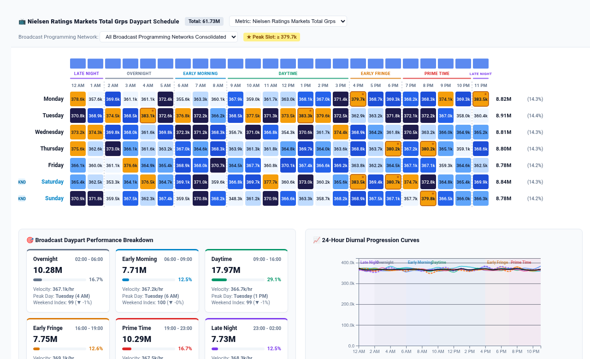

# Broadcast Programming Schedule & Daypart Performance Grid




An executive **Broadcast Programming Schedule & Daypart Performance Grid** custom visualization for Google Cloud Looker, engineered with **D3.js v7**.

In media & television broadcasting (Nielsen GRP/CPP ratings, linear TV programming grids, streaming concurrency), digital advertising exchanges (ad pacing, CPMs, impression delivery), e-commerce (hourly peak conversion windows, flash sales), and gaming telemetry (hourly player concurrency & live-ops events), performance revolves around the **7-day x 24-hour diurnal cycle** and standardized **Industry Dayparts** (Overnight, Early Morning, Daytime, Early Fringe, Prime Time, Late Night).

Native Looker tables and heatmaps are unable to render a synchronized 24x7 diurnal matrix with chronological hour ordering (00:00 to 23:00), industry daypart classification, marginal hourly/daily rollups, peak anomaly detection badges, and synchronized diurnal curves.

This custom visualization delivers a multi-mode, high-density analytics suite capable of processing 5,000+ rows with client-side slicing, dynamic field re-mapping, configurable reference lines, and instant sub-10ms aggregation.

---

## 📸 Key Features

- **Multi-Modal Display Modes**:
  - `Dual Synchronized Split View` (Default): Top 7-Day x 24-Hour Heatmap Matrix paired with Bottom Daypart Scorecard KPIs and 24-Hour Diurnal Progression Curves. Hovering over any cell cross-highlights the hour and daypart in real time.
  - `Hourly 7x24 Heatmap Matrix`: Full 168-slot weekly matrix with daypart boundary dividers, in-cell values, dynamic contrast formatting, top hourly marginal bars, and right daily volume rollup pills.
  - `Broadcast Dayparts (Nielsen Scorecards)`: Automatically aggregates the 168 hours into standardized industry daypart blocks (Overnight, Early Morning, Daytime, Early Fringe, Prime Time, Late Night), reporting Total Volume, % Share of Total, Hourly Run-Rate Velocity, Peak Day & Hour, and Weekend vs Weekday Indexing.
  - `24-Hour Diurnal Spline Curves`: Multi-line D3 chart plotting each day of the week as an interactive curve over the 24-hour cycle against shaded Daypart zones, benchmark reference target line, and an overall weekly baseline curve.
- **Dynamic Field-Role Mapping**:
  - Re-map query columns driving Day of Week, Hour of Day, Slicing Category, Primary Metric, and Benchmark Target via dropdowns dynamically populated from the query's dimensions and measures without reordering Looker Explores.
- **Configurable Reference Lines & Benchmark Targets**:
  - Benchmark target mode supporting `Dataset Mean`, `Dataset Median`, `Fixed Value`, `Percentile P75/P90`, or `Measure Column`.
  - Reference line overlay on diurnal curves with custom benchmark label and variance indicators (±%) across daypart cards.
- **Sorting, Top-N Bucketing & Null Suppression**:
  - Sort categories by `Chronological`, `Metric Volume (Descending/Ascending)`, or `Alphabetical`.
  - Cap categories to Top-N with optional `'Other'` rollup and suppress zero/null data cells.
- **Executive HUD & Label Density Controls**:
  - Switchable Executive Scorecard HUD (`Full Scorecard`, `Compact Strip`, or `Hidden`).
  - In-cell label density controls (`All`, `Peaks Only`, `Hidden`).
  - Custom Title and Subtitle overrides.
- **Multiple Industry Daypart Presets**:
  - `Broadcast / Nielsen Standard (6 Tiers)`: Overnight (02:00-06:00), Early Morning (06:00-09:00), Daytime (09:00-16:00), Early Fringe (16:00-19:00), Prime Time (19:00-23:00), Late Night (23:00-02:00).
  - `Retail & E-Commerce (4 Tiers)`: Late Night (00:00-06:00), Morning Commute (06:00-12:00), Midday & Lunch (12:00-18:00), Evening Prime Shopping (18:00-24:00).
  - `Workplace Operational Shifts (3 Tiers)`: Day Shift (07:00-15:00), Swing Shift (15:00-23:00), Graveyard (23:00-07:00).
- **Peak Anomaly Detection (★ Badges)**:
  - Automatically identifies top volume hours using quantile or standard deviation thresholds (Top 5%, Top 10%, or +1σ Outliers) and overlays subtle gold star markers on peak slots.
- **Brand Palettes, Hex Overrides & Metric Polarity**:
  - 8 curated brand palettes plus custom hex overrides for primary, positive (peak), and negative (deficit) colors.
  - Metric polarity toggle (`Higher is Better` vs `Lower is Better`) for proper sentiment coloring on cost, latency, or drop-rate metrics.
- **Expanded Row Limit Scalability (5,000+ Rows)**:
  - Supports queries with an additional grouping dimension (e.g. `broadcast_programming.network`, `channels.network`, or `products.category`). The visual renders an inline client-side dropdown selector allowing instant filtering by category or viewing all rows consolidated in <10ms.
- **Interactive Tooltips & Drill-Downs**:
  - Detailed hover card displaying Day of Week, Time Window, Daypart badge, Metric value, % of Day Total, % of Week Total, variance vs benchmark, and Peak Anomaly indicator.
  - Clicking any cell opens Looker's native drill-down menu (`LookerCharts.Utils.openDrillMenu`).

---

## 📊 Data Shape Requirements

| Field Type | Required Count | Purpose | Example (`tvun_media_analytics::ad_spot_airings`) |
| :--- | :--- | :--- | :--- |
| **Dimension 1** | `1` *(Required)* | Day of Week (e.g. Monday, Tuesday...) | `ad_spot_airings.airing_day_of_week` |
| **Dimension 2** | `1` *(Required)* | Hour of Day (integers `0-23` or timestamps) | `ad_spot_airings.airing_hour_of_day` |
| **Dimension 3** | `0 to 1` *(Optional)* | Slicing Dimension (Network, Category, Market) | `broadcast_programming.network` |
| **Measure 1** | `1` *(Required)* | Primary Volume / Revenue / Ratings Metric | `nielsen_ratings_markets.total_grps` |
| **Measure 2** | `0 to 1` *(Optional)* | Target Benchmark / Comparison Metric | `ad_spot_airings.total_spend_mxn` |

---

## ⚙️ Configuration Options

Configuration options are strictly organized into **2 clean tabs** (`Display` and `Style`) to keep Looker's Edit Viz modal neat and uncluttered:

### Display Tab
| Option | Type | Default | Description |
| :--- | :--- | :--- | :--- |
| `viewMode` | Select | `Dual Split View` | `split_view`, `hourly_grid`, `daypart_blocks`, `diurnal_curves` |
| `dayDimOverride` | Select | `Auto` | Dropdown of query fields for Day Dimension |
| `hourDimOverride` | Select | `Auto` | Dropdown of query fields for Hour Dimension |
| `sliceDimOverride` | Select | `Auto / None` | Dropdown of query fields for Slicing Category Dimension |
| `primaryMeasureOverride` | Select | `Auto` | Dropdown of query fields for Primary Metric |
| `targetMeasureOverride` | Select | `Auto / None` | Dropdown of query fields for Benchmark Target Measure |
| `startOfWeek` | Select | `Monday` | `monday`, `sunday` |
| `daypartPreset` | Select | `Broadcast / Nielsen Standard` | `nielsen`, `retail`, `shifts` |
| `targetCalculationMode` | Select | `Dataset Mean` | `dataset_mean`, `dataset_median`, `fixed`, `percentile_p75`, `percentile_p90`, `measure_column` |
| `fixedTargetValue` | Number | `0` | Fixed Benchmark Target value when mode is Fixed |
| `referenceLineLabel` | String | `Benchmark Target` | Label for benchmark reference line and target cards |
| `anomalyThresholdPct` | Number | `20` | Threshold percentage for anomaly detection alerts |
| `highlightPeaks` | Select | `Top 5% Peak Slots` | `top_5`, `top_10`, `above_avg`, `none` |
| `sortBy` | Select | `Chronological` | `chronological`, `metric_desc`, `metric_asc`, `alphabetical` |
| `topNLimit` | Number | `0` | Limit displayed slices to Top-N (0 = All) |
| `rollupOther` | Boolean | `false` | Rollup unselected slices into an 'Other' bucket |
| `suppressZeroNull` | Boolean | `true` | Suppress zero/null data cells |
| `hudMode` | Select | `Full Scorecard` | `scorecard`, `compact_strip`, `hidden` |
| `showValueLabels` | Select | `Show All Cell Values` | `all`, `peaks_only`, `hidden` |
| `showMarginals` | Boolean | `true` | Display top hourly bars and right daily totals |
| `showSearch` | Boolean | `true` | Enable top toolbar with dimension slicer & metric switch |
| `customTitleOverride` | Select | `Auto / None` | Custom chart title override |
| `customSubtitleOverride` | Select | `Auto / None` | Custom chart subtitle override |

### Style Tab
| Option | Type | Default | Description |
| :--- | :--- | :--- | :--- |
| `colorPalette` | Select | `Nielsen Broadcast` | `nielsen_broadcast`, `google_enterprise`, `indigo_violet`, `modern_slate`, `cyberpunk_neon`, `emerald_teal`, `sunset_media`, `wellverse_healthcare`, `custom_override` |
| `customPrimaryHex` | Color | `""` | Custom primary brand hex code |
| `customPositiveHex` | Color | `""` | Custom positive / peak slot hex code |
| `customNegativeHex` | Color | `""` | Custom deficit / off-peak hex code |
| `metricPolarity` | Select | `Higher is Better` | `higher_is_better`, `lower_is_better` |
| `colorScaleMode` | Select | `Quantile` | `quantile`, `linear`, `log` |
| `cellRadius` | Number | `4` | Cell corner radius in pixels (0-8) |
| `cellSpacing` | Number | `2` | Cell gap spacing in pixels (1-6) |
| `fontScale` | Select | `Standard` | `compact`, `standard`, `large` |
| `valueFormat` | Select | `Auto` | `auto`, `compact_currency`, `currency`, `compact_num`, `percentage`, `decimal_2`, `raw` |

---

## 🚀 LookML Manifest Snippet

```lookml
visualization: {
  id: "broadcast_daypart_grid"
  label: "Broadcast Programming Schedule & Daypart Performance Grid"
  file: "visualizations/broadcast_daypart_grid.js"
  dependencies: ["https://d3js.org/d3.v7.min.js"]
}
```
