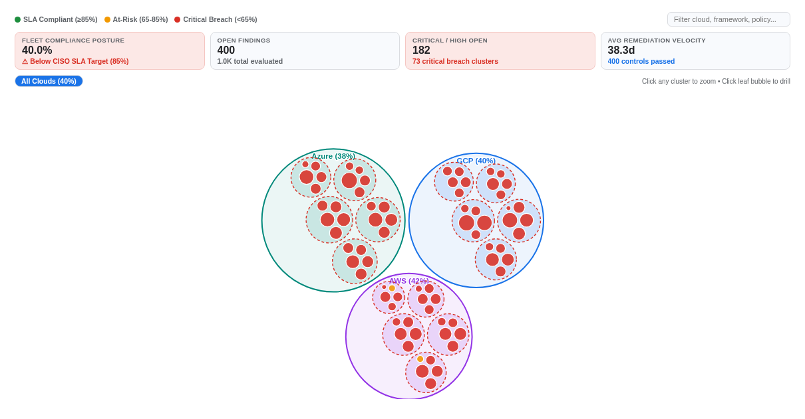

# Cloud Governance & Multi-Cloud Posture Pack



An enterprise **Multi-Cloud Governance, Compliance Posture & SLA Risk Visualizer** for Google Cloud Looker, engineered with **D3.js v7**.

Cloud Security Posture Management (CSPM) and CISO governance teams operate across multi-cloud environments (GCP, AWS, Azure) and overlapping compliance standards (CIS Benchmark v2.0, ISO 27001, NIST 800-53 Rev 5, PCI-DSS v4.0, SOC 2 Type II). Native Looker tables and flat bar charts cannot simultaneously convey hierarchical cloud-to-framework containment, proportional control-pass ratios, or SLA breach clustering across hundreds of resource controls.

The **Cloud Governance & Multi-Cloud Posture Pack** solves these gaps with four complementary visual paradigms inside a single strict 2-tab (`Display` and `Style`) configuration.

---

## Key Features

- **4 Multi-Modal Visual Paradigms**:
  - `Zoomable Hierarchical Circle Pack`: Interactive D3 `d3.pack()` containment bubbles (`Cloud Provider → Compliance Framework → Resource / Policy`) sized by Open Findings and color-coded by Compliance Posture Score %, with click-to-zoom transitions, clickable breadcrumb trails, and dashed breach halo rings.
  - `10x10 Proportional Governance Waffle Grid`: Small-multiples matrix of Cloud Provider × Compliance Framework rendering 100-unit proportional waffle grids showing exact Passed vs Open Non-Critical vs Critical/High control shares.
  - `SLA-Threshold Force Beeswarm`: Pre-warmed D3 force simulation plotting every control cluster along a continuous Compliance Posture % axis grouped by Cloud Provider swimlanes against a dashed CISO SLA Target frontier and shaded breach zone.
  - `Policy Remediation Velocity Ladder`: Ranked compliance exposure bars pairing Compliance % and Avg Remediation Days against the CISO SLA target line.
- **Dynamic Field-Role Mapping**: Dropdowns dynamically populated from the live query via Looker's `registerOptions`:
  - Tier 1 Dimension (`Cloud Provider / Org`)
  - Tier 2 Dimension (`Compliance Framework`)
  - Tier 3 Dimension (`Resource Type / Policy Leaf`)
  - Volume / Bubble Size Measure (`Open Findings`)
  - Compliance Posture Score Measure (`%`)
  - Critical / High Open Findings Measure
  - Avg Remediation Days Measure
  - Optional Benchmark Target Measure
- **Configurable SLA Targets & Anomaly Alerts**:
  - Supports `Fixed Target` (default `0.85`), `Measure Column`, `Dataset Mean`, `Dataset Median (P50)`, `Percentile P75`, `Percentile P90`, or `None`.
  - Critical Breach Alert Threshold (%) highlighting breach clusters in both the Executive HUD and chart rings.
- **5,000+ Row O(N) Client-Side Rollup, Sorting & Top-N**:
  - Aggregates large query results client-side, supports 5 sort modes, Top-N capping with `"Other Controls"` rollup, zero/null suppression, and interactive search filtering.
- **Native Looker Drill-Down & ResizeObserver**:
  - Supports `LookerCharts.Utils.openDrillMenu` on leaf bubbles, waffle cells, beeswarm nodes, and ladder bars, plus debounced `ResizeObserver` responsiveness.

---

## Data Shape Requirements

| Field Type | Count | Purpose | Example (`palo_alto_networks_security::prisma_cloud_compliance`) |
| :--- | :--- | :--- | :--- |
| **Dimension 1** | `1` *(Required)* | Tier 1 Cloud Provider / Org | `prisma_cloud_compliance.cloud_provider` |
| **Dimension 2** | `0` or `1` *(Recommended)* | Tier 2 Compliance Framework | `prisma_cloud_compliance.compliance_framework` |
| **Dimension 3** | `0` or `1` *(Recommended)* | Tier 3 Resource Type / Policy | `prisma_cloud_compliance.resource_type` |
| **Measure 1** | `1` *(Required)* | Volume / Open Findings | `prisma_cloud_compliance.open_findings_count` |
| **Measure 2** | `0` or `1` *(Recommended)* | Compliance Posture Score (%) | `prisma_cloud_compliance.posture_compliance_score` |
| **Measure 3** | `0` or `1` *(Optional)* | Critical / High Open Findings | `prisma_cloud_compliance.critical_high_open_count` |
| **Measure 4** | `0` or `1` *(Optional)* | Avg Remediation Days | `prisma_cloud_compliance.avg_days_to_remediate` |

---

## Configuration Options (Strict 2-Tab Layout)

### Tab 1: Display
- `layoutMode`: `circle_pack` | `waffle_grid` | `compliance_beeswarm` | `remediation_ladder`
- Dynamic field dropdowns (`registerOptions`): `dimLevel1Override`, `dimLevel2Override`, `dimLevel3Override`, `sizeMeasureOverride`, `scoreMeasureOverride`, `criticalMeasureOverride`, `agingMeasureOverride`, `targetMeasureOverride`
- SLA & Thresholds: `targetMode`, `fixedTargetValue`, `referenceLineLabel`, `anomalyThresholdPct`
- Sorting, Top-N & Chrome: `sortBy`, `topNLimit`, `enableOtherRollup`, `suppressZeroNull`, `hudMode`, `labelDensity`, `showLegend`, `showSearch`, `customTitle`, `customSubtitle`

### Tab 2: Style
- `colorPalette`: `google_enterprise` | `prisma_secops` | `modern_slate` | `cyberpunk_dark` | `emerald_finops` | `sunset_media` | `wellverse_healthcare` | `custom_hex`
- Custom color pickers (`display: 'color'`): `customPrimaryColor`, `customPositiveColor`, `customNegativeColor`
- `metricPolarity`, `fontScale`, `valueFormat`, `bubblePadding`

---

## Manifest Snippet (`manifest.lkml`)

```lookml
visualization: {
  id: "cloud_governance_posture_pack"
  label: "Cloud Governance & Multi-Cloud Posture Pack"
  file: "visualizations/cloud_governance_posture_pack.js"
  dependencies: ["https://d3js.org/d3.v7.min.js"]
}
```
