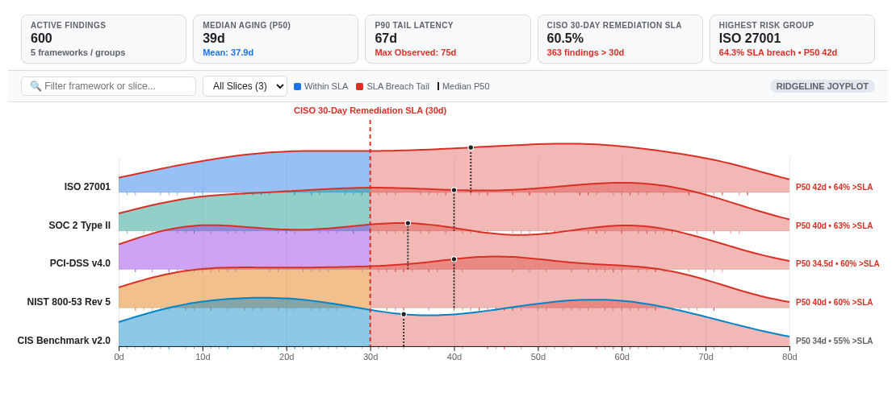

# Compliance & SLA Aging Ridgeline Joyplot



An enterprise **Compliance & SLA Aging Ridgeline Joyplot** custom visualization for Google Cloud Looker, engineered with **D3.js v7**.

Standard BI bar charts and KPI summaries collapse vulnerability and compliance aging into single averages (`AVG(days_open)`), hiding bimodal remediation clusters and long-tail SLA violations. This visualization computes non-parametric **Gaussian Kernel Density Estimation (KDE)** ridgeline waves directly in the browser across thousands of open and exempted cloud security findings—explicitly splitting each wave into a compliant zone and an **alert-shaded SLA Breach Tail** (`> 30d` CISO SLA) alongside Empirical Cumulative Distribution (`ECDF`) remediation curves, IQR quantile beeswarm strips, and multi-cloud breach matrices.

---

## Key Features

- **4 Multi-Modal Visual Paradigms**:
  - `Overlapping KDE Ridgeline Joyplot (SLA Tail Fill)` *(Default)*: Smooth overlapping KDE density ridges per compliance framework / resource type with dual-zone SLA tail shading, P50 median stems, and quantile rug ticks.
  - `Empirical SLA Remediation ECDF Curve`: Cumulative step-curves showing `% of Findings Within N Days` intersecting the vertical CISO Remediation SLA line.
  - `Quantile IQR Strip & Severity Beeswarm`: Horizontal P25–P75 IQR boxes, P10–P90 whiskers, P50 diamonds, and jittered severity-colored finding beads (`CRITICAL`, `HIGH`, `MEDIUM`, `LOW`).
  - `Framework x Cloud SLA Breach Matrix`: Cross-tabulated multi-cloud SLA breach rate and median dwell heatmap with alert highlighting.
- **Dynamic Field-Role Mapping (`Display`)**: Auto-populated query field dropdowns via `_registerDynamicFieldOptions` for Primary Group, Secondary Slice, Severity/Tier, Continuous Numeric Observation, and Optional Target Measure.
- **Configurable SLA Benchmarks & Alerts (`Display`)**: `Fixed SLA Threshold`, `Dataset Mean`, `Dataset Median`, `Percentile P75`, `Percentile P90`, `Target Measure Column`, or `None`, plus customizable SLA Breach Alert % thresholds.
- **Sorting, Top-N & Null Suppression (`Display`)**: Sort by SLA Breach Rate, Median Aging, Finding Volume, or Alphabetical; limit to Top-N with automatic `'Other'` group rollup; suppress zero/null rows.
- **Executive GRC Scorecard HUD, Legend & Filter Bar (`Display`)**: Full Scorecard HUD (`Active Findings`, `Median Aging P50`, `P90 Tail Latency`, `SLA Breach Rate`, `Highest Risk Group`), Compact Strip, or Hidden; live search and multi-cloud slice dropdown; Looker drill-down menu integration.
- **Brand Palettes, Polarity & Typography (`Style`)**: 6 curated presets (`Google Enterprise`, `Modern Slate`, `Cyberpunk Dark`, `Emerald FinOps`, `Sunset Media`, `Wellverse Healthcare`) plus native `display: 'color'` hex overrides, polarity toggle, font scaling, and value formatting.

---

## Data Shape Requirements

Bound to `palo_alto_networks_security::prisma_cloud_compliance`:

| Field Type | Required Count | Purpose | Example (`palo_alto_networks_security::prisma_cloud_compliance`) |
| :--- | :--- | :--- | :--- |
| **Dimension** | `1` *(Required)* | Primary Ridgeline Group | `prisma_cloud_compliance.compliance_framework` |
| **Dimension** | `0–1` *(Optional)* | Secondary Slice / Cloud Provider | `prisma_cloud_compliance.cloud_provider` |
| **Dimension** | `0–1` *(Optional)* | Severity / Risk Tier | `prisma_cloud_compliance.severity` |
| **Dimension / Measure** | `1` *(Required)* | Continuous Aging / Latency Metric | `prisma_cloud_compliance.days_open` |
| **Dimension** | `0–1` *(Optional)* | Row Primary Key (prevents SQL deduplication) | `prisma_cloud_compliance.finding_id` |

---

## Manifest Snippet (`manifest.lkml`)

```lookml
visualization: {
  id: "compliance_sla_ridgeline_analyzer"
  label: "Compliance & SLA Aging Ridgeline Joyplot"
  file: "visualizations/compliance_sla_ridgeline_analyzer.js"
  dependencies: ["https://d3js.org/d3.v7.min.js"]
}
```
