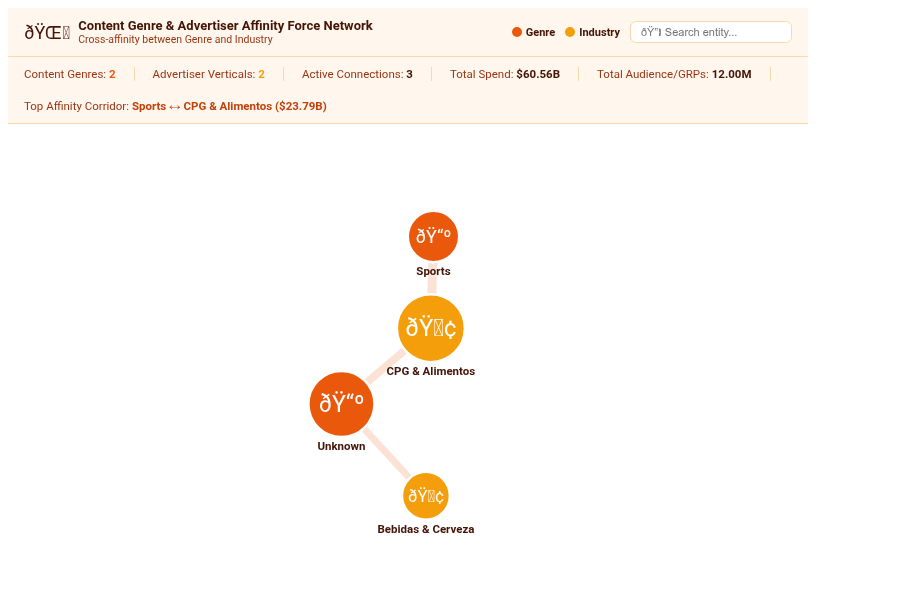

# Content Genre & Advertiser Affinity Force Network (`content_genre_affinity_network`)

An interactive D3.js bipartite co-occurrence and force-directed affinity network designed for media broadcast networks, streaming platforms, and advertising operations. It models the multi-dimensional relationships between content programming genres (e.g., Live Sports, Telenovela, Reality, Noticiero) and advertiser industry categories (e.g., CPG & Food, Beverages, Retail, Automotive, Telecom), weighting connections by total advertising spend and scaling nodes by Nielsen GRP reach.

---

## 💡 Analytical Problem Solved

Traditional media reports isolate programming genres and advertiser categories into disconnected pivot tables or bar charts, obscuring how ad budgets cross-pollinate across genres. Media executives and Ad-Ops sales teams need to answer:
1. *Which advertising verticals disproportionately anchor specific programming genres?*
2. *Where do shared advertiser affinities exist across seemingly unrelated content formats?*
3. *Which content genres act as universal revenue bridges versus specialized niche hubs?*

This custom visualization unifies cross-domain broadcast telemetry into a high-density force graph with interactive ego-network filtering, weak-link threshold pruning, and four distinct layout topologies.

---

## 🚀 Key Features & Capabilities

- **4 Multi-Modal Layout Topologies**:
  - **Organic Force-Directed Physics**: Bounded Barnes-Hut repulsion with collision mitigation and natural community clustering.
  - **Concentric Orbital Rings**: Places primary content genre hubs in an inner orbit and advertiser categories in outer concentric rings.
  - **Dual-Column Bipartite Ribbons**: Organizes genres on the left and advertisers on the right connected by cubic Bézier flow ribbons.
  - **Circular Adjacency Matrix**: Renders an interactive chord-style relationship ring highlighting shared sponsor adjacency.
- **Dynamic Field-Role Dropdowns**: Live query selection of Source Genre Dimension, Target Advertiser Dimension, Spend Measure, and Node Reach Measure directly in Looker's Edit Viz modal.
- **Interactive Ego-Network Filtering**: Hovering over any node dynamically highlights its immediate 1-hop connected network and connecting ribbons while dimming unrelated graph elements.
- **Weak Link Pruning Threshold**: Configurable filter slider to prune low-spend background noise and isolate core revenue corridors.
- **Configurable Benchmark Targets**: Evaluates corridor spend against Dataset Mean, Median (P50), Top Quartile (P75), or Fixed Targets, highlighting high-priority corridors.
- **Executive Scorecard HUD**: Live scorecard bar displaying total genres, advertiser categories, active connections, total spend volume, and top affinity corridor.
- **Looker Drill-Down Integration**: Full compatibility with Looker drill-down menus (`LookerCharts.Utils.openDrillMenu`) on node and ribbon clicks.
- **Performance Optimized**: Pre-warmed force simulation (35 ticks) before DOM mount, debounced ResizeObserver (<4px guard), and client-side O(N) aggregation handling 5,000+ records smoothly.

---

## 📋 Data Requirements

| Field Type | Requirement | Recommended Media Explore Fields |
| :--- | :--- | :--- |
| **Dimension 1 (Source)** | Content Genre or Program Name | `broadcast_programming.genre` or `broadcast_programming.show_title` |
| **Dimension 2 (Target)** | Advertiser Industry or Brand | `advertiser_campaigns.industry_category` or `advertiser_campaigns.advertiser_name` |
| **Measure 1 (Weight)** | Total Ad Spend / Gross Revenue | `ad_spot_airings.total_spend_mxn` |
| **Measure 2 (Size - Optional)** | Nielsen GRPs, Reach, or Impressions | `nielsen_ratings_markets.total_grps` |

---

## 🎨 Configuration Options

### Section 1: Display
- **Network Layout Topology**: `force_directed`, `radial_concentric`, `bipartite_columns`, `adjacency_matrix`.
- **Dynamic Field-Role Dropdowns**: Source Genre Dimension, Target Advertiser Dimension, Affinity Spend Measure, Node Scale Measure.
- **Benchmark Link Target Mode**: `none`, `dataset_mean`, `dataset_median`, `percentile_p75`, `percentile_p90`, `fixed_value`.
- **Fixed Benchmark Spend Target**: Numeric target for reference benchmarking.
- **Reference Line Label**: Custom label displayed on benchmark cards.
- **Weak Link Pruning Filter (% of Max Spend)**: Numeric cutoff to eliminate faint background edges.
- **Node Ranking & Sorting**: `metric_desc`, `metric_asc`, `alphabetical`, `natural`.
- **Node Density Cap (Top-N)**: `all`, `12`, `20`, `30`, `50`.
- **Group Tail Nodes into 'Other' Aggregate Hub**: Boolean rollup toggle for long tails.
- **Executive Scorecard HUD**: `full`, `compact`, `hidden`.
- **Node Label Density**: `all`, `major_only`, `hidden`.
- **Show Interactive Search & Filter**: Instant search input filtering nodes and edges.
- **Custom Chart Title & Subtitle Override**: Clean header cards for executive reporting.

### Section 2: Style
- **Visual Brand Palette**: Sunset Media (Warm), Google Enterprise, Cyber NOC Teal, Emerald Broadcast, Modern Slate, Wellverse Healthcare, Custom Hex.
- **Custom Accent Hex Color**: Dedicated color picker for branded styling.
- **Performance Polarity**: `higher_is_better` vs `lower_is_better`.
- **Typography & Label Scale**: `compact`, `standard`, `large_presentation`.
- **Primary Metric Value Format**: Auto, Compact Currency (`$1.2M`), Compact Number (`1.2M`), Percentage (`45.2%`), Raw Formatted (`1,234,567`), Raw.
