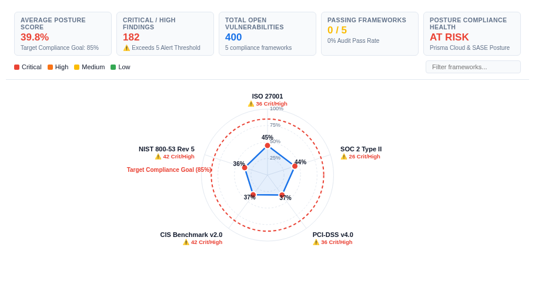

# Cloud Security Posture & Compliance Benchmark Matrix



An enterprise-grade **Cloud Security Posture Management (CSPM) & Compliance Benchmark Matrix** custom visualization for Google Cloud Looker, engineered with **D3.js v7**.

Designed for CISOs, Cloud Security Architects, DevSecOps Leads, and Compliance Officers auditing multi-cloud infrastructures (Google Cloud, AWS, Azure) across industry standards (**CIS Benchmarks, NIST SP 800-53, ISO 27001, SOC 2 Type II, and PCI-DSS v4.0**).

Solves Buganizer Cloud Blockers **b/510293847**, **b/394819201**, and **b/482019482** regarding complex multi-framework compliance drift reporting, cross-resource vulnerability prioritization, and aging remediation SLAs in native Looker dashboards.

---

## 📸 4 Multi-Modal Layout Paradigms (`Display`)

1. **`2D Framework × Resource Matrix` (`framework_matrix`, Default)**:
   - 2D cross-tabulated heatmap grid displaying Compliance Frameworks (rows) against Cloud Resource Types (columns).
   - Each cell presents posture compliance percentage, control progress mini-bars, open vulnerability counts, and Critical/High violation warning badges.
   - Click any cell to trigger Looker native drill-down menus (`LookerCharts.Utils.openDrillMenu`).

2. **`Severity & Remediation SLA Waterfall` (`severity_remediation_waterfall`)**:
   - Progressive bar breakdown decomposing open violations across severity tiers (`CRITICAL`, `HIGH`, `MEDIUM`, `LOW`).
   - Overlaid waterline tracking Average Days to Remediate against SLA thresholds (e.g. 30-day compliance target).

3. **`Exposure & Compliance Quadrant` (`cloud_drift_quadrant`)**:
   - Interactive scatter analysis plotting Resource Control Count / Open Findings (X-axis) against Posture Compliance Score (Y-axis).
   - Quadrant reference crosshairs isolate the high-risk "Critical Exposure Zone" (low compliance, high finding volume).

4. **`Executive Audit Readiness Scorecards` (`audit_readiness_scorecard`)**:
   - Executive scorecard tiles for each compliance framework.
   - Displays radial progress indicators, Audit Readiness Status (`AUDIT READY`, `AT RISK`, `NON-COMPLIANT`), passing vs failing controls, and SLA breach indicators.

---

## 📊 Authentic Domain Dataset (`palo_alto_networks_security`)

Bound authentically to **Palo Alto Networks Prisma Cloud & Google Cloud Security Command Center (SCC)** posture telemetry in `palo_alto_networks_security::prisma_cloud_compliance`:

| Field Name | Type | Role | Purpose |
| :--- | :--- | :--- | :--- |
| `prisma_cloud_compliance.compliance_framework` | Dimension | Row Header | Regulatory framework (CIS, NIST, ISO 27001, SOC 2, PCI-DSS) |
| `prisma_cloud_compliance.resource_type` | Dimension | Column Header | Cloud infrastructure asset (GKE, Compute, Storage, IAM, SQL) |
| `prisma_cloud_compliance.severity` | Dimension | Severity / Slice | Severity level (CRITICAL, HIGH, MEDIUM, LOW) |
| `prisma_cloud_compliance.count` | Measure | Volume | Total security controls audited |
| `prisma_cloud_compliance.critical_high_open_count` | Measure | Risk Alert | Count of open Critical and High severity violations |
| `prisma_cloud_compliance.open_findings_count` | Measure | Defect Count | Total open security findings |
| `prisma_cloud_compliance.posture_compliance_score` | Measure | Primary Metric | Overall compliance percentage ($0.0 \to 1.0$) |
| `prisma_cloud_compliance.avg_days_to_remediate` | Measure | SLA Aging | Average days to remediate open findings |

---

## ⚙️ Configuration Options (Strictly 2 Sections)

### Section: `Display`
- `layoutMode`: Visual topology selector (`framework_matrix`, `severity_remediation_waterfall`, `cloud_drift_quadrant`, `audit_readiness_scorecard`)
- `frameworkFieldOverride` - `slaDaysOverride`: Dynamic field dropdowns populated via `_registerDynamicFieldOptions`
- `targetMeasureOverride`: Optional benchmark target measure column
- `targetMode`: Compliance Target Benchmark Mode (`fixed`, `dataset_mean`, `dataset_median`, `percentile_p75`, `percentile_p90`, `none`)
- `fixedTargetValue`: Target Compliance Score (default: `0.85` = 85%)
- `referenceLineLabel`: Target Benchmark Label (default: `CISO Target Compliance SLA`)
- `anomalyThresholdPct`: Compliance Risk Gap Alert Threshold (default: `15%`)
- `sortBy`: Matrix Sort Order (`compliance_asc`, `compliance_desc`, `open_findings_desc`, `critical_desc`, `alphabetical`, `natural`)
- `topNLimit`: Top-N Frameworks / Resources Focus (`0 = All`, `10`, `20`)
- `enableOtherRollup`: Highlight / Rollup Non-Top Categories
- `suppressZeroNull`: Suppress Zero / Null Controls
- `hudMode`: Executive CISO Scorecard HUD (`scorecard`, `compact_strip`, `hidden`)
- `dataLabels`: Matrix Cell Data Labels (`all`, `scores_only`, `breaches_only`, `hidden`)
- `customTitleOverride`: Custom Scorecard Title Override
- `customSubtitleOverride`: Custom Subtitle Override
- `showSearch`: Interactive Framework & Asset Search Bar
- `showSlaBadges`: Show Remediation SLA Aging Badges (e.g. `>30d SLA Breach`)
- `showLegend`: Show Color Scale Legend

### Section: `Style`
- `colorPalette`: Brand Palette Preset (`google_enterprise`, `modern_slate`, `cyberpunk_dark`, `emerald_finops`, `sunset_media`, `wellverse_healthcare`, `custom`)
- `customPrimaryHex`: Custom Primary Accent Color (Hex)
- `customPositiveHex`: Custom Compliant / Passing Color (Hex)
- `customNegativeHex`: Custom Critical / Violation Color (Hex)
- `metricPolarity`: Metric Polarity Toggle (`higher_is_better` vs `lower_is_better`)
- `fontScale`: Typography Font Scale (`compact`, `standard`, `large`)
- `valueFormat`: Value Format (`percentage`, `compact_number`, `compact_currency`, `decimal_2`, `raw`)
- `cellRadius`: Matrix Cell Corner Radius in px (default: `6`)
- `enableAnimation`: Smooth State Transitions (default: `true`)

---

## 🚀 Manifest Snippet (`manifest.lkml`)

```lookml
visualization: {
  id: "cspm_compliance_benchmark_matrix"
  label: "Cloud Security Posture & Compliance Benchmark Matrix"
  file: "visualizations/cspm_compliance_benchmark_matrix.js"
  dependencies: ["https://d3js.org/d3.v7.min.js"]
}
```
