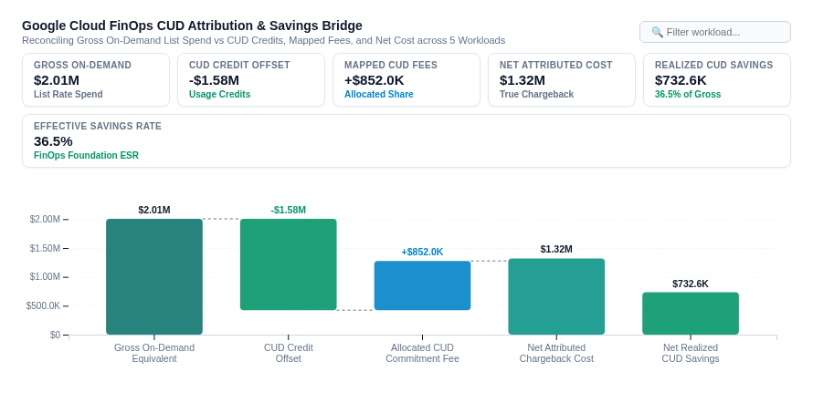

# ☁️ Cloud FinOps CUD Attribution & Savings Bridge



An executive **Cloud FinOps Committed Use Discount (CUD) Attribution & Savings Bridge** custom visualization for Google Cloud Looker, engineered with **D3.js v7**.

Designed for **FinOps Practitioners, Cloud Economists, CFO Offices & Engineering Leads** managing multi-tenant Google Cloud environments with centralized commitment purchases (Resource-Based Compute CUDs, Flexible Spend CUDs for BigQuery, Cloud SQL, Vertex AI, GKE).

Standard cloud billing reports show raw unblended or unallocated payer invoices where central FinOps teams absorb millions in fixed commitment fees while consuming engineering projects receive "free" discount credits. This obscures true cost-to-serve and makes fair chargeback difficult.

This custom visualization delivers a boardroom-grade FinOps reconciliation engine capable of handling 5,000+ detailed billing export rows with client-side O(N) aggregation, stepped waterfall walks, multi-modal views, and native Looker drill-down menus.

---

## 📸 Key Features

- **Multi-Modal Display Modes**:
  - `CUD Attribution Waterfall Bridge (Executive Walk)` (Default): Classic financial bridge waterfall walking from Gross On-Demand List Cost through CUD Usage Credit Offsets, Proportionally Mapped Commitment Fees, and Net Realized Savings to Net Attributed Cost. Features stepped dashed connector lines, variance badges, and zero baseline.
  - `Service Cost & Attribution Breakdown (Grouped Bars)`: Horizontal grouped bar breakdown showing Gross On-Demand Cost vs Allocated CUD Fee vs Net Attributed Cost for every GCP Service or Organization Folder.
  - `Savings Efficiency & ESR Matrix (Quadrant Bubble)`: Strategic quadrant bubble matrix plotting Effective Savings Rate (ESR %) on the X-axis vs Net CUD Savings ($) on the Y-axis with bubble size proportional to Gross On-Demand spend.
  - `Chargeback Allocation Shift Walk (Payer to Net)`: Sequential chargeback variance waterfall walking from Raw Unattributed Payer Cost to Net Attributed Cost per Organization Folder or Project.
- **Executive FinOps Scorecard HUD**:
  - Real-time floating scorecard showing Gross On-Demand Spend, CUD Credit Offset, Mapped CUD Fees, Net Attributed Cost, Realized CUD Savings, and FinOps Foundation Effective Savings Rate (ESR %).
  - Includes interactive workload search and filter bar.
- **Dynamic Field-Role Mapping**:
  - Dynamically binds Entity/Folder Dimension, Service/Project Dimension, Gross On-Demand Measure, CUD Credit Offset Measure, Allocated CUD Fee Measure, and Net Attributed Cost Measure via dropdown selectors without reordering Looker Explore queries.
- **Enterprise Design & Themes**:
  - `Emerald FinOps` (Forest green and mint)
  - `Google Enterprise` (Clean corporate blue, green, and coral)
  - `Executive Slate` (Charcoal, emerald, and ruby)
  - `Modern Slate` (Indigo and rose)
  - `Cyberpunk Dark` (Midnight background with neon cyan and pink accents)
  - `Sunset Media` (Warm amber and terracotta)
  - `Custom Hex Override` (Full custom hex control)
- **High-Performance Architecture**:
  - Debounced `ResizeObserver` (<4px guard, zero layout thrashing).
  - Client-side mathematical decomposition with O(N) complexity for 5,000+ rows.
  - Native Looker drill-down menu integration (`LookerCharts.Utils.openDrillMenu`).

---

## 📊 Data Shape Requirements

| Field Type | Required Count | Purpose | Example (`gcp_cost_cud_finops::gcp_billing_cud_line_items`) |
| :--- | :--- | :--- | :--- |
| **Dimension 1** | `1` *(Required)* | Organization Folder / GCP Project Dimension | `gcp_projects_hierarchy.folder_name` |
| **Dimension 2** | `0 to 1` *(Recommended)* | GCP Service / SKU Dimension | `gcp_billing_cud_line_items.gcp_service` |
| **Measure 1** | `1` *(Required)* | Gross On-Demand Equivalent Cost Measure | `gcp_billing_cud_line_items.total_gross_on_demand_cost_usd` |
| **Measure 2** | `0 to 1` *(Recommended)* | CUD Usage Credit Offset Measure | `gcp_billing_cud_line_items.total_cud_credit_offset_usd` |
| **Measure 3** | `0 to 1` *(Recommended)* | Mapped & Allocated CUD Fee Measure | `gcp_billing_cud_line_items.total_allocated_cud_fee_usd` |
| **Measure 4** | `0 to 1` *(Recommended)* | Net Attributed Chargeback Cost Measure | `gcp_billing_cud_line_items.total_net_attributed_cost_usd` |

---

## ⚙️ Configuration Options

Organized into **2 clean tabs** (`Display` and `Style`):

### Display Tab
| Option | Type | Default | Description |
| :--- | :--- | :--- | :--- |
| `layoutMode` | Select | `CUD Attribution Waterfall Bridge` | `waterfall_bridge`, `service_breakdown`, `savings_efficiency_matrix`, `chargeback_allocation_shift` |
| `entityFieldOverride` | Select | Auto | Dynamic field mapping for Organization Folder / Entity Dimension |
| `serviceFieldOverride` | Select | Auto | Dynamic field mapping for GCP Service / Project Dimension |
| `grossCostMeasureOverride` | Select | Auto | Dynamic field mapping for Gross On-Demand Cost Measure |
| `cudCreditMeasureOverride` | Select | Auto | Dynamic field mapping for CUD Credit Offset Measure |
| `allocatedFeeMeasureOverride` | Select | Auto | Dynamic field mapping for Allocated CUD Fee Measure |
| `netCostMeasureOverride` | Select | Auto | Dynamic field mapping for Net Attributed Cost Measure |
| `showConnectorLines` | Boolean | `true` | Show waterfall stepped connector lines |
| `showStepLabels` | Boolean | `true` | Show value labels above waterfall steps |
| `targetCalculationMode` | Select | `None` | `none`, `dataset_mean`, `dataset_median`, `percentile_p90`, `fixed` |
| `fixedTargetValue` | Number | `0` | Fixed benchmark target value |
| `referenceLineLabel` | String | `Budget Baseline` | Label for benchmark target line |
| `sortBy` | Select | `Gross Spend Descending` | `spend_desc`, `savings_desc`, `alpha` |
| `topNLimit` | Number | `10` | Top-N entities limit (remainder rolled to 'Other') |
| `suppressZeroNull` | Boolean | `true` | Suppress zero/null spend rows |
| `hudDensity` | Select | `Full 6-Card Scorecard HUD` | `full`, `compact`, `none` |
| `customTitle` | String | `""` | Custom chart title override |
| `customSubtitle` | String | `""` | Custom subtitle override |
| `showSearch` | Boolean | `true` | Show filter / search bar |

### Style Tab
| Option | Type | Default | Description |
| :--- | :--- | :--- | :--- |
| `colorPalette` | Select | `Emerald FinOps` | `emerald_finops`, `google_enterprise`, `executive_slate`, `modern_slate`, `cyberpunk_dark`, `sunset_media`, `custom` |
| `customPrimaryHex` | Color | `""` | Custom primary total bars hex color |
| `customPositiveHex` | Color | `""` | Custom positive savings hex color |
| `customNegativeHex` | Color | `""` | Custom cost / fee hex color |
| `metricPolarity` | Select | `Standard FinOps` | `standard_finops` (Lower cost / higher savings is better), `inverted` |
| `fontScale` | Select | `Standard (Balanced)` | `compact` (85%), `standard` (100%), `large` (125%) |
| `valueFormat` | Select | `Compact Currency` | `auto`, `compact_currency`, `full_currency`, `compact_number`, `percentage`, `decimal_2`, `raw` |
| `barPadding` | Number | `0.28` | Bar spacing padding ratio (0.1 to 0.5) |

---

## 🚀 LookML Manifest Snippet

```lookml
visualization: {
  id: "finops_cud_attribution_bridge"
  label: "Cloud FinOps CUD Attribution & Savings Bridge"
  file: "visualizations/finops_cud_attribution_bridge.js"
  dependencies: ["https://d3js.org/d3.v7.min.js"]
}
```
