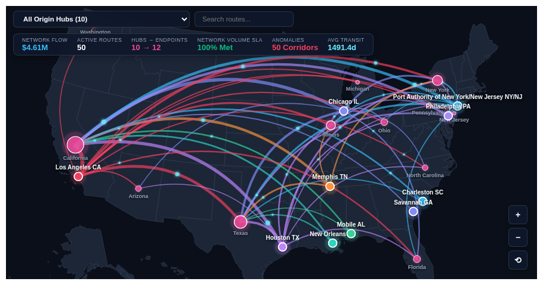

# 🌐 Geospatial Flow & Route Arc Map




An interactive, multi-modal geospatial flow, supply chain route, and flight path visualization built with **D3.js v7** and **TopoJSON Client** for Looker. Designed to solve a persistent analytics challenge across logistics, retail fulfillment, telecommunications, airline routing, and financial clearing networks.

---

## 💡 The Community Analytics Gap

Native Looker mapping capabilities are limited to static regional choropleths and basic point plots on Google Maps. Organizations attempting to visualize:
- **Supply Chain & E-Commerce Fulfillment**: Warehouse/distribution center origin hubs routing orders to destination customer states/cities.
- **Airline & Transportation Networks**: Multi-hub flight paths and passenger volume.
- **Telecommunications & Cloud Networking**: Data center egress traffic, cross-region replication, and inter-datacenter latency.
- **Financial Clearing & Remittances**: Origin accounts clearing through regional liquidity hubs.

...previously had no native Looker capability to render curved origin-to-destination flow corridors, animated directional pulses, or spatial hexbin clustering without requiring expensive third-party mapping tokens (Mapbox) or encountering severe overplotting when querying 5,000+ coordinate records.

The **Geospatial Flow & Route Arc Map** provides pure SVG/Canvas rendering with zero external API key requirements, client-side aggregation across 5,000+ rows, pan/zoom interactivity, origin hub isolation, and live route search.

---

## 🚀 Key Features

### 1. Multi-Mode Layouts
- **Bézier Flow Arcs (`curved_arcs`)**: Great-circle quadratic Bézier curves with dynamic elevation avoiding straight-line overlap. Stroke width scales with volume/sales; colors represent origin hub, volume intensity, or shipping latency.
- **Hub & Spoke Radial (`hub_spoke`)**: Radial spider diagram anchoring origin distribution hubs with concentric outer halo rings and directed spokes.
- **Hexbin Spatial Density Grid (`hexbin_density`)**: Client-side hexagonal spatial tessellation clustering high-density coordinate destinations into regular bins colored by aggregate flow volume or density.
- **Choropleth Corridor Overlay (`choropleth_overlay`)**: Geographic state polygons shaded by inbound destination volume or delivery time, overlaid with major arterial flow corridors.

### 2. High-Density Scalability (5,000+ Rows)
- **Client-Side Route Rollup**: Automatically groups raw transactional records into distinct origin-destination paths, computing real-time percentile ranks and volume shares.
- **Top-N Density Filter**: Filter displayed corridors to *Top 15 Primary Arterials*, *Top 25 Core Corridors*, *Top 50*, *Top 100*, or *All Active Routes*.
- **Live Search & Hub Selector**: Instant autocomplete search box and interactive dropdown to isolate routes originating from specific hubs (e.g. "Los Angeles CA", "Memphis TN").

### 3. Dynamic Interactivity & Visual Polish
- **Animated Flow Pulses**: Glowing particle pulses traverse corridors in the direction of flow at 60fps.
- **D3 Pan & Zoom**: Smooth mouse wheel zooming, click-and-drag panning, and floating HUD navigation buttons (+, −, ⟲ Reset).
- **Executive HUD Banner**: Floating glassmorphism summary card displaying total network flow ($), active routes count, origin hubs count, and weighted average transit days.
- **Interactive Tooltips**: Glassmorphism card displaying route corridor, volume, percentage of total network flow, national volume rank, and Looker drill-down links.

---

## 📊 Required Data Fields

| Field Role | Recommended Field | Supported Types |
| :--- | :--- | :--- |
| **Origin Dimension** | `distribution_centers.name` | String (Hub name or US State) |
| **Origin Lat / Lon** *(optional)* | `distribution_centers.latitude`, `longitude` | Latitude / Longitude numbers |
| **Destination Dimension** | `users.state` or `users.city` | String (State name, abbreviation, or city) |
| **Destination Lat / Lon** *(optional)* | `users.approx_latitude`, `longitude` | Latitude / Longitude numbers |
| **Flow Volume Measure** | `order_items.total_sale_price` | Sum, Count, or Volume metric |
| **Latency Measure** *(optional)* | `order_items.average_shipping_time` | Average transit days or latency |
| **Shipment Count** *(optional)* | `order_items.order_count` | Integer count |

*Note: If coordinates are omitted, the visualization automatically resolves US state names and abbreviations against its built-in geographic centroid dictionary.*

---

## ⚙️ Configuration Options

### Display Tab
- **Dynamic Field-Role Mapping**:
  - `originDimOverride`: Dynamic select dropdown to explicitly map the Origin Hub / City dimension.
  - `destDimOverride`: Dynamic select dropdown to explicitly map the Destination State / City dimension.
  - `volumeMeasureOverride`: Dynamic select dropdown to explicitly map the primary flow volume / weight measure.
  - `latencyMeasureOverride`: Dynamic select dropdown to explicitly map the latency, transit time, or secondary measure.
- **Map Flow Layout**: `curved_arcs` (Bézier Flow Arcs), `hub_spoke` (Hub & Spoke), `hexbin_density` (Hexbin Density Grid), `choropleth_overlay` (Choropleth Corridor).
- **Corridor Sorting & Density**:
  - `sortOrder`: `metric_desc` (Volume Descending), `metric_asc` (Volume Ascending), `alphabetical` (Route Name A–Z), `natural` (Natural Explore Order).
  - `topRoutes`: `all`, `15`, `25`, `50`, `100`.
  - `enableOtherRollup`: Toggle automatic consolidation of non-top corridors into an aggregate "Other Corridors" summary.
  - `suppressZeroNull`: Toggle filtering out zero or null flow volumes.
- **Configurable Benchmarks & Target Thresholds**:
  - `targetCalculationMode`: Benchmark mode: `none`, `dataset_mean` (Average Flow), `dataset_median` (Median Flow), `percentile_p75` (Top Quartile P75), `percentile_p90` (P90 Arterial), `fixed_value` (Custom Target).
  - `fixedTargetValue`: Custom numerical benchmark value when target mode is set to Fixed.
  - `referenceLineLabel`: Custom benchmark title displayed in tooltips and HUD.
  - `anomalyThresholdPct`: Anomaly detection threshold percentage (10% to 100%) to flag corridors deviating significantly from benchmark.
- **Arc Arch & Curvature**: `0.2` (Subtle), `0.35` (Balanced), `0.55` (High Great-Circle).
- **Flow Pulse Animation**: `pulse` (Animated Particles), `glow` (Subtle Glow), `none` (Static Arcs).
- **HUD & Legend Density**:
  - `hudDensity`: `full` (Full Glassmorphism Scorecard), `compact` (Compact KPI Strip), `hidden` (Hide HUD).
  - `labelDensity`: `all` (Show All Hub & State Labels), `peaks_only` (Top Arterial Hubs Only), `hidden` (Hide Map Labels).
  - `customChartTitle` & `customChartSubtitle`: Custom header title and subtitle text overrides.
- **Interactive Controls**:
  - `showOriginFilter`: Toggle origin hub dropdown filter.
  - `showSearch`: Toggle real-time corridor search filter.

### Style Tab
- **Color Theme & Palettes**:
  - 8 Enterprise Color Palettes: `cyber_dark` (Cyberpunk Dark), `google_enterprise` (Google Enterprise Modern), `executive_slate` (Modern Corporate Slate), `emerald_finops` (Emerald FinOps), `sunset_media` (Sunset Media), `wellverse_healthcare` (Wellverse Healthcare), `ocean_blue` (Deep Maritime Navy), `custom` (Custom Hex Override).
- **Custom Brand Hex Overrides**:
  - `customPrimaryHex`: Custom hex color for origin hubs and primary flows.
  - `customPositiveHex`: Custom hex color for corridors above benchmark / positive status.
  - `customNegativeHex`: Custom hex color for corridors below benchmark / anomalous latency.
- **Metric Polarity**: `higher_is_better` (Volume/Revenue) vs `lower_is_better` (Transit Days/Latency/Cost).
- **Arc Coloring Scheme**: `by_origin` (Color by Origin Hub), `by_volume` (Color by Volume Intensity), `by_latency` (Turbo gradient by Transit Time), `monochrome`.
- **Typography & Formatting**:
  - `fontScale`: `compact` (85%), `standard` (100%), `large` (115% Presentation).
  - `valueFormat`: `compact_currency` ($1.2M), `currency` ($1,234,567), `compact_num` (1.2M), `integer` (1,234), `percent` (45.2%), `decimal_2` (1,234.56), `raw`.
- **Geometry Controls**:
  - `baseArcWidth`: 1.0 to 10.0 base stroke width.
  - `originHubRadius`: 4 to 20 base origin hub circle radius.
  - `scaleEndpointRadius`: Toggle dynamic magnitude-based endpoint point sizing (area scales with total shipped inflow).
  - `maxEndpointRadius`: 6 to 30px (upper bound for highest-volume destination endpoints).
  - `minEndpointRadius`: 1 to 10px (lower bound for baseline destination endpoints).

---

## 🛠️ Deployment & Registration

The visualization is deployed instance-wide via:
```bash
python3 /usr/local/google/home/aragosa/looker_custom_viz/scripts/deploy_viz.py --viz flow_arc_map --profile default
```
This deploys the JS bundle to `gs://looker-custom-viz-public-assets/flow_arc_map.js`, registers it instance-wide via `POST /api/4.0/vis_manifest`, and synchronizes it to the consolidated Looker Showcase Dashboard.
