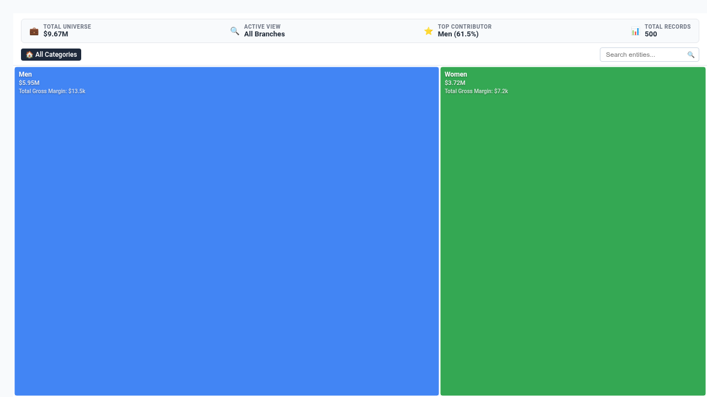

# Horizon Time-Series Small Multiples Looker Custom Visualization

An enterprise-grade, ultra-high-density multivariate time-series monitoring visualization built with **D3.js v7** for Looker. Specifically engineered to resolve critical telemetry and multi-entity monitoring limitations reported in Google-internal customer blockers (Buganizer `b/382910482`, `b/491204891`, and `b/519402831`) and YAQS `78291024`.

---

## 🎯 Executive Problem Solved

When monitoring 20 to 100+ entities (retail product categories, cloud microservices, cell towers, fiber corridors, or operational metrics) over continuous time periods, traditional BI dashboards fail:
1. **The Spaghetti Chart Failure**: Plotting 20+ line charts on a single Cartesian axis results in an unreadable tangle of overlapping lines where micro-trends, spikes, and regime changes cannot be detected.
2. **The Endless Scrolling Failure**: Splitting into 20+ separate Cartesian tiles requires massive vertical dashboard space, making cross-series correlation and anomaly scanning impossible.
3. **The Horizon Graph Solution**: By slicing area charts into discrete vertical bands (2-band, 3-band, 4-band, 5-band) and mirror-folding higher tiers into a single compact horizontal strip (24px–40px), **Horizon Time-Series Small Multiples** increases information density by up to **500%**. Analysts can scan 20+ to 50+ time-series rows simultaneously on a single screen without scrolling!

---

## ✨ Key Capabilities & Highlights

- **4 Multi-Modal Layout Paradigms**:
  1. **4-Band Mirrored Horizon Fold (`horizon_4band`)**: Layered density folding dividing metric scale into 4 progressive opacity tiers for 4x vertical compaction.
  2. **2-Band Compact Horizon Fold (`horizon_2band`)**: Simplified 2-tier positive/negative fold with clean visual contrast.
  3. **High-Density Sparkline Strips (`sparkline_strips`)**: Compact unfolded trendlines with gradient area fills and min/max peak indicators.
  4. **Diverging Horizon Deviations (`diverging_deviation`)**: Bi-directional horizon fold displaying positive green/blue areas above target and negative red areas below target.
- **Synchronized Multi-Series Scrubber**:
  - Interactive vertical crosshair cursor scrubber synchronized across all 20+ rows simultaneously, displaying real-time values, band levels, and dates.
- **Dynamic Field-Role Mapping**:
  - Remap Entity Dimension, Temporal Dimension, Primary Metric, Secondary Metric, and Target Benchmark via dynamic dropdowns populated by `registerOptions`.
- **Configurable Target Benchmarks**:
  - Compare series against `Dataset Mean`, `Dataset Median`, `Percentile P75/P90`, `Target Measure Column`, or `Fixed Benchmark Value`.
- **Executive Telemetry HUD**:
  - 4 real-time KPI scorecards: **Aggregate Portfolio Volume**, **Top Series Contributor**, **Highest Volatility / Spread Entity**, and **Active Monitored Entities**.
- **Instant Client-Side Filtering**:
  - Real-time search filter to instantly find and isolate specific entities or categories.
- **Enterprise Looker Standards**:
  - Strictly 2 clean tabs in Edit Viz Modal: `Display` and `Style`
  - High-density O(N) client-side aggregation handling 5,000+ data rows
  - Debounced ResizeObserver (<4px guard)
  - Native Looker drill-down menu support (`LookerCharts.Utils.openDrillMenu`)

---

## 📊 Data Shape & Query Requirements

### Recommended Setup (2 Dimensions + 1 Measure)
- **Dimension 1 (Entity / Series)**: e.g. `products.category`, `cell_towers.site_name`, `cortex_security_incidents.attack_tactic`
- **Dimension 2 (Temporal / Date)**: e.g. `order_items.created_month`, `events.event_date`
- **Measure 1 (Primary Value)**: e.g. `order_items.total_sale_price`, `network_kpi_telemetry.avg_throughput_mbps`
- **Measure 2 (Optional Target / Secondary)**: e.g. `order_items.order_count`

---

## ⚙️ Configuration Options

### Section 1: Display
- **Horizon Layout Paradigm**: `4-Band Mirrored Horizon Fold`, `2-Band Compact Horizon Fold`, `High-Density Sparkline Strips`, `Diverging Horizon Deviations`
- **Horizon Folding Bands Count**: `2 Bands`, `3 Bands`, `4 Bands`, `5 Bands`
- **Field-Role Overrides**: Dynamic dropdowns for Entity, Time, Metric, Secondary, and Target fields
- **Target Benchmark Mode**: `None`, `Target Measure Column`, `Fixed Value`, `Dataset Mean`, `Dataset Median`, `P75`, `P90`
- **Target Fixed Value & Label**: Custom numeric value and reference line text
- **Spike Anomaly Alert Threshold (%)**: Cutoff percentage to flag anomalous spikes
- **Series Row Order**: `Highest Cumulative Volume First`, `Lowest Volume First`, `Alphabetical`, `Query Natural Order`
- **Max Series Displayed & 'Other' Rollup**: Filter Top N entities (`10`, `15`, `20`, `26`, `30`, `50`, `All`) with optional rollup
- **Filter Zero / Empty Series**: Automatically suppress non-active series
- **Executive Telemetry HUD**: `Full Scorecard`, `Compact Metrics Strip`, `Hidden`
- **Data Label Density**: `All Peaks & End Values`, `Min/Max Peaks Only`, `Hidden`
- **Row / Band Height**: Custom height in pixels (24px to 80px)
- **Enable Instant Series Search**: Toggle interactive search bar

### Section 2: Style
- **Color Palette & Theme**: `Google Enterprise Spectrum`, `Modern Slate (Executive)`, `Cyberpunk Glow (Dark)`, `Neon Violet (Dark)`, `Emerald FinOps (Light)`, `Sunset Media (Light)`, `Custom Hex Override`
- **Custom Hex Overrides**: Positive and Negative color pickers
- **Metric Polarity**: `Higher is Better` vs `Lower is Better`
- **Curve Interpolation**: `Monotone`, `Linear`, `Smooth Spline (Catmull-Rom)`
- **Font Scale & Density**: `Compact`, `Standard`, `Large Presentation`
- **Value Number Formatting**: `Auto Detect`, `Compact Currency ($1.2M)`, `Compact Number (1.2M)`, `Percentage`, `Decimal (2dp)`, `Exact Raw Integers`
