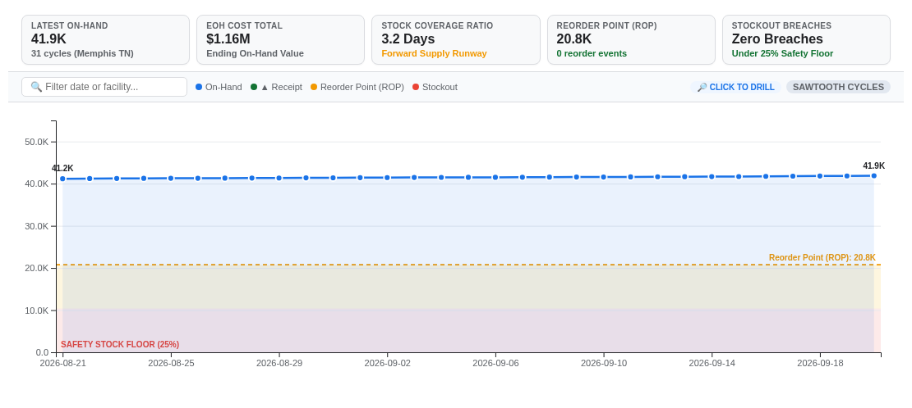

# Inventory Stockout Velocity & Reorder Sawtooth Chart



An enterprise **Inventory Stockout Velocity & Reorder Sawtooth Chart** custom visualization for Google Cloud Looker, engineered with **D3.js v7**.

Traditional BI line and bar charts fail to capture the cyclical physics of supply chain inventory replenishment: items deplete down towards safety thresholds until an order arrives, creating a characteristic "sawtooth" curve. This visualization models safety stock floors, Reorder Point (ROP) trigger lines, stockout hazard zones, and receipt jump nodes to empower inventory planners and operations teams to prevent stockouts and reduce excess holding capital.

---

## Key Features

- **4 Multi-Modal Layout Modes**:
  - `Inventory Sawtooth Depletion Cycles` (Default): Cyclical inventory depletion curves across snapshot dates with upward replenishment jumps, shaded Safety Stock floor zone, and Reorder Point (ROP) dashed benchmark threshold line.
  - `Consumption Velocity & Days-of-Supply Runway`: Daily burn-rate / consumption velocity bars alongside forward supply runway health indicators.
  - `Replenishment Batch & Cycle Variance`: Evaluates cycle-over-cycle order receipt jumps and drawdowns across replenishment periods.
  - `Par Capacity & Inventory Target Divergence`: Polarity-aware divergence bars comparing current on-hand levels against Par Target benchmarks.
- **Dynamic Field-Role Mapping (`Display`)**: Map Date, Facility/SKU, Inventory On-Hand Units, Coverage Ratio / Days of Supply, Inventory Cost Valuation, and optional Target/Par Measure Column via dropdowns automatically populated from the live query (or 1-based index overrides).
- **Configurable Safety Stock & Reorder Benchmarks (`Display`)**: Define Safety Stock floors and Reorder Points (ROP) dynamically using `Dataset Mean`, `Dataset Median`, `Percentile P75`, `Percentile P90`, `Peak Observed Inventory`, `Target / Par Measure Column`, or `Fixed Static Target Value`.
- **Sorting, Top-N Bucketing & Null Suppression (`Display`)**: Sort chronologically, by inventory volume, by stockout risk, or alphabetically; limit to Top-N with optional `'Other'` bucket rollup; and suppress zero/null records.
- **HUD, Legend & Label Density Controls (`Display`)**: Executive KPI scorecard (`Full Scorecard HUD`, `Compact Metric Strip`, `Hidden`), data value label density (`Min/Max Peaks & Breaches Only`, `All`, `Hidden`), status/threshold legend toggle, custom title/subtitle overrides, and interactive search bar.
- **Enterprise Brand Palettes, Polarity & Typography (`Style`)**: 7 brand presets (`Google Enterprise`, `Executive Slate`, `Modern Slate`, `Cyberpunk Dark`, `Emerald FinOps`, `Sunset Media`, `Wellverse Healthcare`) plus native `display: 'color'` hex overrides, metric polarity (`higher_better` vs `lower_better`), font scaling (`compact`, `standard`, `large`), and 7 value formatting presets.
- **Native Looker Drill-Downs & 5,000+ Row Aggregation**: Client-side O(N) aggregation, debounced `ResizeObserver` (`<4px` guard), and Looker contextual drill menu support.

---

## Data Shape Requirements

Supports standard inventory snapshot and stock telemetry queries (`thelook::inventory_snapshot` or `wellverse_mba::inventory_snapshots`):

| Field Type | Required Count | Purpose | Example (`thelook::inventory_snapshot`) |
| :--- | :--- | :--- | :--- |
| **Dimension** | `1` *(Required)* | Date / Timeline | `inventory_snapshot.snapshot_date` |
| **Dimension** | `0–1` *(Optional)* | Facility / Warehouse / SKU | `distribution_centers.name`, `products.category` |
| **Measure** | `1` *(Required)* | Primary Inventory On-Hand Units | `inventory_snapshot.total_in_stock` |
| **Measure** | `0–1` *(Optional)* | Stock Coverage / Days of Supply | `inventory_snapshot.stock_coverage_ratio` |
| **Measure** | `0–1` *(Optional)* | Inventory Valuation / Cost | `inventory_snapshot.eoh_cost_total` |
| **Measure** | `0–1` *(Optional)* | Target / Par Benchmark Column | `inventory_snapshots.par_value` |

---

## Configuration Options (Display & Style)

### Display Options
| Option | Type | Default | Description |
| :--- | :--- | :--- | :--- |
| `layoutMode` | Select | `sawtooth_cycles` | Visual layout mode (`sawtooth_cycles`, `stockout_velocity`, `replenishment_variance`, `inventory_par_divergence`) |
| `dateFieldOverride` | Select | `Auto` | Dynamic query dropdown for date dimension |
| `entityFieldOverride` | Select | `Auto` | Dynamic query dropdown for facility/SKU dimension |
| `inventoryMeasureOverride` | Select | `Auto` | Dynamic query dropdown for primary inventory units measure |
| `coverageMeasureOverride` | Select | `Auto` | Dynamic query dropdown for coverage ratio / days of supply measure |
| `costMeasureOverride` | Select | `Auto` | Dynamic query dropdown for inventory valuation measure |
| `targetMeasureOverride` | Select | `Auto / None` | Dynamic query dropdown for benchmark/par target measure |
| `targetCalculationMode` | Select | `dataset_mean` | Target mode (`dataset_mean`, `dataset_median`, `percentile_p75`, `percentile_p90`, `peak_observed`, `measure_column`, `fixed`) |
| `fixedTargetValue` | Number | `0` | Static Par target value when calculation mode is `fixed` |
| `referenceLineLabel` | String | `Reorder Point (ROP)` | Label displayed on reference line and HUD scorecard |
| `safetyStockPct` | Number | `25` | Safety Stock floor percentage relative to Par target |
| `reorderPointPct` | Number | `50` | Reorder Point (ROP) threshold percentage relative to Par target |
| `anomalyThresholdPct` | Number | `20` | Stockout/overstock hazard breach sensitivity percentage |
| `showSafetyZone` | Boolean | `true` | Display shaded safety stock hazard zone |
| `showReorderLine` | Boolean | `true` | Display dashed Reorder Point benchmark threshold line |
| `showReplenishmentPoints` | Boolean | `true` | Highlight receipt jump nodes with upward triangle markers |
| `sortBy` | Select | `date_asc` | Sort order (`date_asc`, `date_desc`, `inventory_desc`, `inventory_asc`, `hazard_first`, `entity_asc`) |
| `topNLimit` | Number | `0` | Limit display to Top-N cycles (0 = All) |
| `enableOtherRollup` | Boolean | `true` | Roll up remaining cycles into `'Other'` bucket when `topNLimit > 0` |
| `suppressZeroNull` | Boolean | `false` | Suppress zero or null inventory records |
| `hudMode` | Select | `scorecard` | Top executive KPI HUD (`scorecard`, `compact_strip`, `none`) |
| `labelDensity` | Select | `peaks_only` | Data value label density (`peaks_only`, `all`, `hidden`) |
| `showLegend` | Boolean | `true` | Display status & threshold legend |
| `showGridLines` | Boolean | `true` | Display background cartesian grid lines |
| `customTitle` | String | `""` | Optional chart header title override |
| `customSubtitle` | String | `""` | Optional chart header subtitle override |
| `showSearch` | Boolean | `true` | Enable quick-search filter input |

### Style Options
| Option | Type | Default | Description |
| :--- | :--- | :--- | :--- |
| `colorTheme` | Select | `google_enterprise` | Brand palette preset |
| `customPrimaryColor` | Color | `""` | Custom primary inventory stroke hex |
| `customPositiveColor` | Color | `""` | Custom replenishment / safe hex |
| `customNegativeColor` | Color | `""` | Custom stockout / hazard hex |
| `metricPolarity` | Select | `higher_better` | Goal direction (`higher_better` vs `lower_better`) |
| `fontScale` | Select | `standard` | Typography size (`compact`, `standard`, `large`) |
| `valueFormat` | Select | `compact_number` | Numeric formatting (`auto`, `compact_number`, `compact_currency`, `percentage`, `decimal_2`, `full_number`, `raw`) |
| `lineThickness` | Number | `2.5` | Sawtooth stroke thickness in pixels |

---

## Manifest Snippet (`manifest.lkml`)

```lookml
visualization: {
  id: "inventory_stockout_sawtooth"
  label: "Inventory Stockout Velocity & Reorder Sawtooth Chart"
  file: "visualizations/inventory_stockout_sawtooth.js"
  dependencies: ["https://d3js.org/d3.v7.min.js"]
}
```
