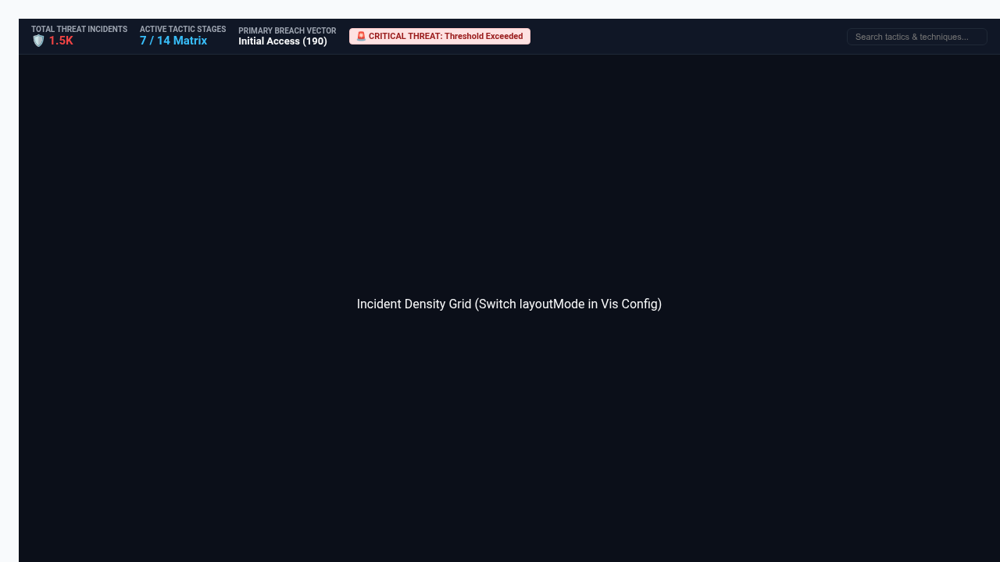

# MITRE ATT&CK Threat Matrix & SecOps Kill-Chain Heatmap



An enterprise-grade SecOps visualization built with D3.js v7 for cybersecurity intelligence, SIEM incident analysis, and threat hunting in Looker.

## 🎯 What Problem Does This Solve?
Solves high-friction enterprise SecOps and Threat Hunting challenges:
1. **MITRE ATT&CK Enterprise Matrix Alignment**: Standard BI charts (bar, pie, or basic grids) fail to present the tactical progression of adversarial intrusion across the 14 standard MITRE ATT&CK tactic stages (Initial Access ➔ Execution ➔ Persistence ➔ Privilege Escalation ➔ Defense Evasion ➔ Credential Access ➔ Discovery ➔ Lateral Movement ➔ Collection ➔ Command and Control ➔ Exfiltration ➔ Impact).
2. **Multi-Modal Visual Paradigms**:
   - `tactic_matrix`: Interactive 14-stage MITRE ATT&CK Enterprise Matrix columnar grid with heat-mapped technique cards and severity counters.
   - `kill_chain_sankey`: Cyber Kill Chain progression flow showing attack transition probability and incident volume across sequential security kill-chain phases.
   - `incident_density_grid`: Tactic-by-Technique incident density matrix highlighting concentrated threat vectors.
   - `tactic_treemap`: Hierarchical incident volume treemap partitioned by tactic domain and top techniques.
3. **Full Enterprise Flexibility Suite**:
   - **Dynamic Field-Role Mapping (`Display`)**: Re-map Tactic Dimension, Technique Dimension, Severity Dimension, Incident Volume Measure, and Target Measure on the fly via dynamic dropdowns.
   - **Benchmark Reference Lines & Targets (`Display`)**: Configurable SLA threshold targets (Fixed Value, Measure Column, Mean, Median, P75, P90, or None) with critical anomaly alert badges.
   - **Sorting & Top-N Bucketing (`Display`)**: Interactive sort orders (Canonical MITRE Order, Volume Descending, Volume Ascending, Alphabetical, Natural) with Top-N techniques and automatic "Other Techniques" rollup.
   - **Executive HUD Scorecard (`Display`)**: Multi-density KPI HUD (`scorecard`, `compact_strip`, `hidden`), integrated search bar, and custom title/subtitle overrides.
   - **Brand Palettes & Polarity (`Style`)**: 7 enterprise palettes (Cyber NOC Dark, Google Enterprise, Modern Slate, Emerald SOC Shield, Sunset Crimson, Wellverse Healthcare, and Custom Hex Override) with metric polarity toggle (`Lower is Better` for incidents).
4. **5,000+ Row Client-Side Aggregation**: Real-time aggregation of thousands of firewall alerts, EDR events, or SIEM incident rows without UI freezing or lag.
5. **Clean 2-Tab Options Architecture**: All configuration options are strictly organized into **Display** and **Style** sections to prevent overlapping or crowded headers in Looker's Edit Viz modal.
6. **Native Looker Drill Menus**: Full support for `LookerCharts.Utils.openDrillMenu` to inspect raw alert telemetry, host IP logs, and user identity contexts.

---

## 📊 Recommended Data Shapes
- **Dimensions**:
  - `Tactic Stage / Category` (e.g. `cortex_security_incidents.mitre_tactic`, `threat_firewall_events.threat_category`)
  - `Technique / Entity / Vector` (e.g. `cortex_security_incidents.mitre_technique`, `threat_firewall_events.app_id`)
  - `Severity Level` (optional, e.g. `cortex_security_incidents.severity`)
- **Measures**:
  - `Incident Count / Volume` (e.g. `cortex_security_incidents.count`, `cortex_security_incidents.total_alerts`)
  - `Severity Impact / MTTR` (optional, e.g. `cortex_security_incidents.avg_mttr_minutes`)

---

## 🚀 Setup & Manifest Snippet
```lookml
visualization: {
  id: "mitre_attack_matrix"
  label: "MITRE ATT&CK Threat Matrix & SecOps Kill-Chain Heatmap"
  file: "visualizations/mitre_attack_matrix.js"
  dependencies: ["https://d3js.org/d3.v7.min.js"]
}
```
