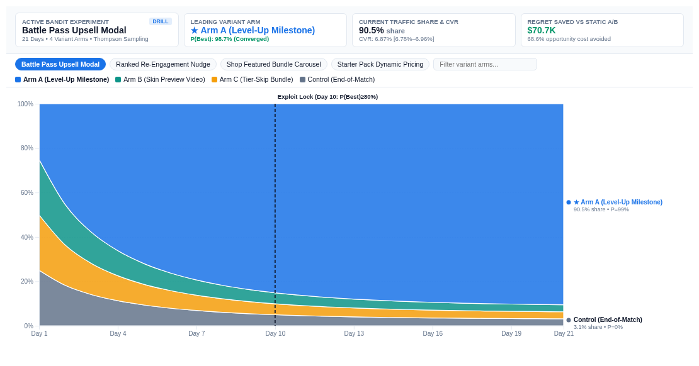

# Multi-Armed Bandit & Thompson Sampling Allocation Analyzer

An executive **Multi-Armed Bandit (Thompson Sampling) Traffic Allocation & Regret Analyzer** custom visualization for Google Cloud Looker, engineered with **D3.js v7**.

Traditional fixed-split A/B tests keep routing 50% (or 75%) of live traffic to losing variants for weeks, burning avoidable opportunity cost. Modern LiveOps, ad-tech, and dynamic pricing teams run **Thompson Sampling / Contextual Multi-Armed Bandits** that dynamically shift traffic toward winning arms as Bayesian posteriors sharpen—requiring visual paradigms that native Looker charts cannot render:
1. **Thompson Sampling Traffic Share Stream (`allocation_ribbon`)**: 100% stacked smoothed area stream tracking daily traffic re-allocation across variant arms with an automated **Exploit Lock** convergence marker (`P(Best) >= Target`).
2. **Cumulative Regret & Savings Horizon (`regret_horizon`)**: Compares sublinear Thompson Sampling regret against a counterfactual static equal-split A/B test, shading the exact **Regret Saved ($)** area between the two curves.
3. **Beta Posterior Density & P(Best) Win Bars (`posterior_win_density`)**: Overlapping Bayesian conversion rate density curves with 95% Credible Intervals paired with horizontal `P(Arm is Best)` probability meters.
4. **Arm Exploration–Exploitation Quadrant (`arm_efficiency_quadrant`)**: Bubble scatter plotting Traffic Share % vs Conversion Rate % with 95% CI whiskers and quadrant classifications.

---

## 📊 Domain-Authentic Dataset

Bound to `void_weaver_analytics::bandit_allocation_telemetry` (`aragosalooker.vw_consumption.bandit_allocation_telemetry`), modeling 4 live gaming LiveOps Thompson Sampling experiments (`Shop Featured Bundle Carousel`, `Battle Pass Upsell Modal`, `Ranked Re-Engagement Nudge`, `Starter Pack Dynamic Pricing`) across 21 days and 4 variant arms each (336 rows).

---

## ⚙️ Configuration Options (2 Clean Tabs: `Display` & `Style`)

### Display Tab
- **Bandit Visual Paradigm**: `allocation_ribbon`, `regret_horizon`, `posterior_win_density`, `arm_efficiency_quadrant`
- **Dynamic Field-Role Dropdowns**: Dynamically populated from the live query (`experimentDimOverride`, `periodDimOverride`, `armDimOverride`, `shareMeasureOverride`, `cvrMeasureOverride`, `winProbMeasureOverride`, `regretMeasureOverride`, `baselineRegretMeasureOverride`, `ciLowerMeasureOverride`, `ciUpperMeasureOverride`, `targetMeasureOverride`)
- **Convergence / Benchmark Target**: `fixed`, `measure_column`, `dataset_mean`, `dataset_median`, `percentile_p75`, `percentile_p90`, `none`
- **Sorting, Top-N & Rollup**: Sort by `P(Best) Descending`, `Traffic Share Descending`, `CVR Descending`, `Alphabetical`, `Natural`; Top-N arm limit with automatic `'Other Arms'` rollup and zero/null suppression
- **HUD, Labels & Filtering**: `scorecard` / `compact_strip` / `hidden` HUD, `peaks_only` / `all` / `hidden` labels, interactive experiment pills + arm filter bar, interactive legend isolation, custom title/subtitle overrides

### Style Tab
- **Brand Palettes & Hex Overrides**: Google Enterprise, Modern Slate, Cyberpunk Dark, Emerald FinOps, Sunset Media, Wellverse Healthcare, and Custom Hex Override (`display: 'color'` pickers)
- **Metric Polarity, Typography & Formatting**: `higher_is_better` vs `lower_is_better`, `compact` / `standard` / `large` font scale, value formatters, and `smooth` / `linear` curve interpolation
