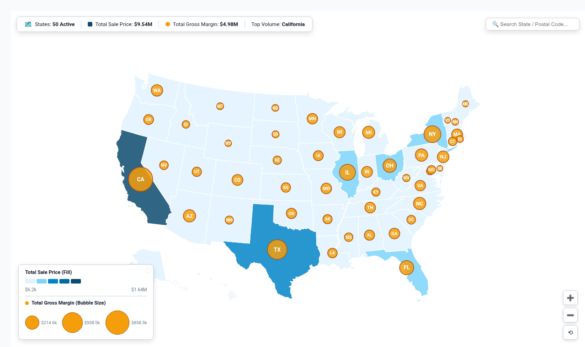

# Dual-Axis Multi-Layer Geospatial Map (`multi_layer_geo_map`)

A high-performance geospatial intelligence visualization solving Looker's premier Map Cloud Blocker (**Buganizer `b/243984441`** and **`go/prd-looker-map-viz-improvements`**).

Native Looker map visualizations are fundamentally constrained to plotting a single metric at a time. This visualization introduces an enterprise dual-axis geospatial engine that plots **two independent measures simultaneously** across geographic regions: **Choropleth Polygon Fills** for primary macro metrics (e.g. Sales Volume or Revenue) and **Proportional Centroid Bubble Pins** for secondary unit/efficiency metrics (e.g. Gross Margin, Order Count, or Latency).

---

## 💡 Inspiration & Cloud Blockers Solved

- **Buganizer Cloud Blocker `b/243984441`**: *Dual-Axis Maps in BI Products*
- **PRD - Looker Map Viz Improvements (`go/prd-looker-map-viz-improvements`)**:
  > *"Dual-Axis Maps in BI Products: As an Analyst, I should be able to plot multiple measures as distinct identifiers on a map. Google Map Viz should support multiple measures on the same map viz. Each measure should be displayed as an identifiable value. Analysts should be able to configure layers separately."*
- **Internal YAQS (`go/yeng/5766299557997936640`)**: *Choropleth color fill plus bubble pin overlay on a single geospatial canvas.*

---

## 🚀 Key Features & Capabilities

- **Dual-Axis Multi-Layer Engine**:
  - **Layer 1 (Choropleth)**: Continuous or quantile color gradient shading based on Primary Measure (e.g. Total Revenue).
  - **Layer 2 (Centroid Bubbles)**: Proportional circles plotted at true state geographic centroids sized according to Secondary Measure (e.g. Gross Margin).
  - **Layer 3 (Tooltip & Context)**: Real-time contextual inspector with percentile benchmarks, rank indicators, and drill-down links.
- **4 Geospatial Projection Modes**:
  1. `dual_layer`: Synchronized Choropleth polygon fill + proportional bubble pins.
  2. `choropleth_only`: High-contrast pure boundary heatmap.
  3. `bubble_only`: Proportional bubble scatter map over subtle boundary outlines.
  4. `hex_cartogram`: Equal-area hexagonal state cartogram eliminating geographic landmass distortion (e.g. Rhode Island has equal visual prominence to Montana).
- **Dynamic Field-Role Mapping**: Auto-populated select dropdowns for Primary State Dimension, Layer 1 Measure, Layer 2 Measure, and Layer 3 Context Measure.
- **Configurable Benchmark Targets & Thresholds**:
  - Benchmark Modes: `dataset_mean`, `dataset_median`, `percentile_p75`, `percentile_p90`, `fixed_value`, or `none`.
  - Anomaly Alert Threshold: Highlights underperforming states failing benchmark by X% with variance badges.
- **Sorting, Top-N Bucketing & Null Suppression**:
  - Sorting: Metric Descending, Metric Ascending, Alphabetical, or Natural.
  - Top-N Focus: Limit focus to Top 10, 15, 20, or 25 states.
  - Suppress Nulls: Filter zero or missing state records.
- **Executive KPI HUD & Search**:
  - Full Scorecard: National totals for both measures, active states count, top volume state, benchmark target progress counter, and title/subtitle.
  - Compact Metric Pill: Single-line streamlined strip.
  - Real-time search bar with instant state highlighting.
- **Synchronized Dual-Axis Legends**:
  - Gradient color bar for Layer 1 with minimum and maximum values.
  - Nested concentric circle scale for Layer 2 showing reference bubble sizes and metric values.
- **6 Enterprise Brand Palettes & Custom Hex Overrides**:
  - Google Enterprise (Blue & Amber), Modern Executive Slate (Indigo & Slate), Cyber NOC Dark (Cyan & Rose Neon), Emerald FinOps (Green & Ruby), Sunset Media (Amber & Violet), Wellverse Healthcare (Teal & Coral), and Custom Hex Overrides.
- **Interactive Pan & Zoom**:
  - Smooth mouse wheel / pinch zoom with bounding constraint and floating reset button.
- **Looker Drill-Down Integration**:
  - Native Looker drill menus (`LookerCharts.Utils.openDrillMenu`) on click for dimensions and measures.

---

## 📋 Data Requirements

| Field Type | Requirement | Examples |
| :--- | :--- | :--- |
| **Dimension** | 1 Geographic Dimension (State Name, Postal Code, or FIPS) | `users.state`, `distribution_centers.state` |
| **Measures** | 1 to 3 Numeric Measures | `order_items.total_sale_price` (Primary Fill), `order_items.total_gross_margin` (Secondary Bubble), `order_items.order_count` |

---

## 🎨 Configuration Options (Strict 2-Tab Schema)

### Section 1: Display
- **Geospatial Map Mode**: `dual_layer` (Choropleth + Bubbles), `choropleth_only`, `bubble_only`, `hex_cartogram` (Equal-Area Hex Cartogram).
- **Primary State Dimension**: Dynamic dropdown to re-map geographic column without altering Looker Explore order.
- **Layer 1 (Choropleth Fill) Measure**: Dynamic dropdown to select measure driving polygon fills.
- **Layer 2 (Bubble Pins) Measure**: Dynamic dropdown to select measure driving proportional bubble pins.
- **Layer 3 (Tooltip & Context) Measure**: Dynamic dropdown for tertiary metric in hover inspection.
- **Reference Benchmark Target Mode**: `none`, `dataset_mean`, `dataset_median`, `percentile_p75`, `percentile_p90`, `fixed_value`.
- **Custom Fixed Target Benchmark Value**: Numeric target override when mode is fixed.
- **Target Benchmark Metric Label**: Custom label for reference benchmark.
- **Underperformance Warning Threshold %**: Tolerance threshold for alert status.
- **State Ranking & Sort Order**: Metric Descending, Metric Ascending, Alphabetical, or Natural.
- **Top-N State Focus Limit**: All, Top 10, Top 15, Top 20, Top 25.
- **Suppress Zero / Null States**: Filter out unobserved geographic entities.
- **Executive KPI HUD Mode**: Full Scorecard, Compact Metric Pill, or Hidden.
- **Centroid Postal Code Labels**: All, Top 10 Peaks Only, On Hover Only, Hidden.
- **Show Dual-Layer Legends**: Toggle synchronized color ramp and bubble scale cards.
- **Show Interactive State Filter**: Toggle real-time search input.
- **Custom Map Title / Subtitle Override**: Optional header text above scorecard.

### Section 2: Style
- **Visual Palette Theme**: Google Enterprise, Modern Executive Slate, Cyber NOC Dark, Emerald FinOps, Sunset Media, Wellverse Healthcare, Custom Hex Overrides.
- **Custom Primary Choropleth Hex**: Custom color picker override for Layer 1.
- **Custom Bubble Pin Hex**: Custom color picker override for Layer 2.
- **Metric Polarity**: Higher is Better vs Lower is Better.
- **Typography & UI Scale**: Compact, Standard, Large Presentation.
- **Layer 1 & Layer 2 Formats**: Auto Detect, Compact Currency ($1.2M), Compact Number (1.2M), Percentage (45.2%), Decimal (1,234.56), Raw.
- **Bubble Radius Scale Multiplier**: Fine-tune bubble size distribution.
- **Choropleth Fill Opacity**: Adjust background polygon transparency.
