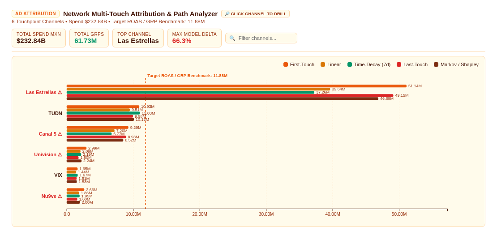

# Multi-Touch Marketing Attribution & Path Decay Analyzer



An executive **Multi-Touch Marketing Attribution & Path Decay Analyzer** custom visualization for Google Cloud Looker, engineered with **D3.js v7**.

Modern marketing campaigns span multiple interconnected media networks, dayparts, and programmatic advertising touchpoints. Native Looker charts force marketers to choose a single static metric or rely on single-touch attribution models (such as First-Touch or Last-Touch), which drastically misallocate marketing budget and obscure cross-channel synergy.

This visualization provides a multi-modal attribution suite designed specifically for media, broadcast advertising, and omni-channel marketing operations.

---

## 📸 Key Features

- **3 Distinct Attribution Paradigms**:
  - `Multi-Model Attribution Comparison` (Default): Side-by-side grouped horizontal bar matrix evaluating channel performance simultaneously across **5 algorithmic attribution models** (First-Touch, Linear, Time-Decay, Last-Touch, and Markov/Shapley) with a configurable benchmark reference line.
  - `Touchpoint Transition Flow (Sankey Ribbons)`: Dynamic multi-hop flow diagram connecting ad spend touchpoints (Left) to conversion outcomes and broadcast programming dayparts (Right).
  - `Campaign ROAS & Efficiency Matrix`: Scatter matrix plotting Ad Spend against Attributed Conversions/GRPs, with interactive circle radii, channel hover cards, and a Target ROAS slope benchmark line.
- **Dynamic Field-Role Mapping (`Display`)**:
  - Query-populated dropdown selectors (`registerOptions`) and 1-based index/name overrides for Primary Channel, Sub-Channel/Daypart, Spend, Conversions/GRPs, and optional Target Measure.
- **Configurable Reference Targets, Top-N & 'Other Channels' Rollup (`Display`)**:
  - Supports `Dataset Mean`, `Dataset Median`, `Measure Column`, `Fixed Value`, `Percentile P75/P90`, and `None`, plus Top-N limiting with automatic `'Other Channels'` rollup and zero/null suppression.
- **Executive Scorecard HUD & Label Density (`Display`)**:
  - Configurable HUD (`Full Scorecard`, `Compact Strip`, `Hidden`), label density (`All`, `Min/Max Peaks Only`, `Hidden`), custom chart title/subtitle overrides, and real-time search filter.
- **Domain-Authentic Media & Broadcast Data**:
  - Bound authentically to `tvun_media_analytics::ad_spot_airings` modeling television networks (`Las Estrellas`, `Canal 5`, `TUDN`, `Univision`, `Nu9ve`, `ViX`), broadcast genres, and dayparts (`Prime Time`, `Daytime`, `Late Night`).
- **7 Curated Enterprise Palettes & Polarity (`Style`)**:
  - `Sunset Media`, `Google Enterprise`, `Modern Slate`, `Cyberpunk Dark`, `Emerald FinOps`, `Wellverse Healthcare`, and `Custom Hex Override` with native color pickers, metric polarity (`Higher is Better` vs `Lower is Better`), font scaling, and value formatting.
- **Looker Drill-Downs & Container Bounds**:
  - Integrated with `LookerCharts.Utils.openDrillMenu` on bars, channel labels, Sankey nodes/ribbons, and scatter points, guarded by a debounced `ResizeObserver` (<4px guard).

---

## 📊 Data Shape Requirements

| Field Type | Required Count | Purpose | Example (`ad_spot_airings`) |
| :--- | :--- | :--- | :--- |
| **Dimension 1** | `1` *(Required)* | Primary Touchpoint Channel / Network | `broadcast_programming.network` |
| **Dimension 2** | `0 to 1` *(Optional)* | Sub-Channel / Genre / Daypart | `broadcast_programming.genre` or `ad_spot_airings.daypart` |
| **Measure 1** | `1` *(Required)* | Ad Spend / Investment Volume | `ad_spot_airings.total_spend_mxn` |
| **Measure 2** | `0 to 1` *(Optional)* | Conversions / GRPs / Reach | `nielsen_ratings_markets.total_grps` |
| **Measure 3** | `0 to 1` *(Optional)* | Target / Benchmark Measure | Custom target measure |

---

## ⚙️ Configuration Options

Configuration options are strictly organized into **2 clean tabs** (`Display` and `Style`) to prevent Looker's Edit Viz modal header tabs from crowding:

### Display Tab
| Option | Type | Default | Description |
| :--- | :--- | :--- | :--- |
| `layoutMode` | Select | `Multi-Model Attribution Comparison` | `attribution_comparison`, `touchpoint_sankey`, `campaign_efficiency_matrix` |
| `touchpointDimOverride` | Select | `Auto` | Primary Channel Dimension (query-populated dropdown or 1-based index) |
| `stageDimOverride` | Select | `Auto` | Sub-Channel/Daypart Dimension (query-populated dropdown or 1-based index) |
| `spendMeasureOverride` | Select | `Auto` | Spend Measure (query-populated dropdown or 1-based index) |
| `conversionMeasureOverride` | Select | `Auto` | Conversions/GRPs Measure (query-populated dropdown or 1-based index) |
| `targetMeasureOverride` | Select | `Auto / None` | Optional Target Measure for `measure_column` benchmark mode |
| `targetMode` | Select | `Dataset Mean` | Benchmark: `dataset_mean`, `dataset_median`, `measure_column`, `fixed`, `percentile_p75`, `percentile_p90`, `none` |
| `fixedTargetValue` | Number | `0` | Fixed benchmark target ratio/value (when Fixed mode selected) |
| `referenceLineLabel` | String | `Benchmark Target` | Reference line and scorecard benchmark label |
| `anomalyThresholdPct` | Number | `25` | Model variance anomaly alert threshold (%) |
| `sortBy` | Select | `Spend (Descending)` | Sorting: `spend_desc`, `spend_asc`, `conv_desc`, `conv_asc`, `variance_desc`, `name_asc`, `natural` |
| `topNLimit` | Number | `8` | Top-N channels display limit (0 = all) |
| `enableOtherRollup` | Boolean | `true` | Roll unselected channels into `'Other Channels'` bucket |
| `suppressZeroNull` | Boolean | `true` | Suppress zero or null data touchpoints |
| `hudMode` | Select | `Full Scorecard HUD` | Executive KPI HUD: `scorecard`, `compact_strip`, `hidden` |
| `showValueLabels` | Select | `Show All Labels` | Label density: `all`, `peaks_only`, `hidden` |
| `showLegend` | Boolean | `true` | Display attribution model and channel color legend |
| `showSearch` | Boolean | `true` | Enable interactive quick-search filter bar |
| `customTitle` | String | `""` | Custom chart title override |
| `customSubtitle` | String | `""` | Custom chart subtitle override |

### Style Tab
| Option | Type | Default | Description |
| :--- | :--- | :--- | :--- |
| `colorPalette` | Select | `Sunset Media` | Preset: `sunset_media`, `google_enterprise`, `modern_slate`, `cyberpunk_dark`, `emerald_finops`, `wellverse_healthcare`, `custom_override` |
| `customPrimaryHex` | Color | `""` | Custom dominant brand color override |
| `customPositiveHex` | Color | `""` | Custom positive / overperforming color override |
| `customNegativeHex` | Color | `""` | Custom alert / underperforming color override |
| `metricPolarity` | Select | `Higher is Better` | Polarity: `higher_is_better` vs `lower_is_better` |
| `fontScale` | Select | `Standard` | Typography scale: `compact`, `standard`, `large` |
| `valueFormat` | Select | `Compact Currency` | Formatting style: `auto`, `compact_currency`, `compact_number`, `percentage`, `decimal_2`, `raw` |

---

## 🚀 LookML Manifest Snippet

```lookml
visualization: {
  id: "multi_touch_attribution_pathway"
  label: "Multi-Touch Marketing Attribution & Path Decay Analyzer"
  file: "visualizations/multi_touch_attribution_pathway.js"
  dependencies: ["https://d3js.org/d3.v7.min.js"]
}
```
