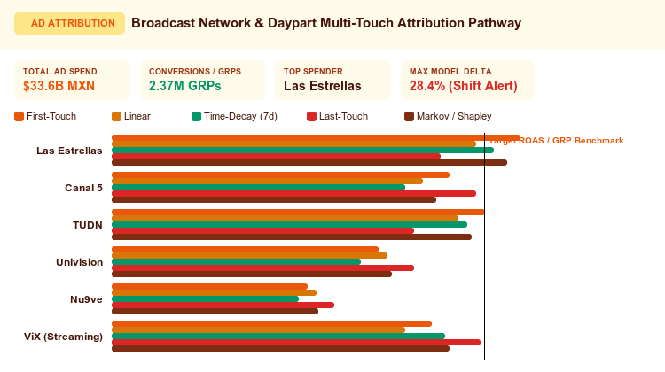

# Multi-Touch Marketing Attribution & Path Decay Analyzer



An executive **Multi-Touch Marketing Attribution & Path Decay Analyzer** custom visualization for Google Cloud Looker, engineered with **D3.js v7**.

Modern marketing campaigns span multiple interconnected media networks, dayparts, and programmatic advertising touchpoints. Native Looker charts force marketers to choose a single static metric or rely on single-touch attribution models (such as First-Touch or Last-Touch), which drastically misallocate marketing budget and obscure cross-channel synergy.

This visualization provides a multi-modal attribution suite designed specifically for media, broadcast advertising, and omni-channel marketing operations.

---

## 📸 Key Features

- **3 Distinct Attribution Paradigms**:
  - `Multi-Model Attribution Comparison` (Default): Side-by-side grouped horizontal bar matrix evaluating channel performance simultaneously across **5 algorithmic attribution models**:
    1. **First-Touch Attribution**: Over-weights top-of-funnel brand discovery and awareness channels.
    2. **Linear Attribution**: Equal credit distribution across all touchpoints.
    3. **Time-Decay Attribution (7-Day Half-Life)**: Exponential decay model weighting touchpoints closer to the conversion event.
    4. **Last-Touch Attribution**: Classic direct-response credit model.
    5. **Markov / Algorithmic Shapley Credit**: Removal-effect credit calculation measuring incremental conversion lift.
  - `Touchpoint Transition Flow (Sankey Ribbons)`: Dynamic multi-hop flow diagram connecting ad spend touchpoints (Left) to conversion outcomes and broadcast programming dayparts (Right).
  - `Campaign ROAS & Efficiency Matrix`: Scatter matrix plotting Ad Spend ($) against Attributed Conversions/GRPs, with interactive circle radiuses, channel hover cards, and a prominent Target ROAS slope benchmark line.
- **Dynamic Field-Role Mapping**:
  - Re-map which query columns drive Channel, Sub-Channel/Daypart, Spend, and Conversions using 1-based index or column name overrides.
- **Executive Scorecard HUD**:
  - Top scorecard band featuring Total Ad Spend, Total Attributed Conversions/GRPs, Top Spender, and Maximum Attribution Model Variance delta (with automated alert badges).
- **Domain-Authentic Media & Broadcast Data**:
  - Bound authentically to `tvun_media_analytics::ad_spot_airings` modeling television networks (`Las Estrellas`, `Canal 5`, `TUDN`, `Univision`, `Nu9ve`, `ViX`), broadcast genres, and dayparts (`Prime Time`, `Daytime`, `Late Night`).
- **Interactive Filtering & Sorting**:
  - Real-time channel search filter, Top-N channel limiters, and sorting by Spend, Conversions, Model Variance, or Alphabetical.
- **7 Curated Enterprise Palettes**:
  - `Sunset Media` (Default warm broadcast & ad-ops palette), `Google Enterprise`, `Modern Slate`, `Cyberpunk Dark`, `Emerald FinOps`, `Wellverse Healthcare`, and `Custom Hex Override`.
- **Looker Drill-Downs & Container Bounds**:
  - Integrated with native Looker drill menus (`looker.drill(...)`) and guarded by debounced `ResizeObserver` (<4px guard).

---

## 📊 Data Shape Requirements

| Field Type | Required Count | Purpose | Example (`ad_spot_airings`) |
| :--- | :--- | :--- | :--- |
| **Dimension 1** | `1` *(Required)* | Primary Touchpoint Channel / Network | `broadcast_programming.network` |
| **Dimension 2** | `0 to 1` *(Optional)* | Sub-Channel / Genre / Daypart | `broadcast_programming.genre` or `ad_spot_airings.daypart` |
| **Measure 1** | `1` *(Required)* | Ad Spend / Investment Volume ($) | `ad_spot_airings.total_spend_mxn` |
| **Measure 2** | `0 to 1` *(Optional)* | Conversions / GRPs / Reach | `nielsen_ratings_markets.total_grps` |

---

## ⚙️ Configuration Options

Configuration options are strictly organized into **2 clean tabs** (`Display` and `Style`) to prevent Looker's Edit Viz modal header tabs from crowding:

### Display Tab
| Option | Type | Default | Description |
| :--- | :--- | :--- | :--- |
| `layoutMode` | Select | `Multi-Model Attribution Comparison` | `attribution_comparison`, `touchpoint_sankey`, `campaign_efficiency_matrix` |
| `touchpointDimOverride` | String | `1` | Primary Channel Dimension index (1 = Col 1) or field name override |
| `stageDimOverride` | String | `2` | Sub-Channel/Daypart Dimension index (2 = Col 2) or field name override |
| `spendMeasureOverride` | String | `1` | Spend Measure index (1 = Measure 1) or field name override |
| `conversionMeasureOverride` | String | `2` | Conversions/GRPs Measure index (2 = Measure 2) or field name override |
| `targetMode` | Select | `Dataset Mean` | Benchmark calculation: `dataset_mean`, `dataset_median`, `fixed`, `percentile_p75`, `percentile_p90` |
| `fixedTargetValue` | Number | `0` | Fixed benchmark target ratio (when Fixed mode selected) |
| `referenceLineLabel` | String | `Benchmark Target` | Reference line and scorecard benchmark label |
| `anomalyThresholdPct` | Number | `25` | Model variance anomaly alert threshold (%) |
| `sortBy` | Select | `Spend Volume (Descending)` | Sorting: `spend_desc`, `conv_desc`, `variance_desc`, `name_asc` |
| `topNLimit` | Number | `8` | Top-N channels display limit (0 = all) |
| `suppressZeroNull` | Boolean | `true` | Suppress zero or null data touchpoints |
| `hudMode` | Select | `Full Scorecard HUD` | Executive KPI HUD: `scorecard`, `compact_strip`, `hidden` |
| `showValueLabels` | Select | `Show All Labels` | Label density: `all`, `peaks_only`, `hidden` |
| `showLegend` | Boolean | `true` | Display attribution model and channel color legend |
| `showSearch` | Boolean | `true` | Enable interactive quick-search filter bar |
| `customTitleOverride` | String | `""` | Executive scorecard title override |
| `customSubtitleOverride` | String | `""` | Executive scorecard subtitle override |

### Style Tab
| Option | Type | Default | Description |
| :--- | :--- | :--- | :--- |
| `colorPalette` | Select | `Sunset Media` | Preset: `sunset_media`, `google_enterprise`, `modern_slate`, `cyberpunk_dark`, `emerald_finops`, `wellverse_healthcare`, `custom_override` |
| `customPrimaryHex` | Color | `""` | Custom dominant brand color override |
| `customPositiveHex` | Color | `""` | Custom positive / overperforming color override |
| `customNegativeHex` | Color | `""` | Custom alert / underperforming color override |
| `metricPolarity` | Select | `Higher is Better` | Polarity: `higher_is_better` vs `lower_is_better` |
| `fontScale` | Select | `Standard` | Typography scale: `compact`, `standard`, `large` |
| `valueFormat` | Select | `Compact Currency` | Formatting style: `compact_currency`, `compact_number`, `percentage`, `decimal_2`, `raw`, `auto` |

---

## 🚀 LookML Manifest Snippet

```lookml
visualization: {
  id: "multi_touch_attribution_pathway"
  label: "Multi-Touch Marketing Attribution & Path Decay Analyzer"
  file: "visualizations/multi_touch_attribution_pathway.js"
  dependencies: ["https://d3js.org/d3.v7.min.js"]
}
```
