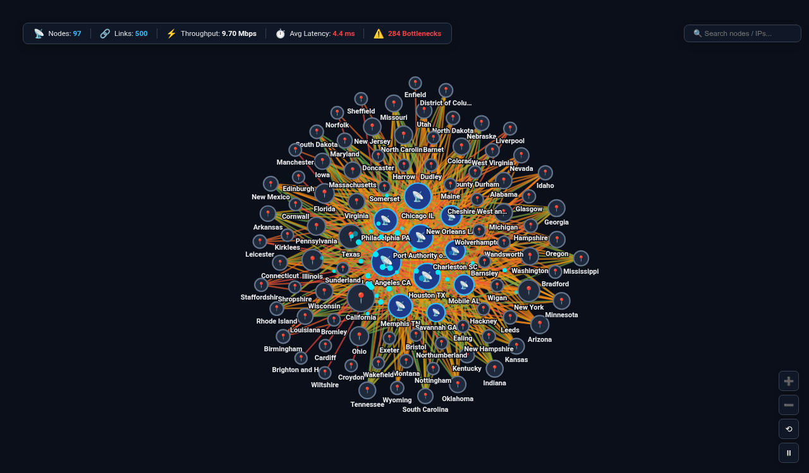

# Network Topology & Latency Flow Graph




An executive **Network Topology & Latency Flow Graph** custom visualization for Google Cloud Looker, engineered with **D3.js v7**.

Designed for **Telecommunications & 5G RAN** (cell tower topology, base station backhaul, RF link performance), **Cloud Infrastructure & SRE** (data center interconnects, edge PoP ingress/egress, microservice service mesh topologies), **Enterprise Networking** (packet flow routing, MPLS tunnels, bandwidth vs latency bottlenecks), and **Logistics/Supply Chain** (regional distribution hubs to fulfillment endpoints).

Looker lacks native graph and network topology visualizations out of the box. Traditional Looker charts (scatter plots, heatmaps, or static tables) cannot model relational node-link dependencies, force-directed graph physics, directional packet flow dynamics, or bottleneck latency thresholds.

This custom visualization delivers a multi-mode, high-density network analytics suite capable of processing 5,000+ connection records with client-side graph aggregation, sticky node pinning, real-time packet pulse animations, and instant bottleneck detection.

---

## 📸 Key Features

- **Multi-Modal Display Modes**:
  - `Force-Directed Topology (Physics)` (Default): Real-time D3 physics simulation with draggable sticky nodes, collision repulsion, canvas zooming & panning, and dynamic packet pulse flow animations. Double-clicking any node unpins its position.
  - `Hierarchical Concentric Tiers`: Organizes nodes into concentric rings (Core Hubs/Datacenters in center, Transit/Distribution Gateways in mid-ring, Edge Cell Sites/Endpoints on outer perimeter).
  - `Circular Peering & Chord Ring`: Arranges all nodes along a perimeter circumference with smooth curved quadratic bezier interconnects, ideal for spotting cross-peering transit and regional routing imbalances.
  - `Adjacency Latency Matrix`: High-density N x N Source vs Target cross-connect matrix heatmap with latency/volume cell gradients and row/column headers.
- **Glowing Packet Pulse Animations**:
  - Simulates active traffic bandwidth with glowing particles (`<circle>` elements with SVG glow filters) traveling along links from source to target at speeds proportional to connection throughput.
  - Also supports `Moving Dash Flow` (`stroke-dasharray` animation) or `Static Links`.
- **Latency Bottleneck Detection (⚠️ Alerts)**:
  - Automatically flags connections where transmission latency exceeds the customizable threshold (e.g. `> 3.8ms`), styling links with warning/critical amber/red colors and reporting the bottleneck count in the Executive HUD.
- **Executive Metrics HUD & Interactive Search Bar**:
  - Real-time floating HUD card showing Total Nodes, Active Links, Total Network Throughput, Average Latency, and Active Bottlenecks.
  - Real-time client-side search box filtering nodes, IP addresses, or hostnames with live match counters and visual dimming of non-matching nodes.
- **Floating Canvas Zoom & Physics HUD**:
  - Integrated floating controls: `[+] Zoom In`, `[-] Zoom Out`, `[⟲ Reset Zoom]`, and `[⏸ Pause / ▶ Play Physics]`.
- **Expanded Row Limit Scalability (5,000+ Rows)**:
  - Client-side data aggregation engine merges repeated transmission logs, calculates in/out degrees, degree centrality, weighted average latency, and supports high-density node limiters (`All`, `Top 25`, `Top 50`, `Top 100`).
- **Interactive Tooltips & Drill-Downs**:
  - Hovering a node highlights immediate 1-hop connected neighbors, dims non-connected nodes, and displays node metrics (Total Volume, Inbound vs Outbound breakdown, and Degree Centrality).
  - Hovering a link displays connection throughput, transmission latency, share of total network flow, and bottleneck status.
  - Clicking any node or link opens Looker's native drill-down menu (`LookerCharts.Utils.openDrillMenu`).
- **4 Curated Visual Themes**:
  - `Cyber NOC Dark` (Default telemetry theme with midnight background, cyan glows, and violet accents)
  - `Google Cloud Telecom` (Clean Google Cloud enterprise white with azure blue and amber accents)
  - `Executive Slate` (Charcoal, teal, and rose slate design)
  - `Emerald Mesh` (Clean dark slate with mint and coral accents)

---

## 📊 Data Shape Requirements

| Field Type | Required Count | Purpose | Example (`order_items`) |
| :--- | :--- | :--- | :--- |
| **Dimension 1** | `1` *(Required)* | Source Node (Datacenter, Base Station, Ingress IP) | `distribution_centers.name` |
| **Dimension 2** | `1` *(Required)* | Target Node (Destination, Edge Cell, Egress IP) | `users.state` |
| **Measure 1** | `1` *(Required)* | Flow Volume / Bandwidth / Revenue Metric | `order_items.total_sale_price` |
| **Measure 2** | `0 to 1` *(Optional)* | Latency / Transmission Delay / Delivery Time | `order_items.average_shipping_time` |
| **Measure 3** | `0 to 1` *(Optional)* | Transaction / Packet Count | `order_items.order_count` |

---

## ⚙️ Configuration Options

Configuration options are strictly organized into **2 clean tabs** (`Display` and `Style`) to keep Looker's Edit Viz modal neat and uncluttered:

### Display Tab
| Option | Type | Default | Description |
| :--- | :--- | :--- | :--- |
| `viewMode` | Select | `Force-Directed Topology` | `force_directed`, `concentric_radial`, `circular_peering`, `adjacency_matrix` |
| `sourceDimOverride` | Select | Auto | Dynamic 1-based index or field name for Source Node |
| `targetDimOverride` | Select | Auto | Dynamic 1-based index or field name for Target Node |
| `volumeMeasureOverride` | Select | Auto | Dynamic 1-based index or field name for Throughput/Volume Measure |
| `latencyMeasureOverride` | Select | Auto | Dynamic 1-based index or field name for Latency/Quality Measure |
| `countMeasureOverride` | Select | Auto | Dynamic 1-based index or field name for Packet/Record Count Measure |
| `flowAnimation` | Select | `Glowing Packet Pulses` | `pulse`, `dash`, `none` |
| `nodeSizing` | Select | `By Total Volume / Throughput` | `volume`, `degree`, `uniform` |
| `edgeMetric` | Select | `Color by Latency / Quality` | `latency`, `volume`, `uniform` |
| `targetCalculationMode` | Select | `Fixed Latency Threshold` | `fixed`, `dataset_mean`, `dataset_median`, `percentile_p75`, `percentile_p90` |
| `latencyThreshold` | Number | `3.8` | Fixed threshold for warning/bottleneck alerts |
| `referenceLineLabel` | String | `Bottleneck Threshold` | Label for anomaly threshold alerts |
| `sortBy` | Select | `Degree Centrality (High to Low)` | `degree_desc`, `metric_desc`, `metric_asc`, `alpha` |
| `nodeLimit` | Select | `All Nodes` | `all`, `25`, `50`, `100` |
| `suppressZeroNull` | Boolean | `false` | Suppress nodes and links with zero/null throughput |
| `hudMode` | Select | `Full Scorecard HUD` | `scorecard`, `compact_strip`, `none` |
| `showLabels` | Select | `Always Visible` | `always`, `peaks_only`, `hover_focus`, `off` |
| `customTitle` | String | `""` | Custom chart title override |
| `customSubtitle` | String | `""` | Custom subtitle / description override |
| `showSearch` | Boolean | `true` | Display real-time node search filter box |

### Style Tab
| Option | Type | Default | Description |
| :--- | :--- | :--- | :--- |
| `colorTheme` | Select | `Cyber NOC Dark` | `cyber_dark`, `google_enterprise`, `modern_slate`, `zayo_corporate`, `slate`, `emerald`, `sunset_media`, `wellverse_healthcare`, `custom` |
| `customPrimaryColor` | Color | `""` | Custom primary node & link highlight color |
| `customPositiveColor` | Color | `""` | Custom optimal / healthy latency hex color |
| `customNegativeColor` | Color | `""` | Custom bottleneck / alert hex color |
| `metricPolarity` | Select | `Lower is Better` | `lower_better`, `higher_better` |
| `fontScale` | Select | `Standard (100%)` | `compact` (85%), `standard` (100%), `large` (125%) |
| `valueFormat` | Select | `Network Bandwidth (bps/Mbps/Gbps)`| `bandwidth`, `compact_num`, `compact_currency`, `numeric` |
| `baseNodeRadius` | Number | `13` | Base node circle radius in pixels |
| `linkDistance` | Number | `110` | Physics spring link distance in pixels |
| `linkThickness` | Number | `2` | Link line thickness multiplier (1-6) |
| `particleSpeed` | Select | `Normal (2.0s)` | `fast`, `normal`, `slow` |

---

## 🚀 LookML Manifest Snippet

```lookml
visualization: {
  id: "network_topology_graph"
  label: "Network Topology & Latency Flow Graph"
  file: "visualizations/network_topology_graph/network_topology_graph.js"
  dependencies: ["https://d3js.org/d3.v7.min.js"]
}
```
