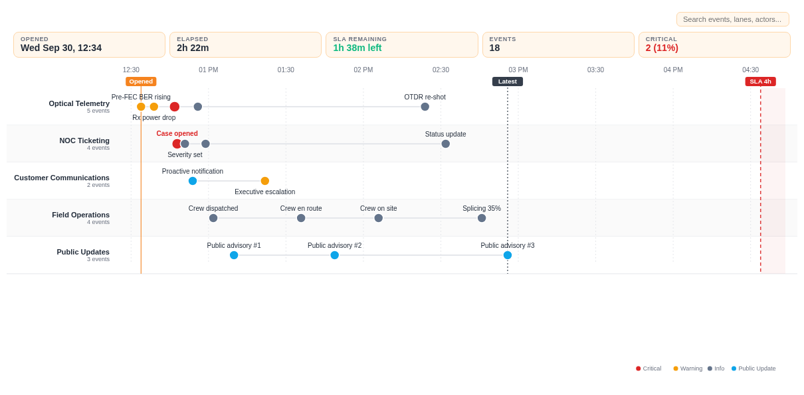

# NOC Incident Timeline

A telecom NOC & SecOps "war room" swimlane timeline for an **outage or security incident case**, fusing events from multiple source systems (NOC ticketing, optical telemetry, field operations, customer communications, public updates) onto one hour/minute-granularity axis.



## What it shows

- **Lanes (y)** = source system; **x** = event timestamp (hours / minutes, not days).
- **Markers** colored by severity — Info (slate), Warning (amber), Critical (red, pulsing ring), Resolved (emerald, check mark), Public Update (blue). Events within a lane are joined by a thin lane line.
- **Collision-aware labels** (event type) — All / Critical & Resolved Peaks Only / None.
- **Reference lines & SLA Target Modes** — *Opened* (earliest event), *SLA* (configurable via Fixed SLA Hours, Measure Column, Dataset Mean/Median/P75/P90 Span, or Hidden; red dashed with shaded breach region) and *Latest / Now* (latest event timestamp or browser wall clock).
- **Multi-Density Executive HUD & Live Search** — Full Scorecard or Compact Telemetry Strip tracking opened time, elapsed / time-to-restore, SLA remaining or breach delta, event count, and critical anomaly alert %, paired with live interactive search filtering across events, lanes, and actors.
- **Sorting, Top-N & Rollup** — Sort lanes chronologically, by event volume, by critical severity count, or alphabetically; limit Top-N lanes with automatic `"Other Sources"` rollup and null suppression.
- Hover tooltip with time, elapsed offset, event type, severity, actor, and full description. Click-to-drill when the field carries `drill_fields` links.

Handles 1–500+ events and configurable Top-N lanes, resizes via a debounced `ResizeObserver`, and shows a clean empty state when the query returns no rows.

## Query shape

| Role | Example field | Notes |
|---|---|---|
| Lane | `noc_case_timeline.source_system` | string dimension |
| Time | `noc_case_timeline.event_time_time` | any date/time dimension; `YYYY-MM-DD HH:MM:SS` or ISO strings parse |
| Label | `noc_case_timeline.event_type` | marker label |
| Detail | `noc_case_timeline.description` | tooltip body |
| Actor | `noc_case_timeline.actor` | optional |
| Severity | `noc_case_timeline.severity` | case-insensitive, tolerant matching (`crit`, `warn`, `resolv/restor/clear`, `public/update/notif`, else info) |
| Target Measure | *(optional numeric measure)* | optional SLA duration measure when `targetMode` is `measure` |

Filter the explore to one case (e.g. `noc_case_timeline.case_id = CASE-2026-9901`) and sort by the time field ascending. When field-role options are left on **Auto**, the viz picks the first date/time dimension as the time axis and resolves the other roles by name hints (`source/system`, `type/event`, `desc/detail`, `sever/priority`, `actor/owner`) with positional fallbacks.

## Options (Strict 2-Tab Layout)

### Tab 1: Display
- **Dynamic Field-Role Dropdowns** (populated via `registerOptions`): `laneField`, `timeField`, `labelField`, `detailField`, `severityField`, `actorField`, `targetMeasureField`.
- **SLA & Reference Lines**: `targetMode` (`fixed` | `measure` | `dataset_mean` | `dataset_median` | `percentile_p75` | `percentile_p90` | `none`), `slaTargetHours` (default `4`), `referenceLineLabel`, `nowMode` (`latest_event` | `wall_clock`), `anomalyThresholdPct` (default `25`).
- **Sorting, Top-N & Filtering**: `sortBy` (`chronological` | `count_desc` | `count_asc` | `critical_desc` | `alpha_asc`), `topNLimit` (default `8`), `enableOtherRollup` (default `true`), `suppressZeroNull` (default `true`).
- **HUD, Labels & Chrome**: `hudMode` (`scorecard` | `compact_strip` | `hidden`), `labelDensity` (`all` | `critical` | `none`), `showLegend`, `showSearch`, `customTitle`, `customSubtitle`.

### Tab 2: Style
- **Palettes & Custom Color Pickers**: `colorPalette` (`google_enterprise` | `zayo_orange` | `optical_cobalt` | `modern_slate` | `cyberpunk_dark` | `emerald_finops` | `sunset_media` | `wellverse_healthcare` | `custom_hex`), `customPrimaryColor`, `customCriticalColor`, `customResolvedColor`.
- **Polarity, Typography & Format**: `metricPolarity` (`lower_is_better` | `higher_is_better`), `fontScale` (`0.85` | `1` | `1.2`), `valueFormat` (`auto` | `duration_hm` | `decimal_hours` | `compact_number` | `raw_minutes`), `laneHeight` (default `56`), `markerSize` (default `7`).

## Example dashboard tile

```yaml
- name: incident_timeline
  type: noc_incident_timeline
  model: zayo_network_analytics
  explore: noc_case_war_room
  fields: [noc_case_timeline.event_time_time, noc_case_timeline.source_system, noc_case_timeline.event_type,
           noc_case_timeline.description, noc_case_timeline.actor, noc_case_timeline.severity]
  filters:
    noc_case_timeline.case_id: CASE-2026-9901
  sorts: [noc_case_timeline.event_time_time asc]
  limit: 500
  targetMode: fixed
  slaTargetHours: 4
  nowMode: latest_event
  labelDensity: all
  hudMode: scorecard
  colorPalette: zayo_orange
```
