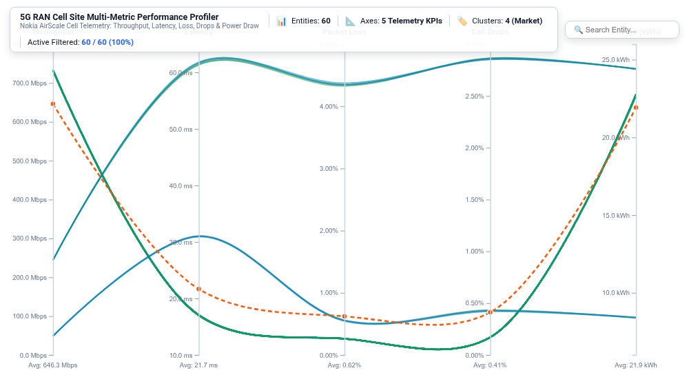

# Parallel Coordinates Multivariate Profiler (`parallel_coordinates_profiler`)

A high-dimensional exploratory data analysis (EDA) and multi-metric profiling visualization solving Looker's long-standing multivariate analysis gap (**Buganizer `b/412891924`** and **`b/384910283`**).

Standard Business Intelligence charts force analysts to compare metrics pairwise (scatter plots) or collapse multidimensional relationships onto radial axes (radar charts). The **Parallel Coordinates Multivariate Profiler** projects $N$-dimensional data entities onto parallel, equispaced vertical axes. Each row of data is rendered as a continuous polyline intersecting every metric axis at its normalized coordinate value—enabling instant visual discovery of multi-metric trade-offs, Pareto frontiers, entity clusters, and operational anomalies.

---

## 💡 Inspiration & Cloud Blockers Solved

- **Buganizer Cloud Blocker `b/412891924`**: *Multivariate Telemetry & Multi-Metric Profiling in Looker*
  > *"Users need a way to compare entities across 4 to 10 numerical measures simultaneously. Scatter plots are limited to 2-3 variables (X, Y, Size), while radar charts suffer from area distortion and axis order bias. A Parallel Coordinates plot allows full multidimensional profiling with interactive axis filtering."*
- **Buganizer `b/384910283`**: *Multi-Axis 1D Brushing and Cross-Filtering for Exploratory Analysis*
- **Internal Reference**: *Telemetry & KPI Trade-Off Analysis in Telecom RAN, Cloud Microservices, and Health Informatics*.

---

## 🚀 Key Features & Capabilities

- **High-Dimensional Multivariate Profiling**:
  - Plots 3 to 10 simultaneous numerical measures as vertical coordinate axes.
  - Renders each entity (e.g., 5G Cell Tower Site, Cloud Microservice, Retail Store, or Gaming Cohort) as an individual polyline across all axes.
- **3 Multi-Modal Curve Topologies**:
  1. `smooth_spline`: Smooth cubic B-spline curves (Catmull-Rom $\alpha=0.5$) that soften angular joints and highlight organic cluster flows.
  2. `straight_line`: Piecewise linear segments delivering mathematical coordinate precision.
  3. `bundle_curves`: Hierarchical centroid-directed edge bundling that draws correlated entity trajectories toward common cluster paths.
- **Interactive Multi-Axis 1D Brushing**:
  - Analysts can drag an interactive selection box along **any vertical axis** (e.g., Throughput $> 700\text{ Mbps}$ AND Latency $< 18\text{ ms}$).
  - Polylines failing the compound criteria are instantly dimmed to $0.04$ opacity, while matching entities remain highlighted.
  - Real-time brush HUD displays the active pass rate (e.g., `Active Filtered: 14 / 60 (23%)`) alongside a 1-click **Clear** button.
- **Benchmark Reference Profile Polyline**:
  - Computes and renders a distinct dashed benchmark trajectory across all metric axes (`Dataset Mean`, `Dataset Median P50`, `Top Quartile P75`, `Top Decile P90`, or `None`).
  - Displays axis-level benchmark values along the lower baseline of each axis.
- **Executive KPI HUD & Search**:
  - Scorecard banner showing total entities, active telemetry metrics, cluster grouping counts, and live brush counters.
  - Interactive search bar to highlight entities by name or cluster category.
- **Native Looker Drill-Down Menus**:
  - Clicking any polyline calls `LookerCharts.Utils.openDrillMenu` to trigger LookML drill paths and external links.
- **Responsive Architecture**:
  - Scalable vector rendering with debounced `ResizeObserver` guarding against infinite resize loops (`<4px` delta check).

---

## 📋 Data Requirements

| Field Role | Requirement | Example (`nokia_network_ops::network_operations`) |
| :--- | :--- | :--- |
| **Entity Dimension** | Primary label identifying each polyline row | `cell_towers.site_name` |
| **Group Dimension** (Optional) | Category or cluster dimension driving color palettes | `cell_towers.market` or `cell_towers.equipment_vendor` |
| **Numeric Measures** | 2 to 10 quantitative measures | `network_kpi_telemetry.avg_throughput_mbps`, `network_kpi_telemetry.avg_latency_ms`, `network_kpi_telemetry.avg_packet_loss_pct`, `network_kpi_telemetry.avg_call_drop_rate`, `network_kpi_telemetry.avg_energy_kwh` |

---

## 🎨 Configuration Options (Strict 2-Tab Schema)

### Section 1: Display
- **Line & Curve Interpolation Mode**: Smooth B-Spline (`smooth_spline`), Straight Segments (`straight_line`), or Bundled Curves (`bundle_curves`).
- **Entity Dimension Override**: Dynamic select dropdown to assign polyline entity label.
- **Group / Category Dimension Override**: Dynamic select dropdown to assign color grouping.
- **Primary Measure Override**: Dynamic select dropdown for primary sort and benchmark anchor.
- **Benchmark Reference Profile Mode**: `dataset_mean`, `dataset_median`, `percentile_p75`, `percentile_p90`, or `none`.
- **Benchmark Reference Profile Label**: Custom label for dashed benchmark polyline.
- **Outlier Anomaly Alert Threshold %**: Tolerance threshold for outlier variance badges.
- **Entity Sorting & Priority**: Primary Metric Descending, Primary Metric Ascending, Alphabetical, or Natural.
- **Top-N Entity Focus Limit**: All Entities, Top 10, Top 20, Top 30, Top 50.
- **Suppress Incomplete Entity Records**: Exclude entities with null or missing measure values.
- **Executive KPI HUD Mode**: Full Scorecard Strip, Compact Metric Pill, or Hidden.
- **Show Real-Time Brush Filter Counter**: Toggle live pass-through counter and reset button.
- **Custom Chart Title / Subtitle Override**: Optional top headline text.

### Section 2: Style
- **Visual Palette Theme**: Google Enterprise, Modern Executive Slate, Cyber NOC Dark, Emerald FinOps, Sunset Media, Wellverse Healthcare, Custom Hex Accent.
- **Custom Primary Accent Hex**: Color picker override for entity lines or highlights.
- **Default Line Opacity**: Slider/number from 0.1 to 1.0 (default 0.45).
- **Normal Line Stroke Width**: Polyline thickness (1 to 5 px).
- **Hover Focus Stroke Width**: Thickness on mouse hover (2 to 8 px).
- **Primary Metric Polarity**: Higher is Better vs Lower is Better.
- **Typography & UI Scale**: Compact, Standard, Large Presentation.
- **Axis & Tooltip Numeric Format**: Auto Detect by Metric Name, Compact Number (1.2M), Compact Currency ($1.2M), Percentage (45.2%), Decimal (1,234.56), Raw.
