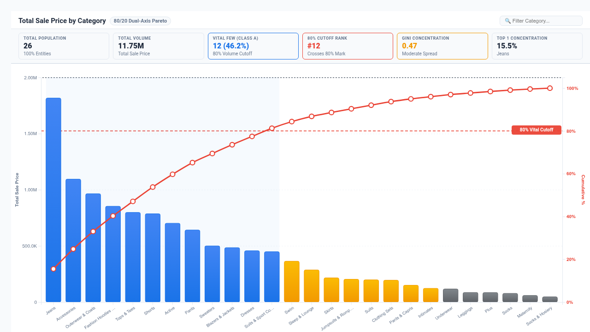

# Pareto 80/20 & ABC Stratification Analyzer Looker Custom Visualization

An enterprise-grade, high-performance Pareto Analysis and ABC Stratification Analyzer built with **D3.js v7** for Looker. Specifically engineered to resolve critical analytical limitations reported in Google-internal Customer Blockers (Buganizer `b/367544487`: *"LookML to support more sophisticated measure out of the box [Cloud Blocker] - Pareto analysis"*) and enterprise customer requirements from **Monzo Bank** (`b/425859046`), **Mango** (`b/530925562`), **Woolworth's** (`b/461541028`), and the **Renault PSO Looker Performance Study**.

---

## 🎯 Executive Problem Solved

Standard business intelligence Cartesian bar charts force users to view raw volume bars in isolation. They cannot:
1. **Model Cumulative Running Distributions Dynamically**: Native Looker Cartesian charts cannot dynamically sort thousands of categories descending by volume and compute running cumulative percentages ($0\%$ to $100\%$) without brittle LookML table calculations or expensive SQL window functions.
2. **Automate 80/20 Pareto Cutoff & ABC Stratification**: Standard charts cannot draw dynamic $80\%$ reference threshold lines or automatically stratify inventory/SKUs/defects into **Class A (Vital Few: 0–80%)**, **Class B (Useful Many: 80–95%)**, and **Class C (Trivial Many: 95–100%)**.
3. **Compute Inequality & Gini Coefficients**: Standard charts cannot plot the empirical Lorenz curve against the theoretical $45^\circ$ line of perfect equality or compute the Gini concentration index live in the executive header.
4. **Scale to 5,000+ High-Density SKUs**: Native charts lag or clutter when ingesting large product catalogs, error logs, or customer cohorts.

---

## ✨ Key Capabilities & Highlights

- **4 Multi-Modal Layout Modes**:
  1. **Classic Pareto & 80/20 Cutoff (`classic_pareto`)**: Dual Y-axis visualization pairing volume bars (Left Y-Axis) with a smooth cumulative percentage ogive curve (Right Y-Axis). Includes a dashed $80\%$ Pareto reference cutoff line with intersection highlights and vital-few background shading.
  2. **ABC Stratification Matrix (`abc_stratification`)**: 3 executive distribution cards segmenting the population into **Class A (Vital Few)**, **Class B (Useful Many)**, and **Class C (Trivial Many)** with item counts, percentage shares, cumulative metric sums, and ranked entity breakdowns.
  3. **Lorenz Inequality Curve & Gini (`lorenz_inequality`)**: Normalized inequality curve plotting Cumulative Share of Population ($X$-Axis) against Cumulative Share of Metric ($Y$-Axis) compared with the $45^\circ$ Line of Perfect Equality, complete with shaded inequality area and live Gini Index calculation.
  4. **Cumulative Stepped Waterfall (`cumulative_waterfall`)**: Stepped waterfall progression showing the incremental additive contribution of each category building towards the $100\%$ total volume.
- **Dynamic Field-Role Mapping via `registerOptions`**:
  - Dynamically re-map Category/Entity, Primary Volume Measure, Comparison Measure, or Grouping Dimensions without modifying LookML.
- **Configurable Benchmark Reference Lines**:
  - Supports customizable Target Benchmark Modes (Fixed Value, Dataset Mean, Dataset Median P50, Top Quartile P75, 90th Percentile P90) alongside the 80% Pareto Cutoff.
- **Flexible Sorting, Rollup & Zero-Suppression**:
  - Interactive sort ordering (`Metric Descending`, `Metric Ascending`, `Alphabetical`, `Natural Query Order`), Top-N limit with automatic tail rollup into "Other", and zero/null suppression.
- **Executive KPI HUD Banner & Density Controls**:
  - 3 HUD density settings: **Full Scorecard (6 KPIs)**, **Compact Strip**, and **Hidden**.
  - 3 Data Label density settings: **All Bars & Points**, **Min/Max Peaks Only**, and **Hidden**.
- **Brand Palettes, Polarity & Formatting**:
  - Supports 7 themes: Google Enterprise, Modern Slate, Cyberpunk Dark, Emerald FinOps, Sunset Media, Wellverse Healthcare, Looker Analytics.
  - Metric Polarity toggle (`Higher is Better` vs `Lower is Better` for defect and cost tracking).
  - Metric Value Formatting (`Auto`, `Compact Number`, `Compact Currency`, `Percentage`, `Decimal 2dp`, `Raw Integer`).
- **High-Density Scalability (5,000+ Rows)**:
  - Ingests high-cardinality datasets with client-side aggregation in $O(N)$ time and debounced `ResizeObserver` with `<4px` jitter protection.
- **Enterprise Looker Integration**:
  - Native Looker Drill-Down Menus via `LookerCharts.Utils.openDrillMenu`.

---

## 📊 Data Shape & Query Requirements

- **Dimension 1 (Category / Entity / SKU)**: e.g. `products.category`, `products.brand`, `orders.customer_id`, `errors.error_code`.
- **Measure 1 (Primary Volume / Revenue / Frequency)**: e.g. `order_items.total_sale_price`, `order_items.order_count`, `defects.count`.
- **Measure 2 (Optional Secondary Comparison)**: e.g. `order_items.order_count`.

---

## ⚙️ Configuration Options

### Display Tab
- **Analysis Layout Mode**: Classic Pareto & 80/20 Cutoff, ABC Stratification Matrix, Lorenz Inequality Curve & Gini, Cumulative Stepped Waterfall.
- **Category / Entity Dimension**: Dynamic dropdown to re-assign the primary dimension.
- **Primary Volume / Frequency Measure**: Dynamic dropdown to re-assign the primary volume measure.
- **Secondary Comparison Measure (Optional)**: Dynamic dropdown for secondary comparison measure.
- **Secondary Grouping Dimension (Optional)**: Dynamic dropdown for optional grouping.
- **Target Benchmark Mode**: None, Fixed Target Value, Dataset Mean Average, Dataset Median (P50), Top Quartile (P75), 90th Percentile (P90).
- **Custom Target / Threshold Value**: Numeric input for target reference line.
- **Reference Line Label Override**: Custom text for benchmark and threshold labels.
- **Class A / Vital Few Cutoff (%)**: Threshold percentage for Class A (default: `80%`).
- **Class B / Useful Many Cutoff (%)**: Threshold percentage for Class B (default: `95%`).
- **Show 80% Pareto Reference Line**: Toggle reference cutoff line on right axis.
- **Show Target / Benchmark Line**: Toggle benchmark reference line on left axis.
- **Item Sorting Order**: Metric Descending, Metric Ascending, Alphabetical, Natural.
- **Max Visible Items (Tail Rolled Up)**: Number of bars to render before rolling tail items into summary group (default: 35).
- **Rollup Tail into 'Other' Group**: Consolidate long-tail entities.
- **Suppress Zero & Null Values**: Clean data from zero-volume noise.
- **Executive KPI HUD Display**: Full Scorecard (6 KPIs), Compact Strip, Hidden.
- **Data Value Labels**: All Bars & Points, Min / Max Peaks Only, Hidden.
- **Chart Title Override / Subtitle Override**: Custom header titles.
- **Show Live Search Filter**: Toggle interactive search bar.
- **Cumulative Curve Smoothing**: Monotone Spline, Linear Polygon, Step After.

### Style Tab
- **Color Theme & Brand Palette**: Google Enterprise, Modern Slate, Cyberpunk Dark, Emerald FinOps, Sunset Media, Wellverse Healthcare, Looker Analytics.
- **Override Class A / B / C Accents**: Custom color pickers for each stratification tier.
- **Override Cumulative Curve Color**: Custom color picker for the ogive curve.
- **Metric Polarity**: Higher is Better vs Lower is Better.
- **Typography Font Scale**: Compact, Standard, Large Presentation.
- **Metric Value Format**: Auto-Detect, Compact Number (1.2M), Compact Currency ($1.2M), Percentage (45.2%), Decimal (2dp), Raw Integer.
- **Bar Spacing Ratio**: Adjust bar thickness and gap padding.
- **Typography Font Family**: Clean font styling.
