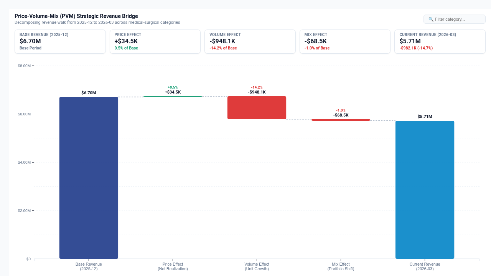

# Price-Volume-Mix (PVM) Revenue Bridge Waterfall



An executive **Price-Volume-Mix (PVM) Revenue Bridge Waterfall** custom visualization for Google Cloud Looker, engineered with **D3.js v7**.

Designed for **Strategic Finance & CFO Offices** (quarterly revenue walks, gross margin bridges, budget-to-actual variance), **Commercial Pricing & Revenue Management** (price realization, inflation pass-through, discount erosion), **Medical-Surgical & Healthcare Supply Chain** (category spend, volume shifts, procedure mix), and **Retail & Consumer Goods** (pack-size mix, category elasticity, portfolio cannibalization).

Standard business intelligence tools often reduce revenue variance to a single flat delta or simple bar chart. This obscures whether revenue growth was powered by genuine pricing power, overall market volume expansion, or an enrichment of higher-margin product mix.

This custom visualization delivers a multi-modal, boardroom-grade financial walk suite capable of handling 5,000+ detailed order lines with client-side O(N) PVM decomposition, interactive filtering, dynamic column role mapping, and native Looker drill-downs.

---

## 📸 Key Features

- **Multi-Modal Display Modes**:
  - `PVM Revenue Bridge Waterfall (Executive Walk)` (Default): Classic financial bridge waterfall decomposing total revenue delta from Base Period to Current Period into distinct Price Effect, Volume Growth Effect, Mix Shift Effect, and Net Delta. Features stepped dashed connector lines, variance badges, and zero baseline.
  - `Category PVM Decomposition (Grouped Contribution)`: Horizontal diverging bar breakdown showing individual Price, Volume, and Mix contributions for every product category or business unit.
  - `Mix & Price Elasticity Matrix (Quadrant Bubble)`: Strategic quadrant bubble chart plotting Price Change % (X) vs Volume Change % (Y) with bubble size proportional to Current Revenue, categorizing products into Strategic Elasticity quadrants.
  - `Sequential Variance Waterfall (Step-by-Step Walk)`: Step-by-step sequential waterfall walking from Base Revenue to Current Revenue category-by-category.
- **Executive Bridge Scorecard HUD**:
  - Real-time floating scorecard showing Base Revenue, Price Effect $, Volume Effect $, Mix Effect $, and Current Period Total Revenue with percentage contribution indicators.
  - Includes interactive category search and filter bar.
- **Dynamic Field-Role Mapping**:
  - Dynamically binds Category Dimension, Period/Date Dimension, Revenue/Spend Measure, and Volume/Units Measure via dropdown selectors without reordering Looker Explore queries.
- **Enterprise Design & Themes**:
  - `Wellverse Healthcare` (Deep navy, cerulean, and emerald med-surg palette)
  - `Google Enterprise` (Clean corporate blue, green, and coral)
  - `Executive Slate` (Charcoal, emerald, and ruby)
  - `Modern Slate` (Indigo and rose)
  - `Cyberpunk Dark` (Midnight background with neon cyan and pink accents)
  - `Emerald FinOps` (Forest green and mint)
  - `Sunset Media` (Warm amber and terracotta)
  - `Custom Hex Override` (Full custom hex control)
- **High-Performance Architecture**:
  - Debounced `ResizeObserver` (<4px guard, zero layout thrashing).
  - Client-side mathematical decomposition with O(N) complexity for 5,000+ rows.
  - Native Looker drill-down menu integration (`LookerCharts.Utils.openDrillMenu`).

---

## 📊 Data Shape Requirements

| Field Type | Required Count | Purpose | Example (`wellverse_mba::order_lines`) |
| :--- | :--- | :--- | :--- |
| **Dimension 1** | `1` *(Required)* | Category / Business Unit / SKU Dimension | `medical_products.category` |
| **Dimension 2** | `0 to 1` *(Recommended)* | Period / Month / Year Dimension | `order_lines.order_month` |
| **Measure 1** | `1` *(Required)* | Revenue / Total Spend Measure | `order_lines.total_spend` |
| **Measure 2** | `0 to 1` *(Recommended)* | Volume / Units Ordered Measure | `order_lines.units_ordered` |

---

## ⚙️ Configuration Options

Organized into **2 clean tabs** (`Display` and `Style`):

### Display Tab
| Option | Type | Default | Description |
| :--- | :--- | :--- | :--- |
| `layoutMode` | Select | `PVM Revenue Bridge Waterfall` | `pvm_waterfall`, `category_breakdown`, `mix_elasticity`, `variance_waterfall` |
| `categoryFieldOverride` | Select | Auto | Dynamic field mapping for Product Category / Entity |
| `periodFieldOverride` | Select | Auto | Dynamic field mapping for Period / Month / Date |
| `revenueMeasureOverride` | Select | Auto | Dynamic field mapping for Revenue / Spend Measure |
| `volumeMeasureOverride` | Select | Auto | Dynamic field mapping for Volume / Units Measure |
| `basePeriodOverride` | String | `""` | Base period selection override (default: earliest period) |
| `currentPeriodOverride` | String | `""` | Current period selection override (default: latest period) |
| `showConnectorLines` | Boolean | `true` | Show waterfall stepped connector lines |
| `showVarianceBadges` | Boolean | `true` | Show delta $ and % variance badges above bars |
| `targetCalculationMode` | Select | `None` | `none`, `dataset_mean`, `dataset_median`, `percentile_p90`, `fixed` |
| `fixedTargetValue` | Number | `0` | Fixed benchmark target value |
| `referenceLineLabel` | String | `Revenue Target` | Label for benchmark target line |
| `sortBy` | Select | `Net Impact Descending` | `impact_desc`, `impact_asc`, `revenue_desc`, `alpha` |
| `topNLimit` | Number | `8` | Top-N categories limit (remainder rolled to 'Other') |
| `suppressZeroNull` | Boolean | `true` | Suppress zero/null revenue categories |
| `hudMode` | Select | `Full Scorecard HUD` | `scorecard`, `compact_strip`, `none` |
| `showDataLabels` | Select | `All Bar Values Visible` | `all`, `peaks_only`, `off` |
| `customTitle` | String | `""` | Custom chart title override |
| `customSubtitle` | String | `""` | Custom subtitle override |
| `showSearch` | Boolean | `true` | Show category search and filter bar |

### Style Tab
| Option | Type | Default | Description |
| :--- | :--- | :--- | :--- |
| `colorTheme` | Select | `Wellverse Healthcare` | `wellverse_healthcare`, `google_enterprise`, `executive_slate`, `modern_slate`, `cyberpunk_dark`, `emerald_finops`, `sunset_media`, `custom` |
| `customPrimaryColor` | Color | `""` | Custom primary total bars hex color |
| `customPositiveColor` | Color | `""` | Custom positive gain hex color |
| `customNegativeColor` | Color | `""` | Custom negative contraction hex color |
| `metricPolarity` | Select | `Higher is Better` | `higher_better`, `lower_better` |
| `fontScale` | Select | `Standard (Balanced)` | `compact` (85%), `standard` (100%), `large` (125%) |
| `valueFormat` | Select | `Compact Currency` | `auto`, `compact_currency`, `full_currency`, `compact_number`, `percentage`, `decimal_2`, `raw` |
| `barPadding` | Number | `0.3` | Bar spacing padding ratio (0.1 to 0.6) |

---

## 🚀 LookML Manifest Snippet

```lookml
visualization: {
  id: "pvm_revenue_bridge"
  label: "Price-Volume-Mix (PVM) Revenue Bridge Waterfall"
  file: "visualizations/pvm_revenue_bridge/pvm_revenue_bridge.js"
  dependencies: ["https://d3js.org/d3.v7.min.js"]
}
```
