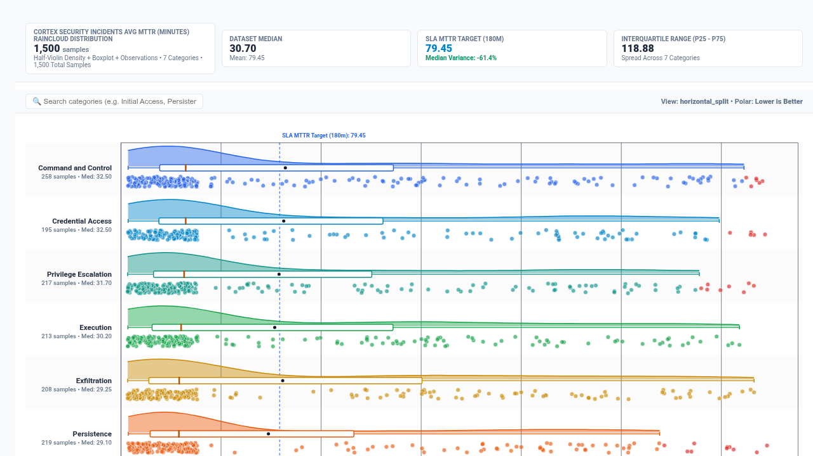

# Raincloud Plot (Half-Violin KDE + Boxplot + Jittered Beeswarm)



An executive **Raincloud Plot** custom visualization for Google Cloud Looker, engineered with **D3.js v7**.

In modern statistical analysis, data science, and operational telemetry (such as SecOps incident MTTR by MITRE ATT&CK tactic, 5G RAN cell tower latency, e-commerce price elasticities, and bio-pharma response distributions), standard summary charts hide vital signals:
- **Bar charts** conceal variance and outliers entirely.
- **Boxplots** hide multimodal distributions (e.g. bimodal clusters caused by automated vs manual workflows).
- **Violin plots** obscure sample size, raw observation density, and exact percentiles.

The **Raincloud Plot** (Allen et al., 2019) overcomes all of these flaws by cleanly integrating three complementary statistical visual layers into a single cohesive layout:
1. **The Cloud**: A smooth **Half-Violin Kernel Density Estimation (KDE)** curve displaying the continuous probability distribution function (PDF).
2. **The Umbrella**: A compact, aligned **Boxplot** displaying the median, interquartile range (IQR, 25th to 75th percentiles), and whiskers (1.5× IQR).
3. **The Rain**: Individual **Jittered Observation Dots** (beeswarm / strip) showing raw sample counts, actual data density, and statistical outliers with full Looker drill-down menu support.

---

## 📸 Key Features

- **Multi-Modal Display Modes**:
  - `Horizontal Raincloud` (Default): Categories stacked along the Y-axis with density clouds pointing upward, aligned boxplots, and jittered rain dots below.
  - `Vertical Columns`: Categories aligned along the X-axis with density clouds on the left, vertical boxplots, and rain dots cascading on the right.
  - `Cloud + Boxplot Only`: High-density executive distribution mode suppressing individual dots for 10,000+ observation datasets.
  - `Jittered Beeswarm Strip with Mean/IQR Overlay`: High-visibility point strip focusing on individual observations with mean and IQR crossbars.
- **Dynamic Field-Role Mapping**:
  - Re-map query columns driving Category, Observation ID, Metric Measure, and Point Size via 1-based index or column name overrides without reordering Looker Explores.
- **KDE Smoothing Bandwidth Selection**:
  - Choose between `Silverman Rule-of-Thumb` (balanced), `Scott Rule`, `Smooth` (wide bandwidth), or `Fine` (high detail) kernel density smoothing.
- **Robust Tukey Fences & Axis Zoom**:
  - Default Tukey fence zoom (+1.5× IQR) prevents extreme outliers from compressing the bulk distribution into hairlines, while flagging outliers with high-visibility alert markers.
- **Deterministic Hash Jitter**:
  - Point positions use deterministic string hashes of observation IDs so dots never jump or flicker when resizing windows or hovering.
- **Executive HUD & Benchmark Target Overlays**:
  - Switchable Executive Scorecard HUD (`Full Scorecard`, `Compact Strip`, or `Hidden`) showing total observations, dataset median, mean, IQR, and variance vs benchmark target.
  - Benchmark reference line overlay across all categories.
- **8 Curated Brand Palettes & Custom Hex Overrides**:
  - Choose from Google Enterprise Blue, Executive Indigo, Modern Slate, Cyberpunk Dark, Emerald FinOps, Sunset Media, Wellverse Healthcare, or Custom Hex Override.
  - Metric polarity toggle (`Lower is Better` for MTTR/latency/cost vs `Higher is Better`).
- **Interactive Tooltips & Native Looker Drills**:
  - Rich hover tooltips displaying Observation ID, Category, Metric value, Category Median, and Outlier flags.
  - Clicking any rain dot triggers Looker's native drill-down menu (`LookerCharts.Utils.openDrillMenu`).

---

## 📊 Data Shape Requirements

| Field Type | Required Count | Purpose | Example (`palo_alto_networks_security::cortex_security_incidents`) |
| :--- | :--- | :--- | :--- |
| **Dimension 1** | `1` *(Required)* | Category / Grouping Dimension | `cortex_security_incidents.mitre_tactic` |
| **Dimension 2** | `1` *(Required)* | Observation ID Dimension | `cortex_security_incidents.incident_id` |
| **Measure 1** | `1` *(Required)* | Continuous Numeric Metric Measure | `cortex_security_incidents.avg_mttr_minutes` |
| **Measure 2** | `0 to 1` *(Optional)* | Point Size Measure | `cortex_security_incidents.alert_count` |

---

## ⚙️ Configuration Options

Configuration options are strictly organized into **2 clean tabs** (`Display` and `Style`) to keep Looker's Edit Viz modal neat and uncluttered:

### Display Tab
| Option | Type | Default | Description |
| :--- | :--- | :--- | :--- |
| `viewMode` | Select | `Horizontal Raincloud` | `horizontal_split`, `vertical_columns`, `cloud_boxplot`, `rain_strip` |
| `categoryDimOverride` | String | `1` | 1-based index or field name override for Category Dimension |
| `observationDimOverride` | String | `2` | 1-based index or field name override for Observation ID Dimension |
| `metricMeasureOverride` | String | `1` | 1-based index or field name override for Continuous Metric Measure |
| `sizeMeasureOverride` | String | `""` | 1-based index or field name override for Point Size Measure |
| `targetCalculationMode` | Select | `Dataset Mean` | `dataset_mean`, `dataset_median`, `fixed`, `percentile_p75`, `percentile_p90`, `measure_column` |
| `fixedTargetValue` | Number | `0` | Fixed benchmark target value when mode is Fixed |
| `referenceLineLabel` | String | `Benchmark Target` | Label for benchmark reference line |
| `bandwidthMode` | Select | `Silverman Rule-of-Thumb` | `silverman`, `scott`, `smooth`, `fine` |
| `jitterAmount` | Select | `Standard Jitter` | `standard`, `compact`, `wide` |
| `pointRadius` | Range | `3.5` | Radius of individual rain dots in pixels (2-8) |
| `pointOpacity` | Range | `0.65` | Opacity of rain dots (0.1 - 1.0) |
| `outlierThreshold` | Select | `Tukey Fences (+1.5 IQR)` | `tukey_fence`, `p99`, `full_domain` |
| `sortBy` | Select | `Median (Descending)` | `median_desc`, `median_asc`, `iqr_desc`, `count_desc`, `alphabetical`, `natural` |
| `topNLimit` | Number | `0` | Limit categories to Top-N (0 = All) |
| `rollupOther` | Boolean | `false` | Rollup unselected categories into 'Other' |
| `suppressZeroNull` | Boolean | `true` | Suppress zero/null observations |
| `hudMode` | Select | `Full Scorecard` | `scorecard`, `compact_strip`, `hidden` |
| `showValueLabels` | Select | `Show All` | `all`, `median_only`, `hidden` |
| `showSearch` | Boolean | `true` | Show interactive category search bar |
| `customTitleOverride` | String | `""` | Custom chart title override |
| `customSubtitleOverride` | String | `""` | Custom chart subtitle override |

### Style Tab
| Option | Type | Default | Description |
| :--- | :--- | :--- | :--- |
| `colorPalette` | Select | `Google Enterprise Blue` | `google_enterprise`, `indigo_violet`, `modern_slate`, `cyberpunk_neon`, `emerald_teal`, `sunset_media`, `wellverse_healthcare`, `custom_override` |
| `customPrimaryHex` | Color | `""` | Custom primary brand hex code |
| `customPositiveHex` | Color | `""` | Custom positive / benchmark hex code |
| `customNegativeHex` | Color | `""` | Custom outlier / anomaly hex code |
| `metricPolarity` | Select | `Lower is Better` | `lower_is_better`, `higher_is_better` |
| `cloudFillOpacity` | Range | `0.45` | Fill opacity of the density cloud (0.1 - 0.8) |
| `boxplotColorMode` | Select | `Match Category Brand Color` | `match_category`, `slate_monochrome`, `high_contrast` |
| `fontScale` | Select | `Standard` | `compact`, `standard`, `large` |
| `valueFormat` | Select | `Auto` | `auto`, `compact_number`, `compact_currency`, `percentage`, `decimal_2`, `raw` |

---

## 🚀 LookML Manifest Snippet

```lookml
visualization: {
  id: "raincloud_plot"
  label: "Raincloud Plot (Half-Violin KDE + Boxplot + Jittered Beeswarm)"
  file: "visualizations/raincloud_plot.js"
  dependencies: ["https://d3js.org/d3.v7.min.js"]
}
```
