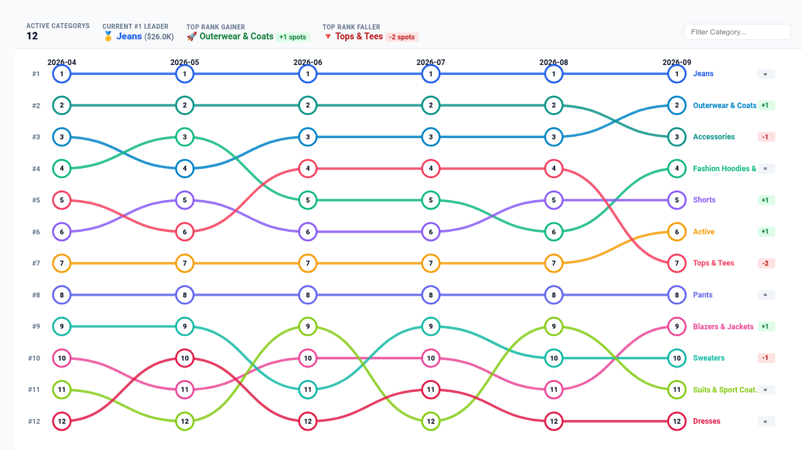

# Rank Bump & Trajectory Chart Looker Custom Visualization

An executive multi-mode **Rank Bump & Trajectory Chart** built with **D3.js v7** for Looker. Designed for executive rank volatility analysis, market share shifts, competitive telemetry, customer segment ranking, and sports/gaming leaderboards over time.

---

## Key Features

- **Multi-Mode Functional Adaptability**:
  - `bump`: Classic smooth cubic Bézier rank bump curves with inverted rank axis (#1 at top).
  - `slope`: Two-period comparative slopegraph highlighting net gainers and fallers.
  - `parallel_coords`: Normalized coordinate trajectories across discrete multi-stage dimensions.
  - `stream`: Flow-volume area streams with rank ordering.
- **Interpolation Controls**:
  - Supports `bumpX` (smooth cubic Bézier), `natural` (smooth natural spline), `monotoneX` (monotone cubic), and `linear` (direct angular connections).
- **Dynamic Field-Role Dropdowns (`Display`)**:
  - Configurable dropdowns dynamically populated from query dimensions and measures via Looker's `registerOptions` trigger. Users select Entity Dimension, Pivot/Period Dimension, Primary Ranking Measure, and Target Measure by name without typing 1-based column indexes.
- **Configurable Reference Lines & Benchmarks (`Display`)**:
  - Support for `dataset_mean`, `dataset_median`, `fixed_value`, `percentile_p75`, `percentile_p90`, or `measure_column` reference baselines.
- **Sorting, Top-N Bucketing & Null Handling (`Display`)**:
  - Sorting by Final Period Rank (`rank_asc`), Metric Descending, Metric Ascending, or Alphabetical; customizable Top-N entity limits; zero/null suppression.
- **Interactive Executive HUD Modes (`Display`)**:
  - `scorecard`: Full top band featuring Active Entities count, #1 Leader, Top Rank Gainer (`+N`), and Top Rank Faller (`-N`).
  - `compact_strip`: Space-efficient inline summary strip for dense dashboard tiles.
  - `hidden`: Clean full-canvas chart mode.
- **Client-Side Quick Filter & Search (`Display`)**:
  - Live search input to highlight specific entities and dim others instantly.
- **Entity Hover & Focus Isolation**:
  - Hovering any curve, node, or legend item isolates that entity's path, bringing it forward with a glowing drop-shadow while dimming background paths.
- **Looker Native Drill-Down Integration**:
  - Clicking any node opens Looker's context drill menu for granular exploration.
- **Brand Palettes, Custom Hexes & Polarity (`Style`)**:
  - Presets: Google Enterprise, Modern Slate, Cyberpunk Dark, Emerald FinOps, Sunset Media, Wellverse Healthcare, Custom Hex Override.
  - Custom Hex Overrides for Primary Leader, Rank Gainer, and Rank Faller colors.
  - Metric Polarity toggle (`Higher is Better` vs `Lower is Better`).
  - Typography Font Scale (`compact`, `standard`, `large`) and Value Format (`auto`, `compact_currency`, `compact_number`, `percentage`, `decimal_2`, `integer`, `raw`).
- **Strict 2-Tab Options Architecture**:
  - Organized strictly into `Display` and `Style` sections to ensure Looker's Edit Viz modal stays clean and uncrowded.

---

## Data Shape & Query Requirements

The visualization supports two flexible data layouts:

### Layout A: Pivoted Time Series (Recommended)
1. **Dimensions**: 1 Categorical Dimension (e.g. `products.category`, `users.state`, `teams.name`).
2. **Pivots**: 1 Temporal or Milestone Dimension (e.g. `order_items.created_month`, `tournaments.stage`).
3. **Measures**: 1 Numeric Measure (e.g. `order_items.total_sale_price`, `orders.count`).

### Layout B: Multi-Measure / Direct Dimensions
1. **Dimensions**: 1 Entity Dimension (e.g. `products.category`).
2. **Measures**: 2 to 12 Numeric Measures representing chronological periods (e.g. `q1_sales`, `q2_sales`, `q3_sales`).

---

## Configuration Options

### Display Tab
- **Visualization Layout Mode**: Bump Chart (`bump`), Slopegraph (`slope`), Parallel Coordinates (`parallel_coords`), Streamgraph (`stream`).
- **Entity Dimension Override**: Dropdown to map query dimensions.
- **Pivot / Period Dimension Override**: Dropdown to map time period or pivot.
- **Primary Ranking Measure Override**: Dropdown to select ranking metric.
- **Target Measure Override**: Optional secondary target measure.
- **Reference Line / Target Mode**: `dataset_mean`, `dataset_median`, `fixed_value`, `percentile_p75`, `percentile_p90`, `measure_column`, `none`.
- **Curve Interpolation**: `bumpX` (Bézier), `natural`, `monotoneX`, `linear`.
- **Entity Sorting & Ordering**: `rank_asc`, `metric_desc`, `metric_asc`, `alphabetical`, `natural`.
- **Display Entity Limit**: Top 5, 8, 10, 12, 15, 20, or All.
- **Group Remaining into 'Other'**: Rollup toggle.
- **Suppress Zero / Null Value Entities**: Clean zero filtering.
- **Executive KPI HUD Mode**: `scorecard`, `compact_strip`, `hidden`.
- **Data Value Labels**: `all`, `peaks_only`, `hidden`.
- **Line Width & Node Radius**: Stroke thickness and marker sizes.
- **Show Node Rank Numbers**: Displays #1, #2 inside node markers.
- **Show Net Rank Shift Delta Badges**: Badges for rank momentum (`+2`, `-1`, `=`).
- **Interactive Search Filter**: Dynamic text search bar.

### Style Tab
- **Brand Palette Preset**: Google Enterprise, Modern Slate, Cyberpunk Dark, Emerald FinOps, Sunset Media, Wellverse Healthcare, Custom Hex Override.
- **Custom Primary Leader Hex**: Direct hex override.
- **Custom Positive Rank Gainer Hex**: Color picker for rank gains.
- **Custom Negative Rank Faller Hex**: Color picker for rank losses.
- **Metric Polarity**: Higher is Better vs Lower is Better.
- **Typography Font Scale**: Compact, Standard, Large.
- **Metric Value Format**: Auto, Compact Currency, Compact Number, Percentage, Decimal, Integer, Raw.
- **Show Vertical Gridlines**: Period column dividers.
- **Show Rank Numbers Axis**: Left-hand rank axis (#1, #2, ...).
- **Enable Smooth Transition Drawing**: SVG path animations.

---

## Demo Query Configuration

Run with the preconfigured Explore query:
- **Model**: `thelook`
- **Explore**: `order_items`
- **Fields**: `products.category`, `order_items.created_month`, `order_items.total_sale_price`
- **Pivots**: `order_items.created_month`
- **Filters**: `order_items.created_date`: `6 months`
- **Sorts**: `order_items.created_month asc`, `order_items.total_sale_price desc`
