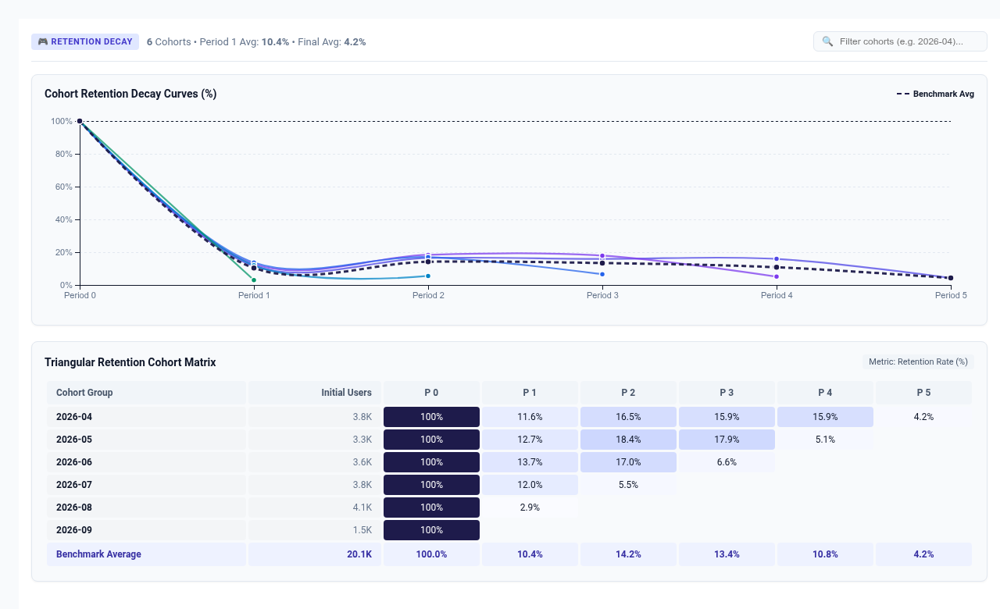

# Player & Customer Retention Cohort Decay




An executive **Player & Customer Retention Cohort Decay** custom visualization for Google Cloud Looker, engineered with **D3.js v7**.

Retention cohort decay analysis is the fundamental heartbeat metric for gaming studios (monitoring D1, D7, D14, and D30 player drop-off), SaaS platforms (tracking annual/monthly subscriber retention), and e-commerce brands (measuring repeat purchase velocity). Native Looker tables cannot render a triangular cohort retention matrix with dynamic Period 0 baseline indexing (100%), multi-cohort decay curves, and benchmark outperformance variance—requiring complex table calculations and rigid pivot structures.

This visualization combines an interactive **Triangular Retention Heatmap Matrix** with **Multi-Cohort D3 Decay Curves** into a unified, multi-mode executive view.

---

## 📸 Key Features

- **Multi-Modal Display Modes**:
  - `Dual Synchronized Split View` (Default): Side-by-side / top-and-bottom synchronized view pairing the dynamic Bézier decay curves with the triangular heatmap matrix. Hovering highlights the active cohort across both representations simultaneously.
  - `Triangular Heatmap Matrix`: Classic cohort retention matrix with quantile color shading, cohort signup row labels, initial cohort volume badges, and a pinned bottom **Benchmark Average** row.
  - `Multi-Cohort Decay Curves`: Pure SVG line chart with smooth Catmull-Rom spline curves plotting each cohort's retention decay trajectory over time, contrasted against a prominent dashed benchmark average curve.
  - `Cumulative Churn & Retention Stack`: Stacked area visualization displaying the proportional decay between retained active users and churned users across lifecycle offsets.
- **Dynamic Period 0 Baseline Normalization**:
  - Automatically indexes Period 0 (Signup/Install) to 100% and computes relative retention rates (`count[t] / count[0] * 100%`) on the fly, eliminating the need for complex Looker table calculations.
  - Supports toggling between Retention Rate (%), Raw Volume / User Count, and Delta vs Benchmark (±% outperformance).
- **Expanded Row Limit Scalability (5,000+ Rows)**:
  - Client-side rollup engine aggregates high-density transactional or user event data without layout thrashing or browser DOM lag.
- **Automatic Lifecycle Offset Detection**:
  - Automatically calculates period offsets whether dimension 2 is an activity date (`month_diff` / `day_diff`), an integer lifecycle offset (`0, 1, 2...`), or a pivoted period.
- **Interactive Quick-Search Filtering**:
  - Real-time client-side search input allows instant filtering of specific cohorts (e.g. searching "2026-04" or "Q2").
- **Flexible Cohort Sorting**:
  - Sort cohorts Chronologically (Oldest to Newest), Reverse Chronological (Newest to Oldest), or by Cohort Size (Largest First).
- **Glassmorphism Interactive Tooltips**:
  - Contextual hover cards showing Cohort Group, Lifecycle Period, Retention Rate (%), Retained Users vs Initial Size, and variance vs All Cohorts Benchmark.
- **Native Looker Drill-Downs**:
  - Clicking any matrix cell or curve point invokes Looker's native contextual drill overlay (`looker.drill(...)`).
- **5 Curated Color Themes**:
  - `Executive Indigo` (Default executive SaaS palette with indigo-to-violet gradients)
  - `Cyberpunk Neon (Dark Mode)` (Vibrant gaming telemetry palette with neon cyan, magenta, and deep dark background)
  - `Emerald Growth` (Mint and deep emerald green scale for positive retention)
  - `Thermal Flame` (Vibrant warm yellow-to-red thermal scale)
  - `Minimal Slate` (Clean corporate grayscale with blue accents)

---

## 📊 Data Shape Requirements

Supports multiple flexible query structures:

### Option A: Unpivoted Two-Dimension Query (Recommended)
| Field Type | Required Count | Purpose | Example (`order_items`) |
| :--- | :--- | :--- | :--- |
| **Dimension 1** | `1` *(Required)* | Cohort Group (Signup Date / Month / Week) | `users.created_month` |
| **Dimension 2** | `1` *(Required)* | Activity Date or Period Offset (`0, 1, 2...`) | `order_items.created_month` |
| **Measure** | `1` *(Required)* | Active Users / Orders / Revenue | `order_items.order_count` |

### Option B: Pivoted Matrix Query
| Field Type | Required Count | Purpose | Example (`order_items`) |
| :--- | :--- | :--- | :--- |
| **Dimension** | `1` *(Required)* | Cohort Group | `users.created_month` |
| **Pivot** | `1` *(Required)* | Period Offset or Activity Month | `order_items.created_month` |
| **Measure** | `1` *(Required)* | Retention Metric | `order_items.order_count` |

---

## ⚙️ Configuration Options

Configuration options are strictly organized into **2 clean tabs** (`Display` and `Style`) to prevent Looker's Edit Viz modal header tabs from crowding:

### Display Tab
| Option | Type | Default | Description |
| :--- | :--- | :--- | :--- |
| `viewMode` | Select | `Dual Synchronized Split View` | `split_view`, `heatmap`, `decay_curves`, `churn_waterfall` |
| `cohortDimOverride` | String | `1` | Primary Cohort Dimension index (1 = Col 1) or field name override |
| `periodDimOverride` | String | `2` | Activity Period Dimension index (2 = Col 2) or field name override |
| `measureOverride` | String | `1` | Primary Metric Measure index (1 = Measure 1) or field name override |
| `targetMeasureOverride` | String | `""` | Optional Target/Benchmark Measure index or field name override |
| `valueDisplay` | Select | `Retention Rate (%)` | `retention_pct`, `raw_count`, `delta_benchmark` |
| `periodZeroHandling` | Select | `Index Period 0 to 100%` | `index_100`, `hide_zero`, `as_is` |
| `targetCalculationMode` | Select | `Dataset Mean` | Benchmark calculation: `dataset_mean`, `dataset_median`, `fixed`, `percentile_p75`, `percentile_p90`, `measure_column` |
| `fixedTargetValue` | Number | `0` | Fixed Benchmark Target % (when Fixed mode selected) |
| `referenceLineLabel` | String | `Benchmark Average` | Reference benchmark line and matrix row label |
| `anomalyThresholdPct` | Number | `20` | Drop-off anomaly alert threshold (%) |
| `sortBy` | Select | `Chronological (Oldest first)` | Cohort sorting: `asc`, `desc`, `size_desc`, `variance_desc` |
| `topNLimit` | Number | `0` | Top-N cohorts display limit (0 = all) |
| `suppressZeroNull` | Boolean | `true` | Suppress zero or null data cells from rendering |
| `hudMode` | Select | `Full Scorecard HUD` | Executive KPI HUD: `scorecard`, `compact_strip`, `hidden` |
| `showValueLabels` | Select | `Show All Labels` | Label density: `all`, `peaks_only`, `hidden` |
| `showBenchmark` | Boolean | `true` | Display Benchmark Average row and dashed curve overlay |
| `showSearch` | Boolean | `true` | Enable top cohort interactive quick-search filter input |
| `customTitleOverride` | String | `""` | Executive scorecard title override |
| `customSubtitleOverride` | String | `""` | Executive scorecard subtitle override |

### Style Tab
| Option | Type | Default | Description |
| :--- | :--- | :--- | :--- |
| `colorTheme` | Select | `Executive Indigo` | Palette preset: `google_enterprise`, `indigo_violet`, `modern_slate`, `cyberpunk_neon`, `emerald_teal`, `sunset_media`, `wellverse_healthcare`, `custom_override` |
| `customPrimaryHex` | Color | `""` | Custom primary brand color override |
| `customPositiveHex` | Color | `""` | Custom positive / retained status color override |
| `customNegativeHex` | Color | `""` | Custom churn / deficit status color override |
| `metricPolarity` | Select | `Higher is Better` | Polarity: `higher_is_better` vs `lower_is_better` |
| `curveSmoothing` | Select | `Smooth Catmull-Rom` | Curve interpolation: `catmull_rom`, `monotone`, `linear` |
| `cellRadius` | Number | `4` | Heatmap cell border radius in pixels |
| `fontScale` | Select | `Standard` | Typography scale: `compact`, `standard`, `large` |
| `valueFormat` | Select | `Auto` | Formatting style: `auto`, `percentage`, `compact_number`, `compact_currency`, `decimal_2`, `raw` |

---

## 🚀 LookML Manifest Snippet

```lookml
visualization: {
  id: "retention_cohort_decay"
  label: "Player & Customer Retention Cohort Decay"
  file: "visualizations/retention_cohort_decay.js"
  dependencies: ["https://d3js.org/d3.v7.min.js"]
}
```

