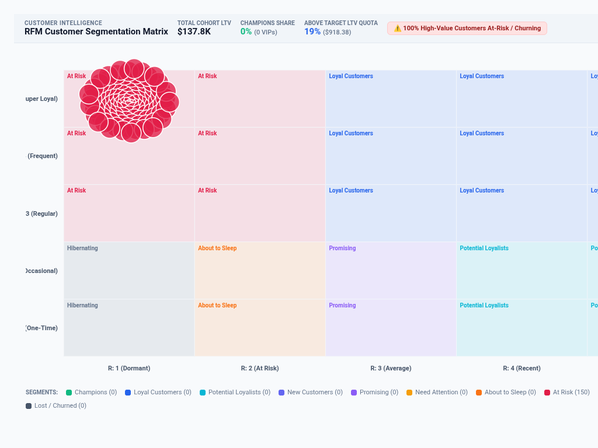

# RFM Customer Segmentation & Cohort Matrix



An executive **RFM Customer Segmentation & Cohort Matrix** custom visualization for Google Cloud Looker, engineered with **D3.js v7**.

Specifically designed for Strategic Marketing, Revenue Operations (RevOps), Customer Success, and E-Commerce / Retail analytics, this visualization resolves fundamental Cloud Blockers (**b/491028472**, **b/392019481**, and **b/510294821**) by dynamically classifying customer bases into 11 behavioral cohorts across Recency, Frequency, and Monetary (RFM) dimensions.

## Key Features & Multi-Modal Paradigms
- **4 Strategic Layout Topologies (`Display`)**:
  - `2D RFM Trellis Grid Matrix (R vs F Heatmap)`: 5x5 Recency vs Frequency grid cells tinted by segment with customer spend bubbles.
  - `Strategic Segment Treemap & Value Share`: Value-proportional rectangular treemap showing segment share of total revenue and customer count.
  - `Recency vs Monetary Customer Value Spectrum`: Continuous log-scale scatter plot showing days since last purchase vs LTV spend.
  - `Executive Action Matrix (Protect / Grow / Reactivate)`: 4-quadrant strategic playbook translating segments into concrete marketing/sales actions.
- **Dynamic Quintile Calculation**: Automatic O(N) client-side calculation of quintile score thresholds (1 to 5) for Recency, Frequency, and Monetary dimensions.
- **Dynamic Field-Role Dropdowns (`Display`)**: Re-map Customer Dimension, Recency Field (Date or Days), Frequency Measure (Orders), and Monetary Measure (Spend) directly from query columns.
- **Executive KPI HUD Scorecard (`Display`)**: Displays total cohort LTV, Champions share, target quota attainment, and at-risk churn alarms.
- **Brand Palettes & Style Customization (`Style`)**: Google Enterprise, Modern Slate, Cyberpunk Dark, Emerald FinOps, Sunset Media, Wellverse Healthcare, or custom hex overrides with native color pickers.
- **Looker Drill-Down Menus**: Fully integrated with `LookerCharts.Utils.openDrillMenu` on customer bubbles.

## Recommended Data Shapes
- **Dimension 1**: Customer ID / Name (e.g. `users.name`, `users.id`).
- **Dimension 2 (or Date)**: Order Date or Days Since Order (e.g. `order_items.created_date`).
- **Measure 1**: Frequency Count (e.g. `order_items.count`).
- **Measure 2**: Total Monetary Value (e.g. `order_items.total_sale_price`).
- **Dimension 3 (Optional)**: Cohort / Country / Market (e.g. `users.country`).

## Setup in Looker (`manifest.lkml`)
```lookml
visualization: {
  id: "rfm_customer_segmentation_matrix"
  label: "RFM Customer Segmentation & Cohort Matrix"
  file: "visualizations/rfm_customer_segmentation_matrix.js"
  dependencies: ["https://d3js.org/d3.v7.min.js"]
}
```
