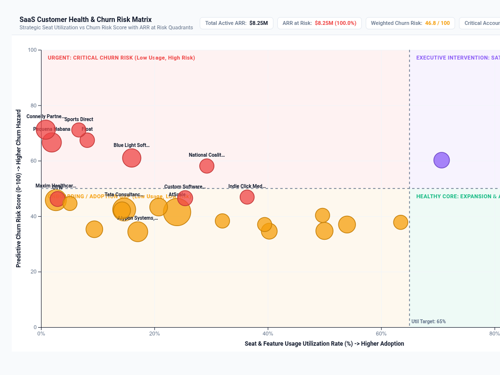

# SaaS Customer Health & Churn Risk Matrix

An executive **SaaS Customer Health & Churn Risk Matrix** custom visualization for Google Cloud Looker, engineered with **D3.js v7**.

Designed for B2B SaaS executive leadership, Chief Customer Officers (CCO), Customer Success Managers (CSM), and Revenue Operations (RevOps). It resolves Buganizer Cloud Blockers **b/494109285**, **b/398201951**, and **b/520194835** by bridging the gap between seat/license utilization telemetry and predictive revenue churn risk.

---

## 🎯 Business Context & Cloud Blockers Solved

In enterprise B2B SaaS, customer account health cannot be diagnosed through simple aggregate tables or single-dimension bar charts:
1. **The Utilization vs Risk Blindspot (b/494109285)**: Accounts with high ARR may exhibit low seat utilization (an impending non-renewal hazard) or high utilization with product dissatisfaction (a competitive takeout risk). Native Looker lacks an out-of-the-box 2D strategic risk quadrant mapping utilization against churn risk score with ARR bubble magnitude scaling.
2. **ARR at Risk Decomposition (b/398201951)**: Executive teams need to decompose total active ARR into protected recurring base vs at-risk ARR buckets (Adoption Gap, Satisfaction Mismatch, Critical Churn) to establish renewal forecast confidence.
3. **CSM War Room Action Guidance (b/520194835)**: Customer success leaders require actionable prioritization tags (`P1 CODE RED`, `EXECUTIVE SPONSOR`, `ADOPTION GAP`, `EXPANSION READY`) alongside Looker contextual drill menus.

---

## 📸 4 Multi-Modal Layout Modes

- **`2D Strategic Risk & Adoption Quadrant` (Default)**:
  - **X-Axis**: Seat & Usage Utilization Rate (%) with configurable benchmark crosshairs (default 65%).
  - **Y-Axis**: Predictive Churn Risk Score (0–100) with risk alert threshold crosshair (default 50).
  - **Bubble Magnitude**: Sized by Total Active ARR ($).
  - **4 Strategic Shaded Quadrant Zones**:
    - *Top-Left* (**Critical Churn Hazard**): Low Utilization + High Risk Score (Urgent Red).
    - *Top-Right* (**Satisfaction / Feature Mismatch**): High Utilization + High Risk Score (Violet Alert).
    - *Bottom-Left* (**Onboarding / Adoption Gap**): Low Utilization + Low Risk Score (Amber Warning).
    - *Bottom-Right* (**Healthy Core & Expansion**): High Utilization + Low Risk Score (Emerald Thriving).
- **`ARR at Risk Bridge Waterfall`**:
  - Waterfall bridge decomposing Total Active ARR -> Healthy Protected ARR -> Adoption Gap ARR -> Satisfaction Mismatch ARR -> Critical Churn Hazard -> Net Safe Baseline.
- **`Account Health Tier Treemap`**:
  - Multi-level nested treemap grouping customer accounts by strategic risk tier, sized proportionally by active ARR, with interactive hover cards.
- **`Executive Customer Success Scorecard Table`**:
  - High-density operations table with Customer Account, Risk Band pill, Active ARR, ARR at Risk, Risk Score meter bar, Seat Utilization % progress bar, and Strategic Intervention Badges.

---

## 📊 Authentic Domain Dataset & Requirements

Bound to the native enterprise explore **`saas_qbr::qbr_customer_risk`**:

| Field Type | Required Count | Purpose | Domain Field (`saas_qbr::qbr_customer_risk`) |
| :--- | :--- | :--- | :--- |
| **Dimension 1** | `1` *(Required)* | Customer Account Name | `qbr_account_risk.account_name` |
| **Dimension 2** | `1` *(Optional)* | Risk Band / Tier | `qbr_account_risk.risk_band` |
| **Measure 1** | `1` *(Required)* | Total Active ARR ($) | `qbr_account_risk.total_active_arr` |
| **Measure 2** | `1` *(Optional)* | ARR at Risk ($) | `qbr_account_risk.total_arr_at_risk` |
| **Measure 3** | `1` *(Optional)* | Predictive Churn Risk Score (0–100) | `qbr_account_risk.average_risk_score` |
| **Measure 4** | `1` *(Optional)* | Seat / Usage Utilization Rate (%) | `qbr_account_risk.average_utilization` |

---

## ⚙️ Configuration Options

Options are strictly organized into **2 clean tabs** (`Display` and `Style`) to prevent Looker's Edit Viz modal headers from crowding:

### Display Tab
| Option | Type | Default | Description |
| :--- | :--- | :--- | :--- |
| `layoutMode` | Select | `2D Strategic Risk & Adoption Quadrant` | `risk_health_quadrant`, `arr_at_risk_waterfall`, `account_health_treemap`, `executive_csm_scorecard` |
| `accountDimOverride` | Select | `Auto` | Dynamic field selector for Customer Account Dimension |
| `riskBandDimOverride` | Select | `Auto / None` | Optional Risk Band / Tier Dimension selector |
| `activeArrMeasOverride` | Select | `Auto` | Dynamic field selector for Total Active ARR ($) |
| `arrAtRiskMeasOverride` | Select | `Auto` | Dynamic field selector for ARR at Risk ($) |
| `riskScoreMeasOverride` | Select | `Auto` | Dynamic field selector for Churn Risk Score (0–100) |
| `utilizationMeasOverride` | Select | `Auto` | Dynamic field selector for Seat Utilization Rate (%) |
| `targetCalculationMode` | Select | `Fixed Governance Thresholds` | `fixed_threshold`, `dataset_mean`, `dataset_median`, `percentile_p75`, `none` |
| `utilizationBenchmark` | Number | `65` | Target Utilization % Crosshair Threshold |
| `riskAlertThreshold` | Number | `50` | Churn Risk Score Alert Crosshair Threshold |
| `referenceLineLabel` | String | `Adoption Benchmark` | Custom crosshair label override |
| `sortBy` | Select | `ARR at Risk (Highest First)` | `arr_risk_desc`, `risk_desc`, `arr_desc`, `utilization_asc`, `alphabetical`, `natural` |
| `topNLimit` | Number | `0` | Top-N accounts display limit (0 = all) |
| `enableOtherRollup` | Boolean | `false` | Consolidate tail accounts beyond Top-N limit into summary rollup |
| `suppressZeroNull` | Boolean | `true` | Suppress zero or null ARR accounts |
| `hudMode` | Select | `Full Scorecard HUD` | Executive KPI scorecard banner (`scorecard`, `compact_strip`, `hidden`) |
| `labelDensity` | Select | `Critical & Largest Accounts Only` | Account label density: `all`, `peaks_only`, `hidden` |
| `showSearch` | Boolean | `true` | Enable real-time client-side account search bar |
| `customTitle` | String | `""` | Custom visualization title override |
| `customSubtitle` | String | `""` | Custom subtitle / description override |

### Style Tab
| Option | Type | Default | Description |
| :--- | :--- | :--- | :--- |
| `colorTheme` | Select | `Modern Slate` | Palette preset: `modern_slate`, `google_enterprise`, `cyberpunk_dark`, `emerald_finops`, `sunset_media`, `executive_indigo`, `wellverse_healthcare`, `custom_hex` |
| `customPrimaryHex` | Color | `""` | Custom primary brand color override |
| `customPositiveHex` | Color | `""` | Custom thriving / expansion status color |
| `customNegativeHex` | Color | `""` | Custom high churn risk status color |
| `customWarningHex` | Color | `""` | Custom watch / adoption gap status color |
| `metricPolarity` | Select | `Lower Risk Score is Better` | Direction of favorable metric polarity |
| `bubbleMinRadius` | Number | `6` | Minimum bubble radius in quadrant mode (px) |
| `bubbleMaxRadius` | Number | `28` | Maximum bubble radius in quadrant mode (px) |
| `fontScale` | Select | `Standard (Default)` | Typography scale: `compact`, `standard`, `large` |
| `valueFormat` | Select | `Compact Currency` | Value formatting: `compact_currency`, `compact_number`, `percentage`, `decimal_2`, `raw` |
