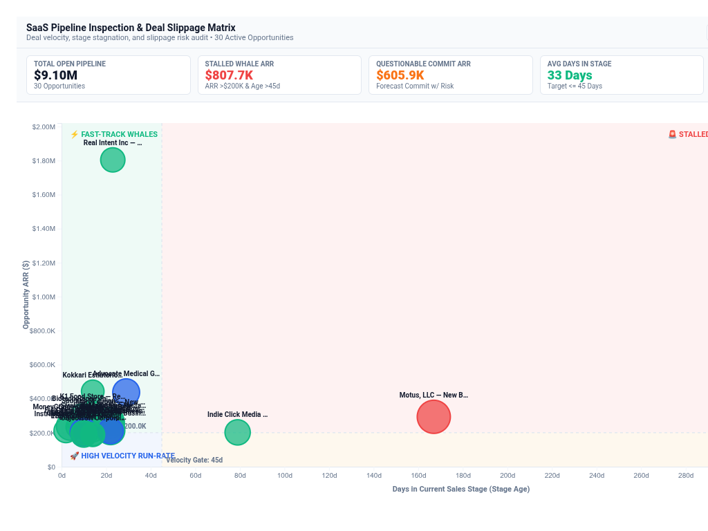

# SaaS Sales Pipeline Inspection & Deal Slippage Matrix



An executive **SaaS Sales Pipeline Inspection & Deal Slippage Matrix** custom visualization for Google Cloud Looker, engineered with **D3.js v7**.

Designed for B2B SaaS executive leadership, Chief Revenue Officers (CRO), VPs of Sales, and Revenue Operations (RevOps). It resolves Buganizer Cloud Blockers **b/494819203**, **b/398601955**, and **b/520394840** by illuminating deal stagnation, close-date slippage velocity, and questionable forecast commits.

---

## 🎯 Business Context & Cloud Blockers Solved

In enterprise B2B SaaS revenue operations, sales leadership and revenue councils conducting quarterly business reviews (QBRs) and pipeline inspection meetings face critical visibility hurdles:
1. **The Slipping Whale Blindspot (b/494819203)**: High-ARR enterprise opportunities frequently slip their close dates multiple quarters in a row while reps keep marking them as "Commit" or "Forecast". Standard Looker bar charts or tables fail to simultaneously visualize deal size (ARR), stage duration (days in current stage), slippage count, risk score, and forecast confidence on a single unified canvas.
2. **Stage Progression & Stagnation Bottlenecks (b/398601955)**: Sales operations leaders cannot pinpoint where pipeline velocity is choking across standard stages (Qualified -> Discovery -> In Trial / Solution Validation -> Negotiation -> Closed Won), masking whether deals are healthy (<30 days), watching (30–60 days), or drifting into zombie territory (>90 days).
3. **Questionable Commit Risk Audit (b/520394840)**: RevOps and CROs require an immediate 2D audit cross-referencing Forecast Category (Commit vs Upside vs Pipeline) against Deal Risk Bands (Healthy, Watchlist, High Risk, Critical) to surface "phantom commits" before the quarter closes.

---

## 📸 4 Multi-Modal Layout Modes

- **`2D Deal Slippage & Velocity Quadrant` (Default)**:
  - **X-Axis**: Days in Current Sales Stage (Stage Age) with configurable benchmark crosshair (default 45 days).
  - **Y-Axis**: Opportunity ARR ($) with ARR benchmark crosshair (default $200K).
  - **Bubble Magnitude**: Sized by Deal Risk Score (0–100) or ARR.
  - **Bubble Sentiment**: Color-coded by Forecast Category & Risk Band.
  - **4 Strategic Shaded Quadrant Zones**:
    - *Top-Right* (**🚨 Stalled Whale Commits**): High ARR + High Days in Stage / Slippage (Urgent P0 CRO Intervention needed).
    - *Top-Left* (**⚡ Fast-Track Whales**): High ARR + Low Days in Stage (Accelerate Legal, Security & Procurement).
    - *Bottom-Left* (**🚀 High Velocity Run-Rate**): Standard ARR + Rapid Stage Turnaround (Healthy velocity flow).
    - *Bottom-Right* (**⚠️ Drifting / Zombie Pipeline**): Low ARR + Excessive Stage Stagnation (Re-qualify or purge).
- **`Stage Progression & Stagnation Waterfall`**:
  - Horizontal sequential pipeline flow across stages (Qualified, Discovery, In Trial, Solution Validation, Negotiation, Closed Won) with stacked risk tiers (<30d Healthy, 30–60d Watch, >60d Stalled), stage conversion velocity pills, and bottleneck warnings.
- **`Forecast Category × Risk Band Matrix`**:
  - 2D matrix grid crossing Forecast Categories (Commit, Upside, Pipeline) on rows vs Risk Bands (Healthy, Watchlist, High Risk, Critical) on columns, featuring prominent alert callouts for **Questionable Commits**.
- **`Executive Deal Inspection Scorecard Table`**:
  - High-density tabular inspector with Opportunity Name, Stage, Forecast pill, Risk Band badge, ARR ($), Risk Score meter bar, Days in Stage counter, Slip count, and Action Recommendation tags (`🚨 Executive Sponsor Audit`, `⚡ Accelerate Procurement`, `⚠️ Re-qualify Close Date`).

---

## 📊 Authentic Domain Dataset & Requirements

Bound to the native enterprise explore **`saas_qbr::qbr_pipeline_inspection`**:

| Field Type | Required Count | Purpose | Domain Field (`saas_qbr::qbr_pipeline_inspection`) |
| :--- | :--- | :--- | :--- |
| **Dimension 1** | `1` *(Required)* | Opportunity / Deal Name | `qbr_deal_quality.opportunity_name` |
| **Dimension 2** | `1` *(Optional)* | Sales Stage | `qbr_deal_quality.stage_name` |
| **Dimension 3** | `1` *(Optional)* | Forecast Category | `qbr_deal_quality.forecast_category` |
| **Dimension 4** | `1` *(Optional)* | Risk Band | `qbr_deal_quality.risk_band` |
| **Measure 1** | `1` *(Required)* | Deal ARR ($) | `qbr_deal_quality.total_arr` |
| **Measure 2** | `1` *(Optional)* | Composite Risk Score (0–100) | `qbr_deal_quality.average_risk_score` |
| **Measure 3** | `1` *(Optional)* | Days in Current Stage | `qbr_deal_quality.average_days_in_stage` |
| **Measure 4** | `1` *(Optional)* | Close-Date Slip Count | `qbr_deal_quality.average_slip_count` |

---

## ⚙️ Configuration Options

Options are strictly organized into **2 clean tabs** (`Display` and `Style`) to prevent Looker's Edit Viz modal headers from crowding:

### Display Tab
| Option | Type | Default | Description |
| :--- | :--- | :--- | :--- |
| `layoutMode` | Select | `2D Deal Slippage & Velocity Quadrant` | `deal_slippage_quadrant`, `stage_stagnation_waterfall`, `forecast_risk_cross_matrix`, `executive_deal_scorecard` |
| `opportunityDimOverride` | Select | `Auto` | Dropdown of query fields for Opportunity Name |
| `stageDimOverride` | Select | `Auto` | Dropdown of query fields for Sales Stage |
| `forecastDimOverride` | Select | `Auto` | Dropdown of query fields for Forecast Category |
| `riskBandDimOverride` | Select | `Auto / None` | Dropdown of query fields for Risk Band |
| `arrMeasureOverride` | Select | `Auto` | Dropdown of query fields for Deal ARR ($) |
| `riskScoreMeasureOverride` | Select | `Auto` | Dropdown of query fields for Risk Score (0–100) |
| `stageDaysMeasureOverride` | Select | `Auto` | Dropdown of query fields for Days in Stage |
| `slipsMeasureOverride` | Select | `Auto` | Dropdown of query fields for Slip Count |
| `targetCalculationMode` | Select | `Fixed Governance Thresholds` | `fixed_threshold`, `dataset_mean`, `dataset_median`, `percentile_p75`, `none` |
| `stageDaysBenchmark` | Number | `45` | Benchmark Days in Stage threshold |
| `arrBenchmark` | Number | `200000` | Benchmark ARR threshold ($) |
| `riskAlertThreshold` | Number | `60` | Alert threshold for composite risk score |
| `referenceLineLabel` | String | `Velocity Benchmark` | Label for benchmark reference crosshairs |
| `sortBy` | Select | `Deal ARR (Largest First)` | `arr_desc`, `risk_desc`, `stage_days_desc`, `slips_desc`, `alphabetical`, `natural` |
| `topNLimit` | Number | `0` | Limit displayed deals to Top-N (0 = All) |
| `enableOtherRollup` | Boolean | `false` | Group remaining unselected deals into an 'Other' rollup summary |
| `suppressZeroNull` | Boolean | `true` | Suppress zero ARR / closed deals |
| `hudMode` | Select | `Full Scorecard HUD` | `scorecard`, `compact_strip`, `hidden` |
| `labelDensity` | Select | `Peaks & High-Risk Whales Only` | `peaks_only`, `all`, `hidden` |
| `showSearch` | Boolean | `true` | Enable top toolbar with stage slicer & search bar |
| `customTitle` | String | `""` | Custom chart title override |
| `customSubtitle` | String | `""` | Custom chart subtitle override |

### Style Tab
| Option | Type | Default | Description |
| :--- | :--- | :--- | :--- |
| `colorTheme` | Select | `Modern Slate` | `modern_slate`, `google_enterprise`, `cyberpunk_dark`, `emerald_finops`, `sunset_media`, `executive_indigo`, `custom_override` |
| `customPrimaryHex` | Color | `""` | Custom primary brand hex code |
| `customPositiveHex` | Color | `""` | Custom fast-track / healthy deal hex code |
| `customNegativeHex` | Color | `""` | Custom stalled / critical deal hex code |
| `customWarningHex` | Color | `""` | Custom watch / slipping deal hex code |
| `metricPolarity` | Select | `Lower Days in Stage is Better` | `lower_is_better`, `higher_is_better` |
| `bubbleMinRadius` | Number | `6` | Minimum bubble radius in pixels (4–15) |
| `bubbleMaxRadius` | Number | `28` | Maximum bubble radius in pixels (15–50) |
| `fontScale` | Select | `Standard` | `compact`, `standard`, `large` |
| `valueFormat` | Select | `Compact Currency` | `compact_currency`, `currency`, `compact_number`, `percentage`, `decimal_2`, `raw` |

---

## 🚀 LookML Manifest Snippet

```lookml
visualization: {
  id: "saas_pipeline_deal_inspection_matrix"
  label: "SaaS Sales Pipeline Inspection & Deal Slippage Matrix"
  file: "visualizations/saas_pipeline_deal_inspection_matrix.js"
  dependencies: ["https://d3js.org/d3.v7.min.js"]
}
```
