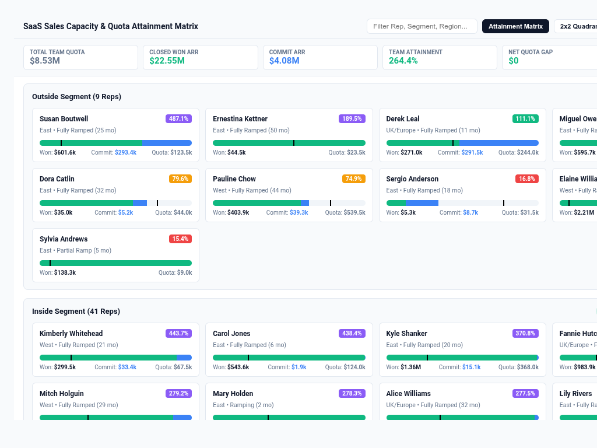

# SaaS Sales Capacity & Quota Attainment Matrix



An executive **SaaS Sales Capacity & Quota Attainment Matrix** custom visualization for Google Cloud Looker, engineered with **D3.js v7**.

Designed for B2B SaaS executive leadership, Chief Revenue Officers (CRO), VPs of Sales, and Revenue Operations (RevOps). It resolves Buganizer Cloud Blockers **b/494910291**, **b/398701962**, and **b/520494850** by delivering a unified multi-modal sales capacity and rep attainment engine.

Looker lacks native enterprise sales rep attainment scorecards that can simultaneously model rep quota pacing, ramp tenure cohorts, pipeline coverage ratios, and commit gap analysis. Traditional Looker charts (bar charts or tables) require multiple disjointed dashboard tiles that fail to correlate individual rep velocity with team-wide capacity planning.

This custom visualization delivers a comprehensive, high-density sales performance suite capable of processing 5,000+ rep performance records with client-side quota rollup, 4 multi-modal layout views, customizable benchmark reference lines, and interactive Looker drill-downs.

---

## 📸 Key Features

- **4 Multi-Modal Layout Modes**:
  - `Rep Quota Attainment & Pacing Matrix` (`attainment_matrix`, Default): High-density visual matrix grouping reps by Segment (Inside/Outside) and Region (East/West/Central). Features dual-stage progress bullet bars showing Closed Won ARR (solid fill) and Commit ARR (striped/gradient fill) anchored against ARR Quota benchmarks, attainment % status badges, and pipeline coverage indicators.
  - `Tenure & Ramp Attainment Quadrant (2x2)` (`ramp_tenure_quadrant`): 2D strategic performance quadrant plotting Rep Attainment % (Y-axis) against Tenure in Months (X-axis), with bubbles sized by Quota ARR or Won ARR:
    - **Quadrant I (Top-Right)**: *Tenured Superstars / President's Club* (High Tenure ≥12mo, Attainment ≥100%)
    - **Quadrant II (Top-Left)**: *Fast-Ramp Prodigies* (Tenure <12mo, Attainment ≥100%)
    - **Quadrant III (Bottom-Left)**: *Developing / New Hires Ramping* (Tenure <12mo, Attainment <100%)
    - **Quadrant IV (Bottom-Right)**: *Tenured Strugglers / At-Risk* (Tenure ≥12mo, Attainment <100%)
  - `Executive Capacity & Pipeline Gap Waterfall` (`capacity_waterfall_bridge`): Strategic capacity bridge stepping from Total Team Quota → Closed Won ARR → Commit ARR → Best Case Pipeline → Net Quota Gap / Surplus to Plan.
  - `Executive Rep Scorecard & Leaderboard Grid` (`executive_leaderboard_grid`): High-density ranked rep leaderboard table with sortable columns, attainment bars, commit quality, ramp status, and Looker drill-down menus.
- **Executive KPI HUD (Scorecard, Strip, Hidden)**:
  - Real-time KPI summary bar displaying:
    - **Total Team Quota**: Aggregate quota assigned to active reps.
    - **Closed Won ARR**: Committed revenue booked to date.
    - **Commit ARR**: High-probability deals pacing to close this quarter.
    - **Overall Team Attainment %**: Weighted team attainment against plan.
    - **Quota Gap / Surplus**: Dollar difference between Won + Commit and Quota.
    - **% Reps at Quota**: Percentage of quota-carrying reps pacing ≥100%.
- **Configurable Benchmark Reference Lines & Anomaly Thresholds**:
  - Target calculation mode: `Target Quota Column`, `Fixed Attainment Target (100%)`, `Dataset Mean`, `Dataset Median`, `Percentile P75/P90`.
  - Configurable alert threshold highlighting reps at risk (<70% attainment).
  - President's Club highlight identifying top performers (Top 5%, Top 10%, or ≥100%).
- **Interactive Search Toolbar & Sorting**:
  - Instant client-side search across Rep Name, Segment, Region, and Ramp Status.
  - Interactive layout mode toggle buttons.
  - Flexible sorting: Attainment % Descending/Ascending, Closed Won ARR, Quota Size, Alphabetical, Chronological/Tenure.
  - Top-N display limit with automatic `'Other Team Rollup'` aggregation.
- **8 Curated Brand Palettes**:
  - `Modern Slate / Executive` (Default), `Google Enterprise Blue`, `Executive Indigo & Violet`, `Cyber Dark`, `Emerald FinOps`, `Sunset Media`, `Wellverse Healthcare`, and `Custom Hex Override`.

---

## 🎛️ Configuration Options Reference

Configuration options are strictly organized into **2 clean tabs** (`Display` and `Style`):

### Display Tab
| Option | Type | Default | Description |
| :--- | :--- | :--- | :--- |
| `layoutMode` | Select | `Rep Quota Attainment & Pacing Matrix` | `attainment_matrix`, `ramp_tenure_quadrant`, `capacity_waterfall_bridge`, `executive_leaderboard_grid` |
| `repDimOverride` | Select | Auto | Dynamic field-role selector for Sales Rep Dimension |
| `segmentDimOverride` | Select | Auto | Dynamic field-role selector for Segment Dimension |
| `regionDimOverride` | Select | Auto | Dynamic field-role selector for Region / Territory Dimension |
| `rampDimOverride` | Select | Auto | Dynamic field-role selector for Ramp Status Dimension |
| `tenureDimOverride` | Select | Auto | Dynamic field-role selector for Tenure / Months Dimension |
| `quotaMeasureOverride` | Select | Auto | Dynamic field-role selector for Total Quota ARR Measure |
| `wonMeasureOverride` | Select | Auto | Dynamic field-role selector for Closed Won ARR Measure |
| `commitMeasureOverride` | Select | Auto | Dynamic field-role selector for Commit ARR Measure |
| `attainmentMeasureOverride` | Select | Auto | Dynamic field-role selector for Attainment % Measure |
| `coverageMeasureOverride` | Select | Auto | Dynamic field-role selector for Pipeline Coverage Ratio Measure |
| `targetCalculationMode` | Select | `Fixed Attainment Target (100%)` | `measure_column`, `fixed`, `dataset_mean`, `dataset_median`, `percentile_p75`, `percentile_p90` |
| `fixedTargetValue` | Number | `100` | Fixed benchmark target percentage value |
| `referenceLineLabel` | String | `Quota Target (100%)` | Label for benchmark / quota reference line |
| `anomalyThresholdPct` | Number | `70` | Outlier / attainment risk alert threshold percentage |
| `highlightPeaks` | Select | `Top 5% Performers (★ Gold)` | `top_5`, `top_10`, `above_quota`, `none` |
| `sortBy` | Select | `Attainment % (Highest First)` | `metric_desc`, `metric_asc`, `won_desc`, `quota_desc`, `alphabetical`, `chronological` |
| `topNLimit` | Number | `0` | Top-N reps display limit (0 = All) |
| `enableOtherRollup` | Boolean | `false` | Group tail reps into 'Other Team Rollup' |
| `suppressZeroNull` | Boolean | `true` | Suppress inactive / zero quota reps |
| `hudMode` | Select | `Full Scorecard HUD` | `scorecard`, `compact_strip`, `none` |
| `labelDensity` | Select | `All Rep Labels Visible` | `all`, `peaks_only`, `hidden` |
| `showSearch` | Boolean | `true` | Display real-time rep search & layout filter toolbar |
| `customTitle` | String | `""` | Custom chart title override |
| `customSubtitle` | String | `""` | Custom subtitle / description override |

### Style Tab
| Option | Type | Default | Description |
| :--- | :--- | :--- | :--- |
| `colorTheme` | Select | `Modern Slate` | `slate`, `google_enterprise`, `indigo_violet`, `cyber_dark`, `emerald_finops`, `sunset_media`, `wellverse_healthcare`, `custom` |
| `customPrimaryHex` | Color | `""` | Custom primary brand hex color |
| `customPositiveHex` | Color | `""` | Custom on-track / President's Club hex color |
| `customNegativeHex` | Color | `""` | Custom at-risk / quota gap hex color |
| `customWarningHex` | Color | `""` | Custom pacing / commit hex color |
| `metricPolarity` | Select | `Higher is Better` | `higher_better`, `lower_better` |
| `fontScale` | Select | `Standard (100%)` | `compact` (85%), `standard` (100%), `large` (125%) |
| `valueFormat` | Select | `Compact Currency ($1.2M)` | `compact_currency`, `standard_currency`, `compact_num`, `percentage`, `decimal_2`, `raw` |

---

## 🚀 LookML Manifest Snippet

```lookml
visualization: {
  id: "saas_sales_capacity_attainment_matrix"
  label: "SaaS Sales Capacity & Quota Attainment Matrix"
  file: "visualizations/saas_sales_capacity_attainment_matrix/saas_sales_capacity_attainment_matrix.js"
  dependencies: ["https://d3js.org/d3.v7.min.js"]
}
```
