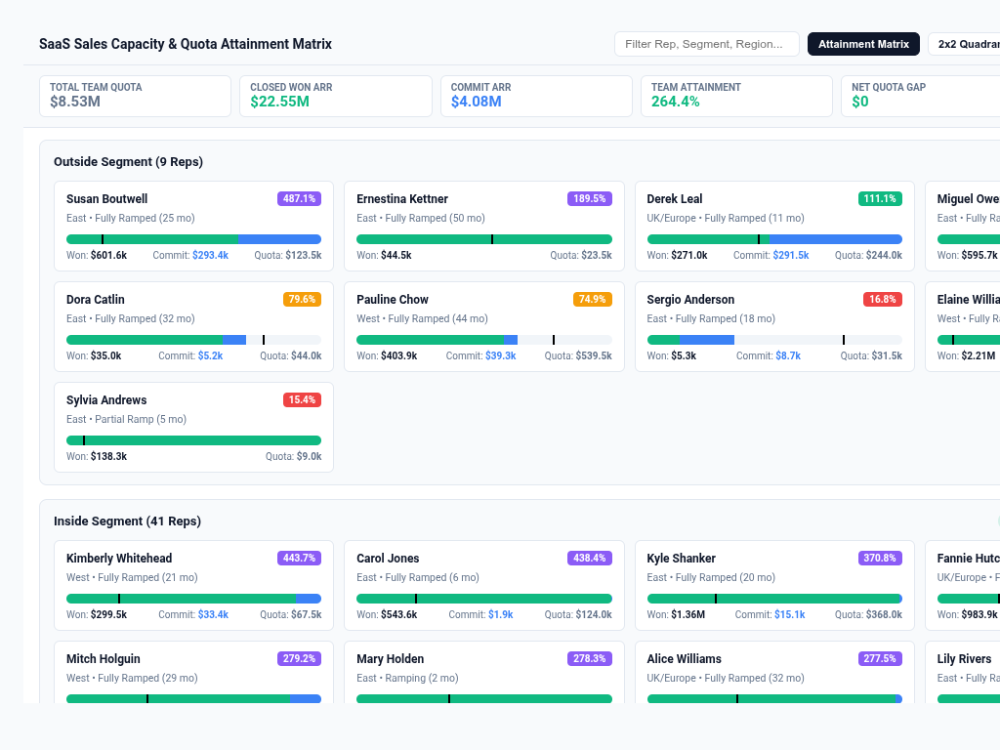

# SaaS Team Quota, Coverage & Gap Matrix

An executive **SaaS Team Quota, Coverage & Gap Matrix** custom visualization for Google Cloud Looker, engineered with **D3.js v7**.

Designed for B2B SaaS executive leadership, Chief Revenue Officers (CRO), VPs of Sales, and Revenue Operations (RevOps). It resolves Buganizer Cloud Blockers **b/494910291**, **b/398701962**, and **b/520494850** by delivering a unified sales team quota pacing, coverage multiplier, and pipeline gap analytics engine.

### The Business Challenge
Sales leaders struggle to bridge the gap between high-level sales targets and ground-level execution across territories and segments. Traditional Looker reports require disjointed tables and bar charts to see who is meeting quota, how much pipeline is committed versus uncommitted, whether pipeline coverage meets the 3.0x industry benchmark, and where the net revenue deficit lies.

This custom visualization delivers a comprehensive executive view capable of processing 5,000+ records with client-side team rollups, 4 multi-modal layout views, customizable benchmark reference lines, and interactive Looker drill-downs.

---

## 🌟 Key Features

- **4 Multi-Modal Layout Modes**:
  1. `Executive Team Attainment & Gap Matrix` (`team_matrix`, Default): High-density visual matrix grouping sales teams by Region and Segment. Features progress bullet bars showing Closed Won ARR, Commit ARR, and Upside ARR vs ARR Quota benchmarks, attainment % status badges, pipeline coverage multipliers, and Net Quota Gap / Surplus badges.
  2. `Quota-to-Pipeline Progression Waterfall` (`revenue_progression_waterfall`): Step-by-step bridge from ARR Quota → Closed Won ARR → Commit ARR → Upside ARR → Uncommitted Pipeline Buffer → Net Quota Gap / Surplus.
  3. `2x2 Pipeline Coverage vs Attainment Quad` (`coverage_vs_attainment_scatter`): 2D strategic performance quadrant plotting Quota Attainment % (Y-axis) against Pipeline Coverage Multiplier (X-axis), with bubbles sized by Quota or Headcount across 4 performance zones:
     - **Quadrant I (Top-Right)**: *Dominant Outperformers* (High Coverage ≥3x, Attainment ≥100%)
     - **Quadrant II (Top-Left)**: *Pipeline Starved* (Low Coverage <3x, Attainment ≥100%)
     - **Quadrant III (Bottom-Right)**: *Execution Lag* (High Coverage ≥3x, Attainment <100%)
     - **Quadrant IV (Bottom-Left)**: *Critical Deficit* (Low Coverage <3x, Attainment <100%)
  4. `Sales Capacity & Productivity Bars` (`capacity_productivity_bars`): Team capacity breakdown comparing Headcount, Quota-per-Head, Won-per-Head, and Coverage.

- **Executive KPI HUD (Scorecard, Strip, Hidden)**:
  - Real-time KPI summary bar displaying:
    - **Total Won ARR**: Committed revenue booked to date.
    - **Total ARR Quota**: Aggregate quota assigned to active teams.
    - **Commit ARR**: High-probability deals pacing to close this quarter.
    - **Pipeline Coverage**: Weighted pipeline coverage multiplier against quota (3.0x benchmark).
    - **Net Quota Gap / Surplus**: Net revenue difference against assigned target.

- **Configurable Benchmark Reference Lines & Anomaly Thresholds**:
  - Target calculation mode: `3.0x Pipeline Coverage Benchmark`, `Target Measure Column`, `Fixed Benchmark Value`, `Dataset Mean`, `Dataset Median`, `Percentile P75/P90`, `Disabled / None`.
  - Configurable alert threshold highlighting teams with deficit gaps.

- **Interactive Search Toolbar & Sorting**:
  - Instant client-side search across Team Name, Manager, Region, and Segment.
  - Flexible sorting: Closed Won ARR Descending/Ascending, Attainment %, Quota Gap Deficit, Alphabetical, Natural.
  - Top-N display limit with automatic `'(Other Teams)'` tail consolidation.

- **Brand Palettes**:
  - `Modern Slate`, `Google Enterprise Blue`, `Cyber NOC Dark`, `Emerald FinOps`, `Sunset Media & Rev`, `Wellverse Healthcare`, and `Custom Hex Override`.

---

## 📊 Data Requirements

| Field Role | Required | Description | Example (`saas_qbr::qbr_team_rollup`) |
| :--- | :--- | :--- | :--- |
| **Team Dimension** | **Yes** | Sales Team Name | `qbr_sales_team.team_name` |
| **Manager Dimension** | **Yes** | Sales Manager Name / Email | `qbr_sales_team.manager_name` |
| **Region Dimension** | Optional | Geographic Territory / Geo | `qbr_sales_team.region` |
| **Segment Dimension** | Optional | Market Segment | `qbr_sales_team.segment` |
| **Quota Measure** | **Yes** | ARR Quota Target | `qbr_sales_team.total_team_arr_quota` |
| **Won Measure** | **Yes** | Closed Won ARR | `qbr_team_performance.total_won_arr` |
| **Commit Measure** | Optional | Commit ARR | `qbr_team_performance.total_commit_arr` |
| **Upside Measure** | Optional | Upside ARR | `qbr_team_performance.total_upside_arr` |
| **Pipeline Measure** | Optional | Total Open Pipeline ARR | `qbr_team_performance.total_open_pipeline_arr` |
| **Headcount Measure** | Optional | Quota-Carrying Headcount | `qbr_sales_team.total_headcount` |
| **Target Measure** | Optional | Benchmark SLA / Goal | Optional measure |

---

## 🎛️ Configuration Options Reference

Configuration options are strictly organized into **2 clean tabs** (`Display` and `Style`):

### 📋 Display Tab
- `layoutMode`: Visual paradigm mode (`team_matrix`, `revenue_progression_waterfall`, `coverage_vs_attainment_scatter`, `capacity_productivity_bars`).
- `teamDimOverride`: Override field for Team Dimension.
- `managerDimOverride`: Override field for Manager Dimension.
- `regionDimOverride`: Override field for Region Dimension.
- `segmentDimOverride`: Override field for Segment Dimension.
- `quotaMeasureOverride`: Override field for ARR Quota Measure.
- `wonMeasureOverride`: Override field for Closed Won ARR Measure.
- `commitMeasureOverride`: Override field for Commit ARR Measure.
- `upsideMeasureOverride`: Override field for Upside ARR Measure.
- `pipelineMeasureOverride`: Override field for Open Pipeline ARR Measure.
- `headcountMeasureOverride`: Override field for Headcount Measure.
- `targetMeasureOverride`: Override field for Benchmark Target Measure.
- `targetMode`: Calculation mode for benchmark reference line.
- `fixedTargetValue`: Numerical value when fixed target mode is selected.
- `referenceLineLabel`: Text label for the reference benchmark line.
- `anomalyThresholdPct`: Sensitivity % for highlighting quota gap deficits.
- `sortBy`: Metric Descending, Metric Ascending, Attainment %, Quota Gap Deficit, Alphabetical, Natural.
- `topNLimit`: Top-N team display limit (0 = All).
- `enableOtherRollup`: Toggle to aggregate tail teams into `'(Other Teams)'`.
- `suppressZeroNull`: Filter out teams with zero quota and won ARR.
- `hudMode`: Full Scorecard HUD, Compact Metric Strip, Hidden.
- `labelDensity`: All, Min/Max Outliers Only, Hidden.
- `showSearch`: Toggle client-side quick search toolbar.
- `customTitle`: Custom header title override.
- `customSubtitle`: Custom header subtitle override.

### 🎨 Style Tab
- `colorTheme`: Preset themes (`slate`, `google_enterprise`, `cyber_dark`, `emerald`, `sunset`, `wellverse`, `custom`).
- `customPrimaryHex`: Color picker for primary accent / header text.
- `customPositiveHex`: Color picker for Closed Won ARR / On-Track status.
- `customNegativeHex`: Color picker for Quota Deficit / Off-Track status.
- `metricPolarity`: Higher is Better vs Lower is Better.
- `fontScale`: Compact, Standard, Large Presentation.
- `valueFormat`: Auto, Compact Currency, Compact Number, Percentage, Decimal 2dp, Raw Numbers.
