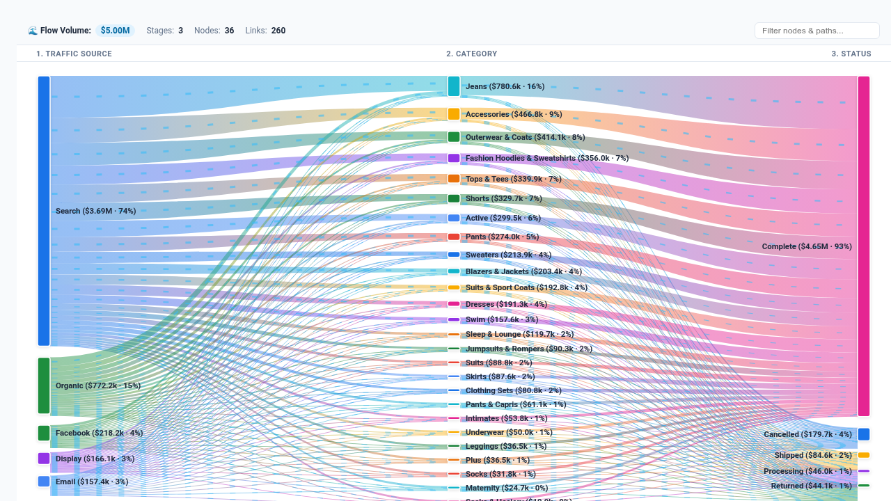

# Sankey Flow & Multi-Stage Allocation Diagram

An executive-grade, multi-stage Sankey flow and budget/pipeline allocation visualization for Looker, engineered with D3.js. 

Designed for **e-commerce conversion funnels**, **customer multi-touch journeys**, **financial cost center allocation & income statements**, **telecommunications network packet routing**, and **marketing campaign multi-channel attribution**.

---

## 🌟 Key Capabilities

1. **Multi-Mode Flow Layouts (`viewMode`)**:
   - **`sankey` (Classic Multi-Stage Sankey)**: High-resolution D3 Bézier flow ribbons with draggable interactive vertical columns, automatic layer rank assignment, cycle detection/removal, and node collision avoidance.
   - **`alluvial` (Streamlined Attributed Paths)**: Stage-anchored alluvial streams highlighting proportions and multi-touch journey path retention across successive dimensions.
   - **`horizontal_tree` (Hierarchical Cascade)**: Dendrogram-style branching tree showing categorical breakdowns from root sources to terminal leaf endpoints.
   - **`chord` (Cross-Stage Peering Ring)**: Circular perimeter chord graph ideal for bi-directional migration and cross-categorical affinities.

2. **Expanded Row Limit Scalability (5,000+ Rows)**:
   - Client-side streaming aggregation engine merges micro-transactions between identical dimension tuples.
   - Dynamic **Top-N Path Truncation** & **Minimum Link Percentage Filter** collapse negligible low-volume flows into an aggregated `(Other Flows)` stream, maintaining silky 60 FPS animation even on massive result sets.

3. **Dynamic Interactive Intelligence**:
   - **Interactive Node Dragging**: Freely reposition nodes vertically within their layer column; link ribbons automatically recalculate and redraw their Bézier curves in real time.
   - **Bi-Directional Path Tracing**: Hovering over any node or link highlights its complete upstream ancestors and downstream descendants while dimming unrelated network noise.
   - **Real-Time Flow Particle Pulse**: Animated gradient particles travel along ribbons to visually convey transmission velocity and volume.
   - **Client-Side Quick Search**: Instantly highlight specific nodes or paths (e.g. `Search`, `Men`, `Cancelled`) across thousands of data points.
   - **Executive Stats HUD & Looker Drill-Down**: Live summary metrics (Total Flow Volume, Node Count, Active Stages, Dominant Path) and native Looker drill menus (`looker.drillMenu`).

4. **Clean 2-Section Configuration (`Display` & `Style`)**:
   - Adheres strictly to the 2-tab configuration standard (`Display` and `Style`), preventing Looker's Edit Viz modal tabs from crowding or wrapping.

---

## 📊 Data Requirements

| Field Role | Required | Description | Example (`thelook`) |
| :--- | :--- | :--- | :--- |
| **Stage 1 Dimension** | **Yes** | Source / Origin / Channel | `users.traffic_source` |
| **Stage 2 Dimension** | **Yes** | Transition / Category / Mid-Point | `products.category` or `products.department` |
| **Stage 3+ Dimension**| Optional | Successive Stages / Outcome / Terminal State | `order_items.status` |
| **Volume Measure** | **Yes** | Quantitative metric driving ribbon width | `order_items.total_sale_price` |
| **Secondary Measure** | Optional | Secondary metric for tooltips (e.g. Order Count) | `order_items.order_count` |

---

## ⚙️ Configuration Options

### 📋 Display Section
- **Visualization Mode (`viewMode`)**: `sankey` (default), `alluvial`, `horizontal_tree`, `chord`.
- **Dynamic Field-Role Dropdowns**:
  - `sourceDimOverride`: Source Dimension override (defaults to 1st dimension).
  - `intermediateDimOverride`: Intermediate / Stage 2 Dimension override (defaults to 2nd dimension).
  - `targetDimOverride`: Target / Terminal Dimension override (defaults to 3rd dimension).
  - `volumeMeasureOverride`: Volume Measure override (defaults to 1st measure).
  - `secondaryMeasureOverride`: Secondary Measure override (defaults to None).
- **Target Calculation Mode (`targetCalculationMode`)**: `dataset_mean`, `dataset_median`, `fixed`, `percentile_p75`, `percentile_p90`, `measure_column`.
- **Fixed Target Value (`fixedTargetValue`)**: Numeric target benchmark for variance indicators.
- **Reference Line Label (`referenceLineLabel`)**: Custom label for target badge (e.g. `Target Benchmark`).
- **Anomaly Alert Threshold (`anomalyThresholdPct`)**: % variance threshold to highlight underperforming/surging paths.
- **Sort Order (`sortBy`)**: `volume_desc`, `volume_asc`, `alphabetical`, `natural`.
- **Top Paths Limit (`topPathsLimit`)**: Truncate graph to top 20, 50, 100, 200, or unlimited paths.
- **Enable (Other) Rollup (`enableOtherRollup`)**: Roll remaining tail into an aggregated `(Other Flows)` stream.
- **Zero / Null Suppression (`suppressZeroNull`)**: Exclude zero or null flow links.
- **Node Alignment (`nodeAlignment`)**: `justify` (align to outer edges), `left`, `right`, `center`.
- **Link Color Mode (`linkColorMode`)**: `gradient` (smooth source-to-target color blend), `source`, `target`, `monochrome`.
- **Link Curvature (`curvature`)**: Curvature intensity of Bézier ribbons (`0.1` to `0.8`, default `0.5`).
- **Minimum Flow Filter (`minLinkPct`)**: Hide flows smaller than X% (`0%`, `0.5%`, `1%`, `2%`, `5%`).
- **Show Node Values / % (`showNodeValues`, `showNodePercentages`)**: Toggle absolute value and stage share labels.
- **Data Label Density (`showValueLabels`)**: `all`, `peaks_only`, `hidden`.
- **Flow Pulse Animation (`enableAnimation`)**: Stream subtle animated photons along active links.
- **Search Bar (`showSearch`)**: Real-time filtering search box.
- **Executive Metric HUD (`hudMode`)**: `scorecard` (Full Scorecard), `compact_strip`, `hidden`.
- **Custom Title / Subtitle Override (`customTitleOverride`, `customSubtitleOverride`)**: Dynamic headline customization.

### 🎨 Style Section
- **Color Palette (`colorPalette`)**: `google_enterprise`, `modern_slate`, `cyberpunk_dark`, `emerald_finops`, `sunset_media`, `wellverse_healthcare`, `custom_override`.
- **Custom Hex Overrides (`customPrimaryHex`, `customPositiveHex`, `customNegativeHex`)**: Fine-grained color controls.
- **Metric Polarity (`metricPolarity`)**: `higher_is_better` vs `lower_is_better`.
- **Font Scale (`fontScale`)**: `compact`, `standard`, `large`.
- **Value Format (`valueFormat`)**: `compact_currency` ($1.2M), `currency` ($1,234,567), `compact_number` (1.2M), `percentage` (84.2%), `decimal_2` (1,234.56), `raw`, `integer` (1,234,567).
- **Node Width (`nodeWidth`)**: Width in pixels of stage bars (8px to 32px, default 18px).
- **Node Padding (`nodePadding`)**: Vertical gap between nodes in the same stage (6px to 40px, default 16px).
- **Link Opacity (`linkOpacity`)**: Default ribbon opacity (`0.15` to `0.70`, default `0.38`).
- **Font Family (`fontFamily`)**: Clean enterprise typography options.
