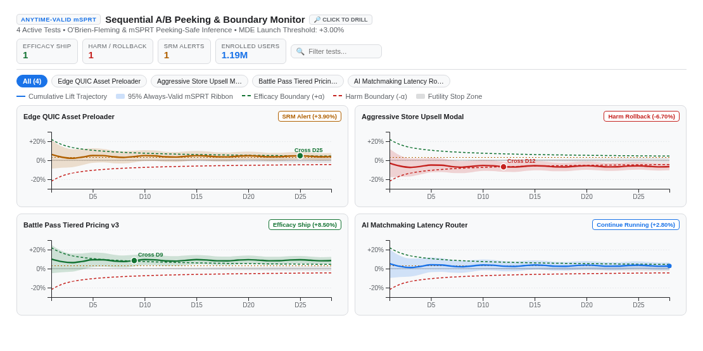

# Sequential A/B Peeking & Anytime-Valid Boundary Monitor (mSPRT)



An interactive **Sequential A/B Testing & Anytime-Valid Inference Monitor** custom visualization for Google Cloud Looker, engineered with **D3.js v7**.

Standard BI dashboards encourage daily "peeking" at A/B test conversion rates with fixed-horizon confidence intervals, inflating Type I false-positive error rates from 5% to over 25%. This visualization solves that experimentation governance gap directly inside Looker by rendering **O'Brien-Fleming $\alpha$-spending stopping boundaries**, **mSPRT anytime-valid confidence sequences**, **Sample Ratio Mismatch (SRM) drift diagnostics**, and **Bayesian posterior ROPE curves**.

---

## 📸 Key Features

- **4 Multi-Modal Experimentation Paradigms (`Display`)**:
  1. `Sequential Boundaries & mSPRT Cone` *(Default)*: Plots cumulative relative lift trajectories alongside upper O'Brien-Fleming efficacy boundaries, lower harm rollback boundaries, inner futility stopping regions, and peeking-safe 95% always-valid confidence ribbons with exact day-of-crossing callouts.
  2. `SRM Allocation Drift & Chi-Square Monitor`: Tracks daily treatment traffic split percentages against the expected 50% randomization band and flags experiments violating $p_{\text{SRM}} < 0.001$.
  3. `Experiment Guardrail Trade-Off Matrix`: Compares primary KPI lift (with always-valid 95% CI whiskers) against guardrail latency deltas and MDE launch thresholds.
  4. `Bayesian Posterior Lift & ROPE Density`: Plots analytical posterior lift curves with Region of Practical Equivalence (ROPE) shading and $P(\text{Beat Control})$ callouts.
- **Dynamic Field-Role Mapping (`Display`)**:
  - Automatically populates dropdowns from live Explore columns via `registerOptions` (`experimentDimOverride`, `timeDimOverride`, `verdictDimOverride`, `liftMeasureOverride`, `ciLowerMeasureOverride`, `ciUpperMeasureOverride`, `upperBoundMeasureOverride`, `lowerBoundMeasureOverride`, `srmMeasureOverride`, `targetMeasureOverride`).
- **Domain-Authentic Telemetry Mart**:
  - Backed by `void_weaver_analytics::sequential_ab_telemetry` (`aragosalooker.vw_consumption.sequential_ab_telemetry`), tracking 28-day sequential snapshots across 4 product & infrastructure A/B experiments (`Efficacy Ship`, `Continue Running`, `Harm Rollback`, and `SRM Alert`).
- **Enterprise Flexibility (`Display` & `Style`)**:
  - Strictly organized into 2 clean tabs (`Display` and `Style`), supporting benchmark MDE modes, sorting, Top-N with `'Other'` rollup, executive scorecard HUD, search/focus pills, 7 brand palettes + native hex pickers, metric polarity, font scaling, Looker drill-down menus, and debounced `ResizeObserver`.

---

## 📊 Data Shape Requirements

| Field Type | Required Count | Purpose | Example (`sequential_ab_telemetry`) |
| :--- | :--- | :--- | :--- |
| **Dimension 1** | `1` *(Required)* | Experiment / Cohort Name | `sequential_ab_telemetry.experiment_name` |
| **Dimension 2** | `1` *(Required)* | Sequential Day / Checkpoint | `sequential_ab_telemetry.experiment_day` |
| **Dimension 3** | `0 to 1` *(Optional)* | Stopping Verdict / Surface | `sequential_ab_telemetry.stopping_verdict` |
| **Measure 1** | `1` *(Required)* | Cumulative Relative Lift (%) | `sequential_ab_telemetry.avg_cum_relative_lift_pct` |
| **Measures 2–7** | `0 to 6` *(Optional)* | Always-Valid CI, Efficacy/Harm Bounds, SRM p-Value, MDE | `avg_always_valid_ci_lower_pct`, `avg_upper_efficacy_bound_pct`, `avg_srm_p_value` |

---

## 🚀 LookML Manifest Snippet

```lookml
visualization: {
  id: "sequential_ab_peeking_monitor"
  label: "Sequential A/B Peeking & Anytime-Valid Boundary Monitor"
  file: "visualizations/sequential_ab_peeking_monitor.js"
  dependencies: ["https://d3js.org/d3.v7.min.js"]
}
```
