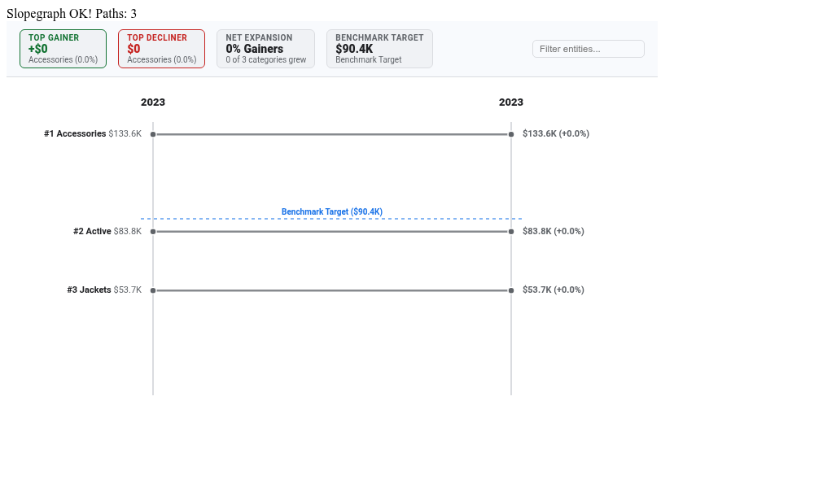

# Slopegraph & Multi-Period Rank Comparison Looker Custom Visualization

An executive-grade, Edward Tufte-style **Slopegraph** custom visualization built with **D3.js v7** for Looker. Specifically engineered for multi-period rank shifts, year-over-year (YoY) progression, pre/post initiative impact assessments, and cohort trajectory analysis.

---

## The Problem It Solves

Standard multi-series line charts and grouped bar charts fail when comparing entities between two key time periods (e.g., 2023 vs. 2024, Q1 vs. Q2, Pre-launch vs. Post-launch):
- **Line Charts**: Become an unreadable "spaghetti bowl" when plotting 15+ entities across dense time axes.
- **Grouped Bar Charts**: Fail to communicate the *direction* and *slope* of change, hiding rank crossovers and relative trajectory.
- **Tufte Slopegraph**: Elegantly plots baseline vs. comparison milestones with direct slope trajectories, intuitive gainer/decliner color coding, and automatic collision avoidance so labels never overlap even when values are tight.

---

## Key Capabilities & Highlights

- **3 Analytical Layout Modes**:
  1. **Direct Value Slopegraph (`dual_axis_value`)**: Calibrated dual vertical scales plotting exact dollar/unit metric values across periods.
  2. **Rank-Shift Ladder (`rank_slope`)**: Ordinal rank comparison (1st, 2nd, 3rd...) with rank shift badges (▲/▼) highlighting market share climbers and decliners.
  3. **Normalized % Growth Divergence (`delta_divergence`)**: Normalized slope lines radiating from a zero-baseline origin, highlighting percentage growth rates.
- **Iterative D3 Label Relaxation Algorithm**: Physics-based iterative relaxation dynamically separates dense clusters on both left and right axes, preventing overlapping labels with dashed alignment ticks.
- **Interactive Gainer & Decliner Highlighting**: Instant visual distinction between gainers (green/teal), decliners (red/coral), and neutral entities with metric polarity toggle (`Higher is Better` vs. `Lower is Better`).
- **Executive KPI HUD Scorecard**: Real-time KPI summary displaying Top Gainer, Top Decliner, Net Trajectory (% of growing entities), and optional Benchmark Target.
- **Configurable Benchmark Reference Lines**: Dynamic reference lines for `Dataset Mean`, `Dataset Median`, `Percentile P75/P90`, or `Fixed Goal Value`.
- **Dynamic Field-Role Mapping**: Automatically populated dropdowns via Looker's `registerOptions` API (`Entity Dimension`, `Period Dimension`, `Primary Measure`).
- **Client-Side Scalability (5,000+ Rows)**: High-performance O(N) client-side aggregation, interactive live search bar, and Top-N density limits (10, 15, 20, 25) with automatic `'Other'` grouping.
- **Native Looker Drill-Down Support**: Clicking any entity slope line or label opens Looker's native drill menu.
- **Streamlined 2-Tab Options Modal**: Options are strictly separated into `Display` and `Style` tabs to keep Looker's configuration headers clean.

---

## Demo Dataset

The live demo is bound to `void_weaver_analytics::title_quarterly_leaderboard`: quarterly gross bookings for a 14-title game publishing portfolio (2025-Q4 to 2026-Q3), with the LiveOps driver behind each quarter. Comparing 2026-Q2 to 2026-Q3 surfaces a real rank reshuffle: *Void Weaver: Eternal* takes #1 on its Season 7 launch, *Star Forge Tactics* jumps #14 to #7 on its global launch, *Gridiron Manager 26* rebounds #12 to #6 with football season, while *Hollow Crown Chronicles* (sunset announced) and *Rift Raiders Co-op* (9-day server outage) fall sharply.

## Data Shape & Query Requirements

The visualization supports two flexible data shapes:

### Format A: Multi-Row Period Format (Recommended)
- **Dimension 1 (Entity/Category)**: e.g. `title_quarterly_leaderboard.game_title`, `qbr_rep_roster.rep_name`, `marketing_channels.channel`
- **Dimension 2 (Period/Milestone)**: e.g. `title_quarterly_leaderboard.fiscal_quarter`, `qbr_rep_quota.fiscal_quarter_label`, `campaign.stage` (filtered to exactly 2 periods, e.g. 2026-Q2 and 2026-Q3)
- **Measure 1 (Primary Value)**: e.g. `title_quarterly_leaderboard.gross_bookings_usd`, `deals.closed_won_arr`, `conversions.total_count`

### Format B: Dual-Measure Column Format
- **Dimension 1 (Entity/Category)**: e.g. `title_quarterly_leaderboard.game_title`
- **Measure 1 (Baseline Period Metric)**: e.g. `bookings_q2`
- **Measure 2 (Comparison Period Metric)**: e.g. `bookings_q3`

---

## Configuration Options

### Section 1: Display
- **Slopegraph Layout Mode**: `Direct Value Slopegraph`, `Rank-Shift Ladder`, `Normalized % Growth Divergence`
- **Entity / Category Dimension**: Dynamically populated dropdown of query dimensions.
- **Time Period / Baseline vs Comparison Dimension**: Dynamically populated period dimension dropdown.
- **Primary Metric Measure**: Dynamically populated primary measure dropdown.
- **Benchmark Target Mode**: `None`, `Dataset Mean`, `Dataset Median`, `Top Quartile Benchmark (P75)`, `Elite Benchmark (P90)`, `Fixed Goal Value`
- **Fixed Benchmark Target Value**: Custom numeric threshold when using Fixed Goal mode.
- **Reference Line Label**: Custom label for the benchmark target chip and reference line.
- **Outlier Shift Threshold (% Change)**: Threshold (default 50%) to flag high-variance entities.
- **Entity Sort Ordering**: `Top Gainers Descending`, `Top Decliners Ascending`, `Baseline Descending`, `Comparison Descending`, `Alphabetical`
- **Entity Density Filter (Top-N)**: `All Entities`, `Top 10`, `Top 15`, `Top 20`, `Top 25`
- **Group Remaining into 'Other' Aggregate Entity**: Group tail entities into an aggregate line.
- **Suppress Zero & Null Value Entities**: Filter out entities with zero values in both periods.
- **Executive KPI HUD Scorecard**: `Full Scorecard Banner`, `Compact Status Strip`, `Hidden`
- **Axis Labels & Entity Titles**: `All Labels with Collision Avoidance`, `Significant Gainers/Decliners Only`, `Hidden`
- **Show Rank Shift Badges (▲ / ▼)**: Toggle rank delta indicators on the comparison axis.
- **Custom Title Override**: Header text override for the visualization.
- **Show Live Search & Filter Bar**: Instant client-side text filtering.

### Section 2: Style
- **Brand Palette Preset**: `Google Enterprise`, `Modern Slate (Light)`, `Cyber Teal (Dark)`, `Neon Violet (Dark)`, `Emerald Growth (Light)`, `Sunset Amber (Light)`, `Wellverse Healthcare`, `Custom Hex Override`
- **Custom Gainer / Growth Hex**: Color picker for positive trajectories.
- **Custom Positive Benchmark Hex**: Color picker for benchmark passing lines.
- **Custom Decliner / Contraction Hex**: Color picker for declining trajectories.
- **Metric Polarity**: `Higher is Better` (Revenue/Volume) vs `Lower is Better` (Latency/Churn/Defects).
- **Slope Line Interpolation**: `Straight Euclidean Vectors`, `Smooth Dynamic Bézier`, `Stepped Horizontal Bridge`
- **Slope Line Stroke Width (px)**: Line thickness (default 2.5px).
- **Typography & Label Scale**: `Compact (85%)`, `Standard (100%)`, `Large Presentation (120%)`
- **Primary Value Formatting**: `Auto / Dynamic`, `Compact Currency ($1.2M)`, `Compact Number (1.2M)`, `Percentage (45.2%)`, `Decimal (2dp)`, `Full Currency`, `Raw Integer`
- **Axis Margin Padding (px)**: Padding for left and right label columns (default 180px).
