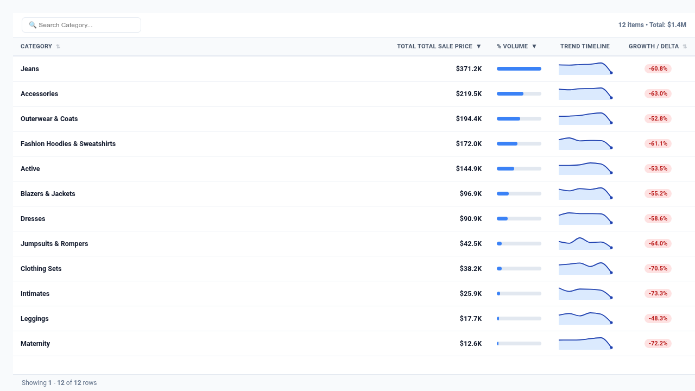

# Sparkline Metric Matrix Table



An executive **Sparkline Metric Matrix Table** custom visualization for Google Cloud Looker, engineered with **D3.js v7**.

Standard Looker tables struggle to display multi-period performance without spreading wide across dozens of monthly or quarterly columns. This visualization collapses temporal pivots into compact in-cell SVG trend sparklines, adds micro bullet bars showing proportional volume, and calculates period-over-period growth variance pills—all within an interactive, searchable scorecard grid.

---

## 📸 Key Features

- **Multi-Modal Display Modes**:
  - `Sparkline Matrix` (Default): In-cell SVG trend sparklines + volume micro bullet bars + period growth percentage delta pills.
  - `Heatmap Matrix`: Dense color-intensity heatmap matrix across pivot periods or metrics with contrast-adjusted text values.
  - `Compact Scorecard`: Executive KPI scorecard with performance status badges (`Top Performer`, `On Target`, `SLA Breach`), share-of-volume bars, and ranks.
- **Dynamic Field-Role Mapping**: Re-map Primary Group Dimension, Pivot Period Dimension, Primary Measure, and Secondary Comparison Measure via dropdowns automatically populated with the dimensions and measures in the live query, directly from the Edit Viz modal without altering LookML query column order.
- **Configurable Benchmark Targets & Reference Lines**: Calculate targets dynamically via `Dataset Mean`, `Dataset Median`, `Top Percentile P75/P90`, `Multiplier of Baseline (e.g. 115%)`, `Fixed Static Target Value`, or `Secondary Measure Column`. Computes row-level variance, attainment %, and highlights variance anomalies breaching SLA thresholds.
- **Executive Scorecard HUD**: Integrated top executive scorecard featuring 5 high-density cards (`Total Volume`, `Average Run-Rate`, `Benchmark Target`, `Top Contributor`, and `Variance Alerts`) or a `Compact Metric Strip`.
- **Flexible Sorting, Top-N Bucketing & Null Suppression**: Sort by `Metric Total Descending`, `Metric Total Ascending`, `Item Name (A-Z)`, or `Variance vs Target`. Group remaining rows into an automatic `'Other (N items)'` rollup summary with summed totals and averaged trend points.
- **5,000+ Row Expanded Row Limit Support**: High-density client-side pagination (`10`, `15`, `25`, `50`, `100`, `All`) capable of processing and sorting massive datasets without layout thrashing or browser DOM lag.
- **In-Cell Trend Sparklines**: SVG micro-charts featuring shaded gradient area fills, peak/trough markers, and final period outcome dots.
- **Period Growth Variance Pills**: Automatic calculation of percentage delta between the earliest and latest pivot period with directional color-coding.
- **Interactive Quick Search Filter**: Real-time client-side search filtering across categorical dimensions.
- **Native Looker Drill-Downs**: Click any row to launch Looker's contextual drill overlay.
- **Enterprise Brand Palettes & Typography Scaling**:
  - `Google Enterprise` (Default Google Blue, Emerald Green, Coral Red)
  - `Executive Slate` (Neutral slate, orange accents, emerald/crimson pills)
  - `Modern Slate` (Indigo/cobalt accents with slate neutral grid)
  - `Cyberpunk Dark` (High-contrast dark mode with neon sky blue)
  - `Emerald FinOps` (Mint, forest green, and teal)
  - `Sunset Media` (Warm amber, tangerine, and crimson)
  - `Wellverse Healthcare` (Deep navy and clinical emerald)
  - `Custom Hex Override` (User-defined primary sparkline, positive, and negative hex codes)
  - Metric Polarity toggle (`Higher is Better` vs `Lower is Better`) and typography scale (`Compact`, `Standard`, `Large Presentation`).

---

## 📊 Data Shape Requirements

Supports two distinct query structures:

### Option A: Pivoted Time-Series (Recommended)
| Field Type | Required Count | Purpose | Example (`order_items`) |
| :--- | :--- | :--- | :--- |
| **Dimension** | `1` *(Required)* | Row Grouping | `products.category`, `users.state`, `sales_reps.name` |
| **Pivot** | `1` *(Required)* | Temporal Period | `order_items.created_month`, `order_items.created_quarter` |
| **Measure** | `1` *(Required)* | Metric to trend | `order_items.total_sale_price`, `order_items.count` |

### Option B: Multi-Measure Matrix
| Field Type | Required Count | Purpose | Example (`order_items`) |
| :--- | :--- | :--- | :--- |
| **Dimension** | `1` *(Required)* | Row Grouping | `products.category` |
| **Measures** | `2–6` *(Required)* | Metric comparisons | `order_items.total_sale_price`, `order_items.total_gross_margin` |

---

## ⚙️ Configuration Options (Display & Style)

### Display Options
| Option | Type | Default | Description |
| :--- | :--- | :--- | :--- |
| `tableMode` | Select | `Sparkline Matrix` | Display mode (`sparkline_matrix`, `heatmap_grid`, `compact_scorecard`) |
| `dimFieldOverride` | Select | `Auto` | Dropdown of query fields for primary grouping dimension |
| `pivotFieldOverride` | Select | `Auto` | Dropdown of query fields for pivot period dimension |
| `measureFieldOverride` | Select | `Auto` | Dropdown of query fields for primary metric measure |
| `secondaryMeasureOverride` | Select | `Auto` | Dropdown of query fields for secondary / target measure |
| `targetCalculationMode` | Select | `Dataset Mean` | Target benchmark mode (`none`, `second_measure`, `multiplier`, `fixed`, `dataset_mean`, `dataset_median`, `percentile_p75`, `percentile_p90`) |
| `targetMultiplier` | Number | `1.15` | Multiplier when calculation mode is set to multiplier |
| `fixedTargetValue` | Number | `0` | Static benchmark target value |
| `referenceLineLabel` | String | `Target Benchmark` | Label displayed in HUD scorecard and tooltips |
| `showReferenceLine` | Boolean | `true` | Display benchmark target in HUD and row attainment badges |
| `anomalyThresholdPct` | Number | `25` | Percentage variance threshold triggering an alert badge |
| `sortBy` | Select | `Metric Total Descending` | Sort rows by total, name, or variance vs target |
| `topNLimit` | Number | `0` | Limit display to Top-N rows (0 = All) |
| `enableOtherRollup` | Boolean | `false` | Roll up items outside Top-N into an 'Other' summary row |
| `suppressZeroNull` | Boolean | `false` | Suppress zero or null metric rows from the table |
| `pageSize` | Select | `25 Rows per Page` | Pagination limit for 5,000+ row datasets (`10`, `15`, `25`, `50`, `100`, `all`) |
| `hudMode` | Select | `Full Scorecard HUD` | Top executive KPI HUD (`scorecard`, `compact_strip`, `none`) |
| `showSparklines` | Boolean | `true` | Display in-cell SVG trend sparklines |
| `showMicroBars` | Boolean | `true` | Display in-cell proportional volume bars |
| `showVarianceBadge` | Boolean | `true` | Display period growth percentage pills |
| `showSummaryRow` | Boolean | `true` | Display grand total rollup footer row |
| `customTitle` | String | `""` | Optional chart header title override |
| `customSubtitle` | String | `""` | Optional chart header subtitle override |
| `showSearch` | Boolean | `true` | Enable top quick-search filter input |

### Style Options
| Option | Type | Default | Description |
| :--- | :--- | :--- | :--- |
| `colorTheme` | Select | `Google Enterprise` | Brand palette preset |
| `customPrimaryColor` | Color | `""` | Custom primary sparkline line and volume bar fill hex |
| `customPositiveColor` | Color | `""` | Custom positive attainment / growth text hex |
| `customNegativeColor` | Color | `""` | Custom negative variance / alert text hex |
| `metricPolarity` | Select | `Higher is Better` | Goal direction (`higher_better` vs `lower_better`) |
| `fontScale` | Select | `Standard` | Typography size (`compact`, `standard`, `large`) |
| `valueFormat` | Select | `Compact Currency` | Numeric formatting (`auto`, `compact_currency`, `compact_number`, `percentage`, `decimal_2`, `full_currency`, `full_number`, `raw`) |
| `rowHeight` | Number | `46` | Row height in pixels |

---

## 🚀 Manifest Snippet (`manifest.lkml`)

```lookml
visualization: {
  id: "sparkline_matrix_table"
  label: "Sparkline Metric Matrix Table"
  file: "visualizations/sparkline_matrix_table.js"
  dependencies: ["https://d3js.org/d3.v7.min.js"]
}
```
