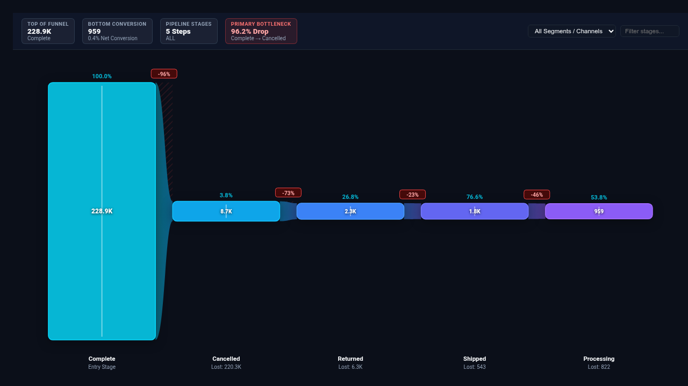

# Telemetry & Conversion Funnel Looker Custom Visualization

An executive-grade, high-performance telemetry pipeline and conversion funnel visualization built with **D3.js v7** for Looker. Specifically engineered for **Gaming Telemetry** (FTUE level progression, player drop-off, in-game economy sink funnels), **E-Commerce & Retail** (Checkout conversion, cart abandonment, multi-touch attribution channels), and **SaaS & Product Telemetry** (Onboarding activation, sign-up workflows, product feature adoption).

---

## Key Capabilities & Highlights

- **4 Multi-Mode Pipeline Layouts**:
  1. **Curved Stream Pipeline**: Smooth continuous Bézier flow ribbon connecting stage pillars with organic liquid contours and bottleneck drop-off indicators.
  2. **Stepped Isometric Funnel**: Classic trapezoidal stage blocks with highlighted drop-off lateral badges and stage-to-stage conversion metrics.
  3. **Waterfall Drop-off Stack**: Dual-column bar layout pairing retained stage volume with downward churn columns highlighting exact lost counts.
  4. **Segmented Stacked Stream**: Multi-channel or multi-cohort stage breakdown displaying stacked categorical bands across every funnel step.
- **Dynamic Field-Role Mapping**: Custom select dropdowns automatically populated from the live query (`Stage Dimension`, `Segment / Cohort Dimension`, `Primary Volume Measure`, `Secondary Metric Measure`).
- **Configurable Benchmark Reference Lines & Targets**: Benchmark calculation modes (`Dataset Mean`, `Dataset Median`, `Percentile P75`, `Percentile P90`, `Fixed Goal Value`) with customizable reference labels and chokepoint drop-off alert thresholds.
- **Interactive Sorting & Top-N Rollups**: Order stages naturally, by volume descending/ascending, or alphabetically, with Top-N density limits (5, 8, 12, 15) and automatic grouping into an `'Other Stages'` rollup.
- **Dual-Metric Telemetry Support**: Compare primary throughput volume (players, users, events) with a secondary business metric (revenue, IAP monetization, session duration).
- **Client-Side Scalability (5,000+ Rows)**: High-performance O(N) client-side aggregation, multi-dimensional slicing, and dynamic sorting ensure smooth 60fps rendering.
- **Executive KPI HUD Scorecard**: Real-time KPI summary displaying Top-of-Funnel Entry, Net Retention %, Benchmark Target, and primary bottleneck/chokepoint detection with Full, Compact, or Hidden density modes.
- **Brand Palettes & Metric Polarity**: 8 brand themes (Google Enterprise, Modern Slate, Cyber Teal, Neon Violet, Emerald Growth, Sunset Amber, Wellverse Healthcare, Custom Hex Override) with polarity toggles (`Higher is Better` vs `Lower is Better`).
- **Streamlined 2-Tab Options Modal**: Options are strictly organized into `Display` and `Style` tabs to prevent crowded or overlapping edit dialog headers in Looker.

---

## Data Shape & Query Requirements

The visualization supports three versatile data formats:

### Format A: Multi-Dimensional Cohort / Channel Funnel (Recommended)
- **Dimension 1 (Cohort/Segment)**: e.g. `player_onboarding_funnel.acquisition_channel`
- **Dimension 2 (Funnel Stage)**: e.g. `player_onboarding_funnel.funnel_stage`
- **Measure 1 (Primary Volume)**: e.g. `player_onboarding_funnel.players_reached`
- **Measure 2 (Optional Secondary Metric)**: e.g. `player_onboarding_funnel.total_iap_revenue_usd`

### Format B: Single-Dimension Funnel
- **Dimension 1 (Funnel Stage)**: e.g. `order_items.status`
- **Measure 1 (Primary Volume)**: e.g. `order_items.order_count`
- **Measure 2 (Optional Secondary Metric)**: e.g. `order_items.total_sale_price`

### Format C: Multi-Measure Funnel
- **0 Dimensions**
- **2 to 8 Measures representing sequential funnel stages**: e.g. `Visits`, `Cart Adds`, `Checkouts Initiated`, `Purchases Completed`

---

## Configuration Options

### Section 1: Display
- **Funnel Pipeline Layout**: `Curved Stream Pipeline`, `Stepped Isometric Funnel`, `Waterfall Drop-off Stack`, `Segmented Stacked Stream`
- **Funnel Stage Dimension**: Dynamically populated dropdown of query dimensions.
- **Cohort / Segment Dimension**: Optional breakdown dimension for multi-channel funnel slicing.
- **Primary Volume Measure**: Dynamically populated primary throughput measure.
- **Secondary Metric Measure**: Optional secondary measure (monetization, latency, revenue).
- **Benchmark Target Mode**: `None`, `Dataset Mean`, `Dataset Median`, `Top Quartile Benchmark (P75)`, `Elite Benchmark (P90)`, `Fixed Goal Value`
- **Fixed Benchmark Target Value**: Custom numeric threshold when using Fixed Goal mode.
- **Reference Line Label**: Custom label for the benchmark target chip and reference marker.
- **Chokepoint Drop-off Alert Threshold (%)**: Drop-off rate threshold (default 35%) to flag severe funnel leakage.
- **Funnel Stage Ordering**: `Query Default (Natural Order)`, `Volume Descending`, `Volume Ascending`, `Alphabetical Stage Name`
- **Stage Density Filter (Top-N)**: `All Stages`, `Top 5`, `Top 8`, `Top 12`, `Top 15`
- **Group Remaining into 'Other' Aggregate Stage**: Toggle automatic rollup of trailing stages.
- **Suppress Zero & Null Value Stages**: Filter out stages with 0 or null throughput.
- **Executive KPI HUD Scorecard**: `Full Scorecard Banner`, `Compact Status Strip`, `Hidden`
- **In-Stage Value & Drop-off Labels**: `All Labels & Drop-off Badges`, `Chokepoints & Outliers Only`, `Hidden`
- **Conversion % Reference**: `Step-to-Step Conversion`, `Top of Funnel Overall`, `Both Metrics`
- **Pipeline Orientation**: `Horizontal Flow (Left to Right)`, `Vertical Pipeline (Top to Bottom)`
- **Custom Title Override**: Custom title heading above the funnel.
- **Show Live Search & Filter Bar**: Instant client-side search input.

### Section 2: Style
- **Brand Palette Preset**: `Cyber Teal (Dark)`, `Google Enterprise`, `Modern Slate (Light)`, `Neon Violet (Dark)`, `Emerald Growth (Light)`, `Sunset Amber (Light)`, `Wellverse Healthcare`, `Custom Hex Override`
- **Custom Primary Stage Hex**: Color picker for primary stage fill.
- **Custom Positive / Retained Hex**: Color picker for retained flow and passing benchmarks.
- **Custom Drop-off / Leakage Hex**: Color picker for drop-off badges and leakage paths.
- **Metric Polarity**: `Higher is Better` (Conversion/Volume) vs `Lower is Better` (Churn/Drop-off/Friction).
- **Surface Styling**: `Smooth Gradient Blend`, `Solid Color Stages`, `Glass Translucent Fill`
- **Curvature & Neck Shaping**: `High Flow Bézier Curves`, `Subtle Dynamic Arcs`, `Linear Sharp Edges`
- **Typography & Label Scale**: `Compact (85%)`, `Standard (100%)`, `Large Presentation (120%)`
- **Primary Value Formatting**: `Auto / Dynamic`, `Compact Number (1.2M, 45K)`, `Compact Currency ($1.2M)`, `Percentage (45.2%)`, `Decimal (2dp)`, `Full Currency`, `Raw Integer`
- **Stage Gap Padding (px)**: Spacing between stages (default: 16px).
- **Minimum Neck Thickness (px)**: Minimum thickness for small downstream stages (default: 28px).
