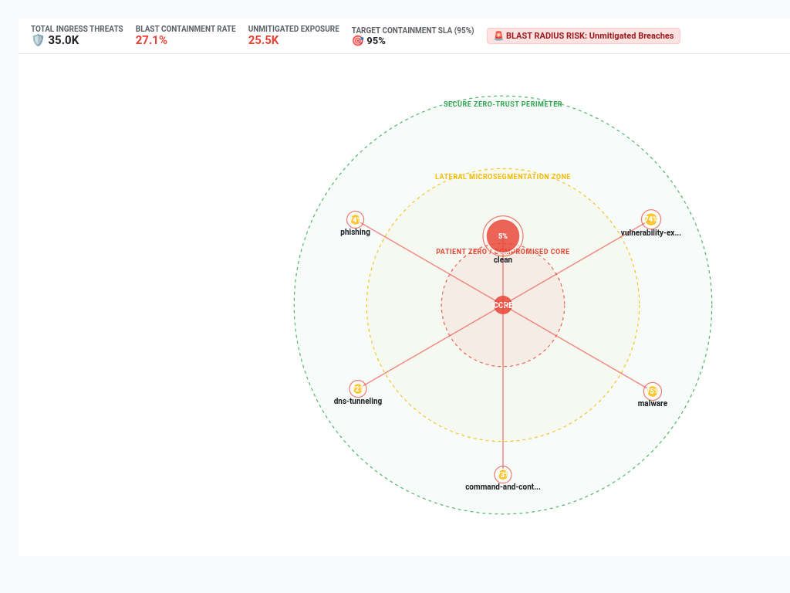

# Zero-Trust Blast Radius & Attack Surface Exposure Graph



An enterprise-grade cybersecurity visualization built with D3.js v7 for zero-trust microsegmentation, lateral movement modeling, and attack surface blast radius analysis in Looker.

## 🎯 What Problem Does This Solve?
Solves critical challenges faced by enterprise SecOps, CISO offices, and Cloud Security teams (Palo Alto Networks Cortex/Prisma, Chronicle SecOps, Mandiant):
1. **Lateral Movement & Blast Radius Modeling**: Traditional BI charts (bar, pie, table) cannot convey topological attack spread or evaluate how deeply an ingress compromise can penetrate internal infrastructure.
2. **Multi-Modal Visual Paradigms**:
   - `blast_radius_rings`: Concentric lateral impact rings (Patient Zero compromised core, lateral microsegmentation perimeter, and zero-trust quarantine boundary) with dynamic node sizing, breach alert pulses, and SLA threshold rings.
   - `containment_sankey`: Multi-stage ingress flow linking Threat Vectors (e.g. exploit, malware, spyware) to Enforcement Actions (Blocked, Dropped, Allowed, Alerted) and target impact tiers.
   - `exposure_matrix`: 2D Threat Category vs Firewall Enforcement Action matrix with cell containment heatmaps and marginal volume totals.
   - `executive_soc_scorecard`: High-level SOC posture scorecard displaying Total Threats, Containment Rate %, and Unmitigated Active Exposures alongside high-risk vector drill-downs.
3. **Full Enterprise Flexibility Suite**:
   - **Dynamic Field-Role Mapping (`Display`)**: Dropdowns dynamically populated from the active explore for Threat Category, Action, Severity, and Threat Counts.
   - **Configurable Benchmark SLA Targets (`Display`)**: Target containment SLA modes (Fixed % Goal, Dataset Mean, Top Decile P90) with visual reference line rings and breach threshold alerts.
   - **Interactive Sorting & Top-N Bucketing (`Display`)**: Sort by Threat Volume Descending, Containment Rate Ascending (Highest Risk First), or Alphabetical with automatic "Other Vectors" aggregation.
   - **Executive HUD Scorecard (`Display`)**: Configurable KPI scorecard (`scorecard`, `compact_strip`, `hidden`), real-time search filter bar, and custom title/subtitle overrides.
   - **Brand Palettes & Polarity (`Style`)**: 7 enterprise brand palettes (Cyber NOC Dark, Google Enterprise, Modern Slate, Emerald SOC Shield, Sunset Crimson, Wellverse Healthcare, Custom Hex Override) with metric polarity toggle (`Lower is Better` for threats/unmitigated breach risk).
4. **5,000+ Row Client-Side Aggregation**: Real-time aggregation of thousands of firewall alerts, EDR events, or SIEM incident rows without UI freezing or lag.
5. **Clean 2-Tab Options Architecture**: All configuration options are strictly organized into **Display** and **Style** sections to prevent overlapping or crowded headers in Looker's Edit Viz modal.
6. **Native Looker Drill Menus**: Full support for `LookerCharts.Utils.openDrillMenu` to inspect raw alert telemetry, host IP logs, and user identity contexts.

---

## 📊 Recommended Data Shapes
- **Dimensions**:
  - `Threat Category / Vector` (e.g. `threat_firewall_events.threat_category`, `cortex_security_incidents.mitre_tactic`)
  - `Enforcement Action` (e.g. `threat_firewall_events.action`, `threat_firewall_events.rule_name`)
  - `Severity Level` (optional, e.g. `threat_firewall_events.severity`)
- **Measures**:
  - `Threat Count / Ingress Volume` (e.g. `threat_firewall_events.threat_count`)
  - `Blocked / Contained Threats` (optional, e.g. `threat_firewall_events.blocked_threat_count`)

---

## 🚀 Setup & Manifest Snippet
```lookml
visualization: {
  id: "zero_trust_blast_radius"
  label: "Zero-Trust Blast Radius & Attack Surface Exposure Graph"
  file: "visualizations/zero_trust_blast_radius.js"
  dependencies: ["https://d3js.org/d3.v7.min.js"]
}
```
